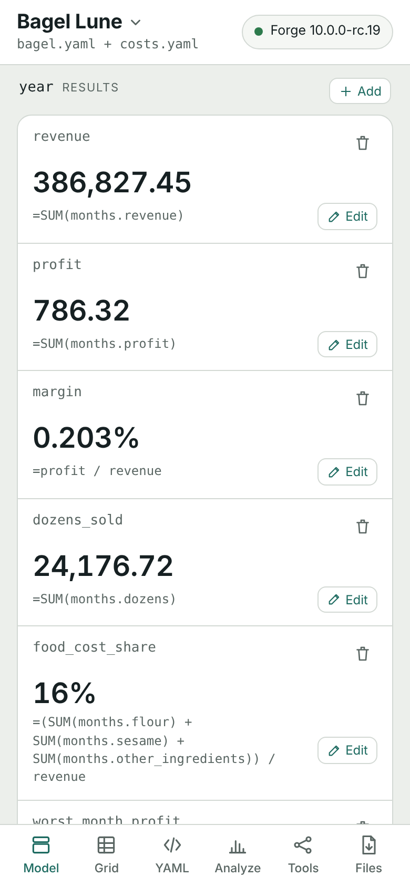
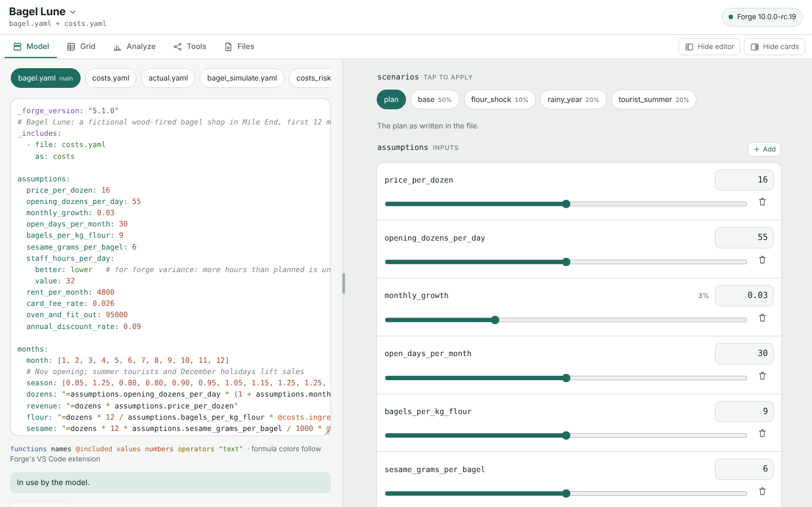

# Forge

**Financial models as plain text: readable by people, writable by AI, calculated the same way every time.**

[](https://github.com/mollendorff-ai/forge/actions/workflows/ci.yml)
[](https://crates.io/crates/mollendorff-forge)
[](https://github.com/mollendorff-ai/forge/actions/workflows/ci.yml)
[](https://github.com/mollendorff-ai/forge)
[](https://github.com/mollendorff-ai/forge/actions/workflows/ci.yml)
[](LICENSE-MIT)

Forge reads a financial model written in YAML (inputs, formulas, tables, scenarios) and calculates it with 202 Excel-style functions, plus what a spreadsheet leaves to plug-ins: Monte Carlo, tornado charts, decision trees, real options, Bayesian networks. One engine, written in Rust, runs on the command line, as an MCP server for AI agents, and in your browser.

<p align="center">
  <a href="https://mollendorff-ai.github.io/forge/"></a>
  &nbsp;
  <a href="https://mollendorff-ai.github.io/forge/"></a>
</p>

| **You work with numbers** | **You build with AI agents** |
| --- | --- |
| Open [Forge Studio](https://mollendorff-ai.github.io/forge/) in your browser. Nothing to install, made for a phone, works offline. | Install the command line, or give your agent the MCP server. The agent writes YAML; Forge does the arithmetic. |
| [Try it →](https://mollendorff-ai.github.io/forge/) · [More on Studio](#forge-studio) | [Quick start →](#quick-start) · [For AI agents](#for-ai-agents) |

**Checked, not trusted.** 1,460 formula tests compare Forge with Gnumeric, the analytics are compared with R, and both suites live [in this repository](validation/) and run in CI. What does not work yet is [listed below](#status-and-known-limitations), not hidden.

## Forge Studio

Studio is Forge compiled to WebAssembly and run in your browser tab. Open an example, or your own YAML or Excel file, and the model shows as cards: drag an input, the results move. Edit a formula with suggestions for names and functions, see the whole model as a grid, apply a scenario, run goal seek, a tornado or a Monte Carlo simulation, and save the workbook `forge export` writes.

- **Your model stays on your device.** There is no server doing the math, no account, no cookies and no analytics. GitHub Pages serves the page, so GitHub sees that someone downloaded it, as with any website; after that, nothing you type leaves the tab. Your files are kept in your browser's storage, on your device.
- **It works offline.** Add it to your Home Screen and it opens and calculates with no connection: on a plane, in a tunnel, in a meeting room with bad Wi-Fi.
- **The numbers are Forge's.** The page calculates nothing itself; it asks the same engine as the command line, and CI checks that the WebAssembly answers equal the native ones, case by case.

The shop in the screenshots, Bagel Lune, is fictional. It makes 786.32 on 386,827.45 of revenue, and Forge will tell you in one command that it [breaks even at 15.97 a dozen](docs/posts/bagel-price.md), three cents under its price. Bagels are a hard business; the arithmetic, at least, is easy.

## Status and known limitations

Forge is a release candidate (v10.0.0-rc.19) and an R&D prototype: read its claims as hypotheses to check, not facts to trust. It was built with AI assistance under the author's direction (Claude is listed as a co-author in `Cargo.toml`). Do not rely on it for real financial decisions without checking the results independently.

Known problems as of 2026-11-12 (what is planned, and in what order, is in the [roadmap](.asimov/roadmap.yaml)):

- `forge export` writes a formula that Excel cannot express with the same meaning (Monte Carlo functions, Forge's one-column `VLOOKUP`, `IRR(-cost, flows)` and a few others) as its calculated value and lists it.
- `forge export` does not write `scenarios` (Excel has no equivalent); it lists them as not exported. Keep the YAML file as the source of truth.
- `forge calculate` cannot evaluate `MC.*` distributions (for example `examples/monte-carlo.yaml`); it says so and points to `forge simulate`.
- Each analytics command has been checked once end to end, on the `examples/bagel` models, against calculations written outside Forge. That is one model each, not broad coverage.

## Four questions, answered

Models of the kind people have. Every number below is what the command prints, and the tests check each one against a calculation written outside Forge (the price seek with 1,000 runs instead of 5,000).

**How much more a month to save 80,000 of interest on a mortgage?** [`examples/mortgage`](examples/mortgage/README.md) is 450,000 at 4.79% over 25 years, compounded twice a year as Canadian fixed rates are. Paying 300 more a month already means 247 payments instead of 300 and 64,596.88 less interest.

```text
$ forge goal-seek examples/mortgage/mortgage.yaml --target saved.interest --value 80000 --vary loan.extra_per_month
   loan.extra_per_month = 397.044208 → saved.interest = 79999.999976
```

A month-by-month loop in Python, solved with SciPy, gives 397.044208. The model holds that loop too, as a table of 300 months in which each month opens with what the month before closed with (`opening: "=PREV(closing, loan.principal)"`): it is paid off with payment 247, in June 2047, and its interest equals the closed form's. [`examples/periods`](examples/periods/README.md) has a monthly plan and a five-year valuation written the same way.

**What price gives a new bagel shop an 80% chance of making money in its first year?** [`examples/bagel`](examples/bagel/README.md) has twelve months of seasonal demand, five cost lines, and supplier prices kept in an included file. In the simulation, opening demand, staffing, the flour price and the wage are uncertain.

```text
$ forge simulate examples/bagel/bagel_simulate.yaml --seek "P(year.profit > 0) = 0.8" --vary price_per_dozen --min 14 --max 24
   assumptions.price_per_dozen = 18.32
   P(year.profit > 0) there: 80.00%  (2.92% at 14, 100.00% at 24)
   22 simulations of 5000 iterations, the same draws each time
```

At the planned 16 a dozen, the chance is 34.76%. The simulation names what drives the result: opening demand (+0.84), then staff hours (-0.42), the wage (-0.29) and the flour price (-0.09). The tornado shows how far each input can move the year when it changes alone:

```text
$ forge tornado examples/bagel/bagel.yaml
   assumptions.opening_dozens_per_day |██████████████████████████████| swing 114,499.75  (output -56,463.56 at low, 58,036.20 at high)
   assumptions.price_per_dozen        |████████████████████████      | swing 94,192.48  (output -46,309.92 at low, 47,882.56 at high)
   assumptions.staff_hours_per_day    |████████████████████          | swing 76,590.00  (output 46,740.32 at low, -29,849.68 at high)
   assumptions.rent_per_month         |██████                        | swing 24,000.00  (output 10,386.32 at low, -13,613.68 at high)
   assumptions.card_fee_rate          |█                             | swing 4,641.93  (output 3,880.94 at low, -760.99 at high)
```

**Where did the household's October go?** [`examples/household`](examples/household/README.md) compares a budget with what came in and went out. Under `income` higher is better, and under `expenses` lower is better.

```text
$ forge variance examples/household/budget.yaml examples/household/actual.yaml
Variable                      Budget       Actual     Variance      Var %   Status
income.side_work              400.00       150.00      -250.00     -62.5%     ⚠️ ❌
expenses.groceries            700.00       812.43       112.43      16.1%     ⚠️ ❌
expenses.transport            180.00        96.50       -83.50     -46.4%     ⚠️ ✅
expenses.eating_out           250.00       388.75       138.75      55.5%     ⚠️ ❌
expenses.total              3,100.00     3,305.85       205.85       6.6%        ❌
result.left_over            2,500.00     2,044.15      -455.85     -18.2%     ⚠️ ❌
```

(Six of its thirteen lines.) The same bagel model also runs scenarios, break-even, a decision tree, real options, a bootstrap and a Bayesian network: see its [README](examples/bagel/README.md).

**Why is the year 27,000 over budget?** [`examples/rolling-forecast`](examples/rolling-forecast/README.md) is a rolling forecast with a fiscal year that starts in April. Its months are actuals up to October 2026 and forecast after, there are two products, and a budget table is looked up month by month. The variance splits into volume, mix and price, and the three add up to it exactly.

```text
$ forge calculate examples/rolling-forecast/forecast.yaml --dry-run
      fy2027.revenue = 987621.930676404
      fy2027.budget = 960600
      fy2027.variance = 27021.9306764037
      pvm.volume = 14412.7435574308
      pvm.mix = 11875.965095039
      pvm.price = 733.222023933951
```

The quarters are a table of their own, rolled up from the months with one formula: in a table column an aggregate's range is the whole column and its criterion the row's value, as on a summary sheet in Excel (ADR-058).

```text
   📊 Table: quarters
      revenue = [229100.5, 240878.5, 253830.273215977, 263812.657460427]
      budget = [225300, 235200, 245100, 255000]
```

(A few of its lines.) Its README lists what Forge cannot do there yet, such as months without actuals.

## Beyond the spreadsheet

A spreadsheet calculates cells. The questions above need more than that, and Forge has a command for each, from the same YAML file:

| The question | The command |
| --- | --- |
| How likely is the year to make money? | `forge simulate`: Monte Carlo with six distributions (normal, triangular, uniform, PERT, lognormal, discrete), percentiles, and the input value that reaches a chosen probability |
| Which input matters most? | `forge tornado`, `forge sensitivity` |
| What if things go well, or badly? | `forge scenarios`: probability-weighted, with the expected value |
| Invest now, wait, or walk away? | `forge decision-tree` (backward induction), `forge real-options` (Black-Scholes and binomial: defer, expand, contract, abandon, switch) |
| How sure is that average? | `forge bootstrap`: percentile, basic and BCa intervals |
| How does one risk lead to another? | `forge bayesian`: Bayesian networks, with evidence |
| Where did the budget go? | `forge variance`, `forge report` |
| What price breaks even? Hits a target? | `forge break-even`, `forge goal-seek` |
| Can my colleague open it in Excel? | `forge export` writes a workbook with live formulas; `forge import` reads one back |

How each one is set up in YAML, with examples: [docs/FEATURES.md](docs/FEATURES.md). Every command is listed there too, and `forge examples` prints a runnable model for most of them.

### 202 functions

Most are Excel's, under Excel's names, so a formula reads as it would in a cell. Seven are not in Excel: `VARIANCE`, `VARIANCE_PCT` and `VARIANCE_STATUS` (which knows that a cost under budget is good news), `BREAKEVEN_UNITS`, `BREAKEVEN_REVENUE`, `SCENARIO`, and `PREV` for the row above. Not every Excel function is covered; `forge functions` lists what is, and [docs/FUNCTIONS.md](docs/FUNCTIONS.md) has them all.

| Category | Examples |
|----------|----------|
| **Financial** | NPV, IRR, MIRR, XNPV, XIRR, PMT, PV, FV, RATE, NPER, CUMIPMT, CUMPRINC, SYD, VDB, RRI |
| **Date** | TODAY, DATE, YEAR, MONTH, DATEDIF, EDATE, EOMONTH, NETWORKDAYS, WEEKNUM, ISOWEEKNUM |
| **Conditional** | SUMIF, COUNTIF, AVERAGEIF, SUMIFS, COUNTIFS, MAXIFS, MINIFS |
| **Math** | ROUND, ROUNDUP, ROUNDDOWN, MROUND, CEILING, FLOOR, MOD, SQRT, POWER |
| **Logic** | IF, AND, OR, LET, SWITCH, INDIRECT, LAMBDA |
| **Lookup** | MATCH, INDEX, VLOOKUP, HLOOKUP, XLOOKUP, XMATCH, CHOOSE |
| **Statistical** | MEDIAN, MODE, VAR, STDEV, PERCENTILE.INC/.EXC, QUARTILE.INC/.EXC, CORREL, SLOPE, INTERCEPT, RSQ, FORECAST.LINEAR, NORM.DIST, NORM.INV, GEOMEAN |
| **Text** | CONCAT, TEXTJOIN, TRIM, UPPER, LOWER, LEN, MID |
| **Aggregation** | SUM, AVERAGE, MIN, MAX, COUNT |
| **Array** | UNIQUE, COUNTUNIQUE, FILTER, SORT |
| **FP&A-Native** | VARIANCE, VARIANCE_PCT, VARIANCE_STATUS, BREAKEVEN_UNITS, BREAKEVEN_REVENUE, SCENARIO |

## For AI agents

Any agent that can write a file and run a command can use Forge: Claude Code, Codex, Gemini, Cursor, Copilot, Aider. The agent writes YAML, `forge calculate` gives the numbers. No SDK, no API key, no protocol: files are the interface. The results come from the formula evaluator, not from a language model's arithmetic, and each one traces back to a formula.

Why not let the agent edit a spreadsheet? A `.xlsx` file is zipped XML, and its formulas say `B7:G42` where a YAML model says `months.revenue`. For one five-year DCF, the workbook was about 7 times the size of the YAML (19 times counting the XML inside). Token counts were not measured, and an agent that reads only the cells it needs avoids much of that; the names are the bigger difference. A YAML model also diffs, reviews and merges like code.

For tighter integration, `forge mcp` is an MCP server with 20 tools (validate, calculate, audit, export and import; sensitivity, goal seek, break-even, variance, compare; simulate, scenarios, decision trees, real options, tornado, bootstrap, Bayesian networks; and schema, functions and examples for discovery). Every tool takes the YAML inline, so it works in sandboxed clients with no file system:

```json
{
  "mcpServers": {
    "forge": {
      "command": "forge",
      "args": ["mcp"]
    }
  }
}
```

[docs/MCP.md](docs/MCP.md) describes each tool. `forge serve` runs a REST API for validate, calculate, audit, export and import ([docs/FEATURES.md](docs/FEATURES.md#http-rest-api-server)).

## Quick start

```bash
# Install the prebuilt binary with Homebrew (macOS, Linux); this repository is the tap
brew tap mollendorff-ai/forge https://github.com/mollendorff-ai/forge
brew install mollendorff-ai/forge/forge

# Or with cargo-binstall (releases after 10.0.0-rc.11; Windows too)
cargo binstall mollendorff-forge

# Or build from source
cargo install --path .

# Validate a model
forge validate model.yaml

# Calculate with scenario
forge calculate model.yaml --scenario optimistic

# Export to Excel with formulas (see known limitations)
forge export model.yaml output.xlsx
```

There are runnable models in [`examples/`](examples/); [`examples/starter.yaml`](examples/starter.yaml) is the one to copy.

### Editors

Forge models are YAML files, so any editor with YAML support works. Two things help:

- **The schema**: [`schema/forge.schema.json`](schema/forge.schema.json) (which checks a file against the schema of the format its `_forge_version` names) gives completion of keys and marks a misspelt key or a text where a number belongs as you type, in any editor that runs yaml-language-server (VS Code with the YAML extension, Zed, Neovim, Helix). Put this first line in a model, or see [schema/README.md](schema/README.md) for the settings:
  ```yaml
  # yaml-language-server: $schema=https://raw.githubusercontent.com/mollendorff-ai/forge/main/schema/forge.schema.json
  ```
- **VS Code**: [`editors/vscode`](editors/vscode/README.md) highlights formulas (functions, names, `@include` values, numbers) inside any YAML file and applies the schema to `*.forge.yaml` files. It is not on the Marketplace yet; the README says how to build and install it.

There is no language server: run `forge validate` and `forge calculate` in a terminal, or `forge watch` to recalculate on every save.

### Side by side: `forge report`

`forge report` shows a calculated file's scalars as a table: one row per group, one column per key, and groups with the same keys lined up. It reads what `forge calculate` wrote and never writes the file. `--format markdown` pastes into a document; `csv` and `json` keep all 15 significant digits.

```bash
forge calculate options.yaml && forge report options.yaml --format markdown
```

See [docs/REPORT.md](docs/REPORT.md).

## How we know the numbers are right

Forge's results are checked against engines it does not control, and none of the checks is complete. The unit tests run on every push. The two validation suites, in [`validation/`](validation/), run on every pull request and every merge to `main` that changes the engine or a suite, and every week. [VALIDATION.md](VALIDATION.md) lists what each one covers, its latest result and how to run it; [docs/STABILITY.md](docs/STABILITY.md) says what a stable release will promise, and what it will not.

| Check | What it covers | Latest result (2026-11-12) |
| --- | --- | --- |
| Unit tests (this repo) | 1,768 tests and 2 doctests, including Black-Scholes and binomial option prices checked against QuantLib reference values | Pass; run on every push |
| [forge-e2e-gnumeric](validation/gnumeric) | 1,460 formula cases. A case passes only if `forge calculate`, Gnumeric's recalculation of the exported `.xlsx` (LibreOffice's for the 70 cases Gnumeric cannot read), and Forge after export and import all match the expected value | 1,445 pass, 1 skipped |
| [forge-e2e-r](validation/r) | Math, date and financial functions, and analytics (Monte Carlo, bootstrap, tornado, sensitivity, decision trees, real options, Bayesian networks) compared with R | 136 function checks pass; 70 of 77 analytics specs compared with R, 7 skipped |

Next steps: compare more of the skipped analytics specs (elasticity, the exponential distribution, one-point ranges).

Clippy runs in pedantic mode and CI fails on a warning.

## Intended use

Forge is new and there is no adoption data yet. These are the uses it is designed for:

| Team | Intended use |
| --- | --- |
| **FP&A** | 3-statement models, budget vs actual, rolling forecasts |
| **M&A** | DCF valuations, sensitivity analysis, scenario comparison |
| **Consulting** | Client financial models with version control |
| **Fintech** | Automated projections via API, embedded calculations |
| **AI Agents** | A coding agent writes YAML and Forge evaluates it |

## Documentation

| Document | What it holds |
| --- | --- |
| [Features](docs/FEATURES.md) | The model file, every command, every analysis |
| [Functions](docs/FUNCTIONS.md) | The 202 functions |
| [MCP](docs/MCP.md) | The MCP server and its 20 tools |
| [Examples](examples/) | Runnable models, each with a README |
| [Posts](docs/posts/) | One question each, answered with the examples |
| [Validation](VALIDATION.md) | What is checked against what, and the latest results |
| [Stability](docs/STABILITY.md) | What a stable release promises |
| [Architecture](docs/architecture/) | The decisions (ADRs) and why |
| [Roadmap](.asimov/roadmap.yaml) | What is next, in order, and what is unverified |
| [Changelog](CHANGELOG.md) | Every release |

## Development

```bash
cargo test                              # Run all tests
cargo clippy -- -D warnings             # Lint (pedantic)
make check                              # Full CI check
cargo build --release && (cd validation/gnumeric && cargo run --release)   # Against Gnumeric and LibreOffice (VALIDATION.md)
cargo build --lib --no-default-features # The engine alone: no command line, servers or Excel (ADR-055)
```

## License

Licensed under either of

- [Apache License, Version 2.0](LICENSE-APACHE)
- [MIT License](LICENSE-MIT)

at your option.

This is the standard dual-license used by the Rust ecosystem (rustc, Tokio, Serde, etc.).

---

**Built with [Asimov](https://github.com/mollendorff-ai/asimov)** - The AI autonomy framework.
