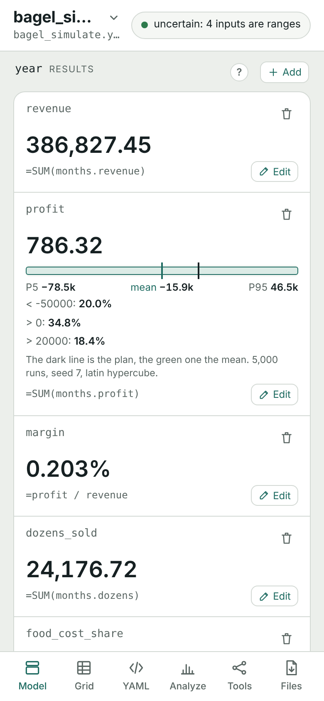
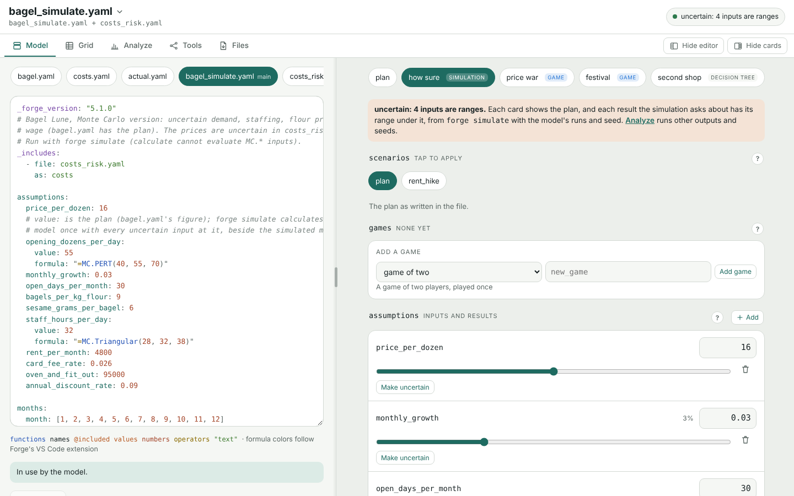
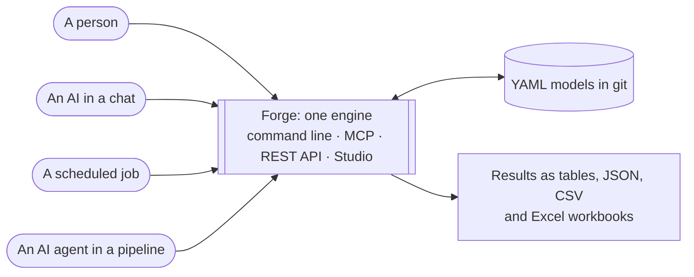

# Forge

**Financial models as plain text: readable by people, writable by AI, calculated the same way every time.**

[](https://github.com/mollendorff-ai/forge/actions/workflows/ci.yml)
[](https://crates.io/crates/mollendorff-forge)
[](https://github.com/mollendorff-ai/forge/actions/workflows/ci.yml)
[](https://github.com/mollendorff-ai/forge)
[](https://github.com/mollendorff-ai/forge/actions/workflows/ci.yml)
[](LICENSE-MIT)
[](https://scorecard.dev/viewer/?uri=github.com/mollendorff-ai/forge)

Forge reads a financial model written in YAML (inputs, formulas, tables, scenarios) and calculates it with 203 Excel-style functions, plus what a spreadsheet leaves to plug-ins: Monte Carlo, tornado charts, decision trees, real options, Bayesian networks, game theory. One engine, written in Rust, runs on the command line, as an MCP server for AI agents, and in your browser.

<p align="center">
  <a href="https://forge.mollendorff.ai/"></a>
  &nbsp;
  <a href="https://forge.mollendorff.ai/"></a>
</p>

**Checked, not trusted.** 2,182 formula tests compare Forge with Gnumeric, the analytics are compared with R and the games with Gambit, the axelrod library and egttools, on every pull request that changes the engine: [how we know the numbers are right](#how-we-know-the-numbers-are-right). What does not work yet is [listed](#status-and-known-limitations), not hidden.

## Where to start

| You are | Start here | Then |
| --- | --- | --- |
| **New to Forge**, with or without a terminal | [Forge Studio](https://forge.mollendorff.ai/?example=bagel) in your browser, nothing to install; or [the guide](docs/guide/README.md), six lessons on one model | [A tour of Studio](docs/guide/studio.md); [the bagel shop](#the-bagel-shop) below |
| **Working with an AI**, or building an agent | [The prompt for your AI](#try-it-with-your-ai), or [Forge with an AI](docs/guide/ai.md) | [Seven more prompts](docs/PROMPTS.md); [the MCP server](docs/MCP.md); [the agent skill](skills/forge-modelling/SKILL.md) |
| **Building a pipeline** | [Models checked on every pull request](docs/guide/pipeline.md) | [Workflows](docs/WORKFLOWS.md); [the command line reference](docs/cli/README.md) |
| **Embedding Forge** in a program or a page | [Embedding Forge](docs/EMBEDDING.md) | [docs.rs](https://docs.rs/mollendorff-forge); [forge-wasm](forge-wasm/README.md) |
| **Changing or releasing Forge** | [Contributing](CONTRIBUTING.md) | [AGENTS.md](AGENTS.md), the rules; [Maintaining Forge](docs/MAINTAINING.md); [the architecture](docs/architecture/README.md) |

Every page is listed in [the documentation's index](docs/README.md).

## The bagel shop

Bagel Lune is a made-up wood-fired bagel shop in Montreal, planned over its first twelve months in [`examples/bagel`](examples/bagel/README.md): a table of months with seasonal demand, five cost lines, supplier prices kept in a second file, and four scenarios. The guide's lessons are written on it, and [Studio opens it](https://forge.mollendorff.ai/?example=bagel) from a link. Every number below is what the command prints: the tests run each command, and check its numbers against a calculation written outside Forge (the price seek with 1,000 runs instead of 5,000).

**How does the first year go?** Revenue of 386,827.45 and a profit of 786.32. The third month is the worst, at -7,935.53.

```text
$ forge calculate examples/bagel/bagel.yaml --dry-run
      year.revenue = 386827.449537828
      year.profit = 786.320361712362
      year.worst_month_profit = -7935.5334064
```

**What price breaks even?** 15.97 a dozen, three cents under the 16 it charges. Bagels are a hard business; the arithmetic, at least, is easy ([the post](docs/posts/bagel-price.md)).

```text
$ forge break-even examples/bagel/bagel.yaml --output-var year.profit --vary assumptions.price_per_dozen
   assumptions.price_per_dozen = 15.97 (15.966607933396) → year.profit = -0.000063
```

**Which input matters most?** The tornado moves each input on its own, from low to high, and shows how far the year moves:

```text
$ forge tornado examples/bagel/bagel.yaml
   assumptions.opening_dozens_per_day |██████████████████████████████| swing 114,499.75  (output -56,463.56 at low, 58,036.20 at high)
   assumptions.price_per_dozen        |████████████████████████      | swing 94,192.48  (output -46,309.92 at low, 47,882.56 at high)
   assumptions.staff_hours_per_day    |████████████████████          | swing 76,590.00  (output 46,740.32 at low, -29,849.68 at high)
   assumptions.rent_per_month         |██████                        | swing 24,000.00  (output 10,386.32 at low, -13,613.68 at high)
   assumptions.card_fee_rate          |█                             | swing 4,641.93  (output 3,880.94 at low, -760.99 at high)
```

**What price gives an 80% chance of making money?** In the simulation, opening demand, staffing, the flour price and the wage are uncertain. At the planned 16 a dozen, the chance is 34.76%; it takes 18.32.

```text
$ forge simulate examples/bagel/bagel_simulate.yaml --seek "P(year.profit > 0) = 0.8" --vary price_per_dozen --min 14 --max 24
   assumptions.price_per_dozen = 18.32
   P(year.profit > 0) there: 80.00%  (2.92% at 14, 100.00% at 24)
   22 simulations of 5000 iterations, the same draws each time
```

**What if the shop across the street cuts its price?** The payoffs of a price war come from the plan's own numbers. Cutting pays more whatever the rival does, so both cut, and each earns 19,188.94 a month, less than if both had held at 16: a prisoner's dilemma the plan's numbers make.

```text
$ forge game examples/bagel/price_war.yaml
      lune: hold is dominated by cut
      rival: hold is dominated by cut
         lune: cut (payoff 19,188.94)
```

The same shop also runs scenarios, goal seek, a decision tree, real options, a bootstrap, a Bayesian network and its actual year against the plan: its [README](examples/bagel/README.md) has each command and what it prints, and [the guide](docs/guide/README.md) builds the shop from an empty file.

### Other models

**How much more a month to save 80,000 of interest on a mortgage?** [`examples/mortgage`](examples/mortgage/README.md) is 450,000 at 4.79% over 25 years, compounded twice a year as Canadian fixed rates are. A month-by-month loop in Python, solved with SciPy, gives 397.044208:

```text
$ forge goal-seek examples/mortgage/mortgage.yaml --target saved.interest --value 80000 --vary loan.extra_per_month
   loan.extra_per_month = 397.04 (397.044207903935) → saved.interest = 80,000.00
```

**Why is the year 27,000 over budget?** [`examples/rolling-forecast`](examples/rolling-forecast/README.md) has a fiscal year that starts in April, actuals up to October and forecast after, two products and a budget looked up month by month. The variance splits into volume, mix and price, and the three add up to it exactly:

```text
$ forge calculate examples/rolling-forecast/forecast.yaml --dry-run
      fy2027.variance = 27,022  (27021.9306764037)
      pvm.volume = 14,413  (14412.7435574308)
      pvm.mix = 11,876  (11875.965095039)
      pvm.price = 733  (733.222023933951)
```

A household's budget against its October is in [`examples/household`](examples/household/README.md), and [the posts](docs/posts/README.md) ask one question each of these models.

## Try it with your AI

Forge is made for AI agents, so the quickest way to see it work is to let yours try it. Paste this into Claude, ChatGPT, Grok or any AI that can run commands (a coding agent, or a chat with a code sandbox):

```plaintext
Try Forge, the financial-modelling engine from Möllendorff AI:
https://github.com/mollendorff-ai/forge (Rust; the crate is mollendorff-forge).
Do not build it from source. Install the release binary and its examples with:

  curl -fsSL https://raw.githubusercontent.com/mollendorff-ai/forge/main/install.sh | sh -s -- --examples

Then, with the forge binary it installed:
1. Run `forge calculate forge-examples/bagel/bagel.yaml --dry-run` and tell me
   how the bagel shop's first year goes: revenue, profit and the worst month.
2. Do not just compare with the numbers in Forge's README: those come from
   Forge too. Check two results yourself: recompute them from the inputs in
   bagel.yaml and costs.yaml with your own code, and say whether they agree.
3. Change one input (the price per dozen, say), calculate again, and explain
   what changed and why.

After this I will keep asking you questions about this model and what-ifs;
answer from the model and Forge itself, and use `forge --help` and
`forge <command> --help` for anything else Forge can do.

If you cannot run commands here, say so plainly and do not invent any
results. Point me to Forge Studio instead (https://forge.mollendorff.ai/),
where I can open the bagel example myself in a browser.
```

It names the project exactly, since "Forge" is a crowded name; it installs the release binary in a few seconds instead of letting the agent compile for minutes; and it asks the AI to check Forge rather than repeat the README's numbers.

It needs an AI that can run commands. Tried by the maintainer on 2026-11-15: it worked on Claude and on Grok, free tiers included; the free tiers of ChatGPT and Gemini had no sandbox to run it in. For those, the prompt's last lines ask the AI to say so rather than make numbers up, and to send you to [Forge Studio](https://forge.mollendorff.ai/), which needs nothing but a browser.

**Seven more prompts** in [docs/PROMPTS.md](docs/PROMPTS.md), each run by a fresh agent before it went in: build a model from a description, bring a workbook in from Excel and back, budget against actual, what-if (scenarios, break-even, goal seek, sensitivity), risk and decisions (simulation, tornado, decision tree, real options), games (what will the other side do?), and a price war built from the bagel shop's own numbers. Each ends with the model's YAML, to open in Studio, and the page ends with what to keep in a prompt of your own.

## Four ways to use Forge

The same model and the same binary, from one person to a pipeline nobody watches:



1. **A person alone.** A model is a text file: change an input, `forge calculate`, and `git diff` shows every result it moved. No AI needed.
2. **A person with an AI in a chat.** The AI writes the model and explains it; Forge does every sum, so no number is the AI's guess. [Tested prompts](docs/PROMPTS.md).
3. **A pipeline without AI.** Forge as the deterministic calculator in a financial job, at month-end say: the same inputs give the same numbers, a failed formula exits with 1, and the results come out as JSON, CSV or a workbook.
4. **A pipeline with AI.** An agent reads a new report and writes or updates the model, Forge checks and calculates it, and a person reviews the change as a pull request: a diff of formulas and inputs, not a workbook to trust. This is where Forge is headed.

Each, with its diagram and commands: [docs/WORKFLOWS.md](docs/WORKFLOWS.md). The first two have been run end to end by fresh agents. No one has yet run a whole pipeline without AI in production, but its gate, a workflow that checks a repository of models on every pull request, has run green and red ([the guide's pipeline page](docs/guide/pipeline.md)). The pipeline with AI has run on a real filing with [Sentinel](https://github.com/mollendorff-ai/sentinel), a small earnings-analysis demo built on Forge: an AI in a chat read Apple's quarterly release and wrote the model, Forge calculated it, and its gross profit and operating income equal the figures the filing prints.

## Forge Studio

Studio is Forge compiled to WebAssembly and run in your browser tab. Open an example, or your own YAML or Excel file, and the model shows as cards: drag an input, the results move. Edit a formula with suggestions for names and functions, see the whole model as a grid, apply a scenario, run goal seek, a tornado or a Monte Carlo simulation, and save the workbook `forge export` writes.

- **Your model stays on your device.** There is no server doing the math, no account, no cookies and no analytics. GitHub Pages serves the page, so GitHub sees that someone downloaded it, as with any website; after that, nothing you type leaves the tab. Your files are kept in your browser's storage, on your device. A link can carry a model to Studio, after the `#`, the part of an address that a browser never sends to a server (ADR-080). A link you make holds your model wherever you paste it.
- **It works offline.** Add it to your Home Screen and it opens and calculates with no connection: on a plane, in a tunnel, in a meeting room with bad Wi-Fi.
- **The numbers are Forge's.** The page calculates nothing itself; it asks the same engine as the command line, and CI checks that the WebAssembly answers equal the native ones, case by case.

## Beyond the spreadsheet

A spreadsheet calculates cells. The questions above need more than that, and Forge has a command for each, from the same YAML file:

| The question | The command |
| --- | --- |
| How likely is the year to make money? | `forge simulate`: Monte Carlo with six distributions (normal, triangular, uniform, PERT, lognormal, discrete), percentiles, and the input value that reaches a chosen probability |
| Which input matters most? | `forge tornado`, `forge sensitivity` |
| What if things go well, or badly? | `forge scenarios`: probability-weighted, with the expected value |
| Invest now, wait, or walk away? | `forge decision-tree` (backward induction), `forge real-options` (Black-Scholes and binomial: defer, expand, contract, abandon, switch) |
| How sure is that average? | `forge bootstrap`: percentile, basic and BCa intervals |
| How does one risk lead to another? | `forge bayesian`: Bayesian networks, with evidence and under a scenario; a probability may be a formula over the model, and a named query's posterior is a scalar later formulas read |
| What will a rival do, and what then? | `forge game`: the equilibria of a game in the model's `games:` section (dominated strategies, pure and mixed; a symmetric game of any number of players is written as one payoff for each strategy over how many of the others play each; with two strategies, its symmetric mixes and whether a population returns to each), the shares of a population generation by generation (`dynamics:`), and tournaments of repeated play between built-in strategies |
| Where did the budget go? | `forge variance`, `forge report` |
| What price breaks even? Hits a target? | `forge break-even`, `forge goal-seek` |
| Can my colleague open it in Excel? | `forge export` writes a workbook with live formulas; `forge import` reads one back |
| Does the model still give the figures it states? | `forge validate`: each formula with its result stored and up to date, and the `expect:` of the file and of each scenario |
| Can an agent change the model without breaking it? | `forge edit`: set a value or a formula, add or delete, rename a name and every name that reads it, make an input uncertain or certain again; a change is kept only when the model reads back valid, comments and layout untouched |

How each one is set up in YAML, with examples: [docs/FEATURES.md](docs/FEATURES.md). Every command is listed there too, and `forge examples` prints a runnable model for most of them.

### 203 functions

Most are Excel's, under Excel's names, so a formula reads as it would in a cell. Some are not in Excel: `VARIANCE`, `VARIANCE_PCT` and `VARIANCE_STATUS` (which knows that a cost under budget is good news), `BREAKEVEN_UNITS`, `BREAKEVEN_REVENUE`, `SCENARIO`, `PREV` for the row above, `COUNTUNIQUE`, and the six `MC.*` distributions `forge simulate` draws. Not every Excel function is covered; `forge functions` lists what is, and [docs/FUNCTIONS.md](docs/FUNCTIONS.md) has them all. A formula can hold a list in braces as in Excel, a row `{1,2,3}` or a column `{1;2;3}`: `=LARGE(x, {1,2,3})` ([ADR-064](docs/architecture/ADR-064-ARRAY-CONSTANTS.md)).

| Category | Examples |
|----------|----------|
| **Financial** | NPV, IRR, MIRR, XNPV, XIRR, PMT, PV, FV, RATE, NPER, CUMIPMT, CUMPRINC, SYD, VDB, RRI |
| **Date** | TODAY, DATE, YEAR, MONTH, DATEDIF, EDATE, EOMONTH, NETWORKDAYS, WEEKNUM, ISOWEEKNUM |
| **Conditional** | SUMIF, COUNTIF, AVERAGEIF, SUMIFS, COUNTIFS, MAXIFS, MINIFS |
| **Math** | ROUND, ROUNDUP, ROUNDDOWN, MROUND, CEILING, FLOOR, MOD, SQRT, POWER |
| **Logic** | IF, AND, OR, LET, SWITCH, INDIRECT, LAMBDA |
| **Lookup** | MATCH, INDEX, VLOOKUP, HLOOKUP, XLOOKUP, XMATCH, CHOOSE |
| **Statistical** | MEDIAN, MODE, VAR, STDEV, PERCENTILE.INC/.EXC, QUARTILE.INC/.EXC, CORREL, SLOPE, INTERCEPT, RSQ, FORECAST.LINEAR, NORM.DIST, NORM.INV, GEOMEAN |
| **Text** | CONCAT, TEXTJOIN, TRIM, UPPER, LOWER, LEN, MID |
| **Aggregation** | SUM, AVERAGE, MIN, MAX, COUNT |
| **Array** | UNIQUE, COUNTUNIQUE, FILTER, SORT |
| **FP&A-Native** | VARIANCE, VARIANCE_PCT, VARIANCE_STATUS, BREAKEVEN_UNITS, BREAKEVEN_REVENUE, SCENARIO |

## For AI agents

Any agent that can write a file and run a command can use Forge: Claude Code, Codex, Gemini, Cursor, Copilot, Aider. The agent writes YAML, `forge calculate` gives the numbers. No SDK, no API key, no protocol: files are the interface. The results come from the formula evaluator, not from a language model's arithmetic, and each one traces back to a formula.

Why not let the agent edit a spreadsheet? A `.xlsx` file is zipped XML, and its formulas say `B7:G42` where a YAML model says `months.revenue`. For one five-year DCF, the workbook was about 7 times the size of the YAML (19 times counting the XML inside). Token counts were not measured, and an agent that reads only the cells it needs avoids much of that; the names are the bigger difference. A YAML model also diffs, reviews and merges like code.

For tighter integration, `forge mcp` is an MCP server with 23 tools (validate, calculate, edit, audit, export and import; sensitivity, goal seek, break-even, variance, compare; simulate, scenarios, decision trees, real options, tornado, bootstrap, Bayesian networks, games; and schema, functions, templates and examples for discovery). Every tool takes the YAML inline, so it works in sandboxed clients with no file system:

```json
{
  "mcpServers": {
    "forge": {
      "command": "forge",
      "args": ["mcp"]
    }
  }
}
```

With a file path, the server reads and writes as you, and only inside the folder it starts in; `"args": ["mcp", "--root", "/path/to/models"]` names the folder, and `--any-path` lifts the limit ([docs/MCP.md](docs/MCP.md#keeping-files-inside-one-folder)). [docs/MCP.md](docs/MCP.md) describes each tool, and [Forge with an AI](docs/guide/ai.md) has rules to put in your project's `AGENTS.md` or `CLAUDE.md`. `forge serve` runs a REST API for validate, calculate, audit, export and import ([docs/FEATURES.md](docs/FEATURES.md#http-rest-api-server)).

## Quick start

```bash
# Install the release binary for your system (Linux, macOS; x86_64, ARM),
# checked against the release's checksums, into ~/.local/bin; --examples also
# puts the release's examples in ./forge-examples
curl -fsSL https://raw.githubusercontent.com/mollendorff-ai/forge/main/install.sh | sh -s -- --examples

# Or with Homebrew (macOS, Linux); this repository is the tap
brew tap mollendorff-ai/forge https://github.com/mollendorff-ai/forge
brew install mollendorff-ai/forge/forge

# Or with cargo-binstall (Windows too). The version range is needed while
# Forge has only release candidates, and --disable-strategies compile stops it
# from quietly building from source when it cannot reach GitHub (a sandbox
# whose GitHub token cannot use GitHub's GraphQL API, for one)
cargo binstall mollendorff-forge --version '>=10.0.0-rc.1' --disable-strategies compile

# Or download the archive yourself and check it (on macOS: shasum -a 256 -c;
# on ARM Linux: forge-aarch64-unknown-linux-musl; on Windows: the .zip)
url=https://github.com/mollendorff-ai/forge/releases/latest/download
curl -LO "$url/forge-x86_64-unknown-linux-musl.tar.gz" -LO "$url/checksums.txt"
sha256sum -c --ignore-missing checksums.txt
gh attestation verify forge-x86_64-unknown-linux-musl.tar.gz --repo mollendorff-ai/forge  # built by this repo's workflow (from rc.28; SECURITY.md)
tar -xzf forge-x86_64-unknown-linux-musl.tar.gz    # the forge binary, here

# Or build it: from crates.io (several minutes), or from a copy of this repository
cargo install mollendorff-forge --version '>=10.0.0-rc.1'
cargo install --path .

# Validate a model
forge validate model.yaml

# Calculate with scenario
forge calculate model.yaml --scenario optimistic

# Export to Excel with formulas (see known limitations)
forge export model.yaml output.xlsx
```

`forge calculate` writes each result into the model, next to its formula, and keeps the file as it was in `model.yaml.bak`; `--dry-run` prints the results and changes nothing.

There are runnable models in [`examples/`](examples/); [`examples/starter.yaml`](examples/starter.yaml) is the one to copy. The commands in this README name `examples/…`, as in a clone of this repository; `install.sh --examples` puts the same files in `forge-examples/`, so there write `forge-examples/` instead.

### Editors

Forge models are YAML files, so any editor with YAML support works. Two things help:

- **The schema**: [`schema/forge.schema.json`](schema/forge.schema.json) (which checks a file against the schema of the format its `_forge_version` names) gives completion of keys and marks a misspelt key or a text where a number belongs as you type, in any editor that runs yaml-language-server (VS Code with the YAML extension, Zed, Neovim, Helix). Put this first line in a model, or see [schema/README.md](schema/README.md) for the settings:

  ```yaml
  # yaml-language-server: $schema=https://raw.githubusercontent.com/mollendorff-ai/forge/main/schema/forge.schema.json
  ```

- **VS Code**: [`editors/vscode`](editors/vscode/README.md) highlights formulas (functions, names, `@include` values, numbers) inside any YAML file and applies the schema to `*.forge.yaml` files. It is not on the Marketplace yet; the README says how to build and install it.

There is no language server: run `forge validate` and `forge calculate` in a terminal, or `forge watch` to recalculate on every save.

## How we know the numbers are right

Forge's results are checked against engines it does not control, and none of the checks is complete. [VALIDATION.md](VALIDATION.md) lists what each one covers, its latest result and how to run it; [docs/STABILITY.md](docs/STABILITY.md) says what a stable release will promise, and what it will not.

| Check | What it covers | Checked on every pull request by |
| --- | --- | --- |
| Unit tests (this repo) | Black-Scholes and binomial option prices checked against QuantLib reference values, among the rest | CI's Test job, on every pull request and every merge to `main` (the CI badge above) |
| [forge-e2e-gnumeric](validation/gnumeric) | 2,182 formula cases. A case passes only if `forge calculate`, Gnumeric's recalculation of the exported `.xlsx` (LibreOffice's for the cases Gnumeric cannot read), and Forge after export and import all match the expected value. With them, 2,700 generated cases, arguments drawn from a seed toward the edges, compared with Gnumeric and LibreOffice ([ADR-062](docs/architecture/ADR-062-GENERATED-CASES.md)) | The Validation workflow's Gnumeric job, on every pull request that changes the engine or a suite; every week with 27,000 new generated cases |
| [forge-e2e-r](validation/r) | Math, date and financial functions, and analytics (Monte Carlo, bootstrap, tornado, sensitivity, decision trees, real options, Bayesian networks) compared with R | The Validation workflow's R job, on the same pull requests and every week |
| [validation/games](validation/games) | Games: equilibria compared with Gambit, tournaments with the axelrod library, 2 x 2 closed forms with R; games of many players and their dynamics with egttools, and again in R from the payoffs alone | The Validation workflow's games job, on the same pull requests and every week |
| [validation/repo](validation/repo) | The documentation: every `$ forge` command in this README and in the guide runs and prints what the page shows, and the counts of functions and tools in the docs are the code's | CI's Repository checks job, on every pull request |

Clippy runs in pedantic mode and CI fails on a warning.

## Status and known limitations

Forge is a release candidate (v10.0.0-rc.35) and an R&D prototype: read its claims as hypotheses to check, not facts to trust. It was built with AI assistance under the author's direction (Claude is listed as a co-author in `Cargo.toml`). Do not rely on it for real financial decisions without checking the results independently.

Forge began in 2025 as the core of a trading-engine idea, built closed-source for a few months. Making the YAML calculator showed it was worth more as a financial-modelling tool, and it was opened under MIT OR Apache-2.0 in February 2026; it is not a trading engine and does not plan to become one ([ADR-063](docs/architecture/ADR-063-ORIGIN-OF-FORGE.md)).

Known problems (what is planned, and in what order, is in each lane's [roadmap](.asimov/roadmap/)):

- `forge export` writes a formula that Excel cannot express with the same meaning (Monte Carlo functions, Forge's one-column `VLOOKUP`, `IRR(-cost, flows)` and a few others) as its calculated value, an uncertain input (`MC.*`) as its plan value, and lists it. `forge import` brings such a cell back as that value: the distribution stays in the YAML file.
- `forge export` does not write `scenarios` (Excel has no equivalent); it lists them as not exported. Keep the YAML file as the source of truth.
- A two-dimensional array constant such as `{1,2;3,4}` is refused (Forge has no two-dimensional values), and `forge import` brings a formula with one in as its values.
- `forge calculate` does not draw `MC.*` distributions (for example `examples/monte-carlo.yaml`): it says so and points to `forge simulate`, or calculates the model at plan with `--plan`, each uncertain input at its `value:`.
- Each analytics command has been checked once end to end, on the `examples/bagel` models, against calculations written outside Forge. That is one model each, not broad coverage.
- Some analytics specs are not yet compared with R: elasticity, the exponential distribution, one-point ranges ([VALIDATION.md](VALIDATION.md)).

## Documentation

| Document | What it holds |
| --- | --- |
| [All the documentation](docs/README.md) | Where to start by who you are, and every page by what it holds |
| [Guide](docs/guide/README.md) | Lessons on one model, the bagel shop: the first ten minutes, a first model written by hand, keeping a model, what if, how likely, what will they do, and working with an AI |
| [Features](docs/FEATURES.md) | The model file, every command, every analysis |
| [Functions](docs/FUNCTIONS.md) | The 203 functions |
| [MCP](docs/MCP.md) | The MCP server and its 23 tools |
| [Examples](examples/) | Runnable models, each with a README; [docs/EXAMPLES.md](docs/EXAMPLES.md) walks through them |
| [Glossary](docs/GLOSSARY.md) | The terms: a model, scenario, equilibrium, plan |
| [Command line reference](docs/cli/README.md) | Every command and option, with its output |
| [Side by side](docs/REPORT.md) | `forge report`: a calculated file's scalars as a table, for a document or a spreadsheet |
| [Posts](docs/posts/) | One question each, answered with the examples |
| [Validation](VALIDATION.md) | What is checked against what, and the latest results |
| [Stability](docs/STABILITY.md) | What a stable release promises |
| [Architecture](docs/architecture/) | The decisions (ADRs) and why |
| [Roadmap](.asimov/roadmap/) | What is next in each lane, in order; [roadmap.yaml](.asimov/roadmap.yaml) holds the state and what was done |
| [Changelog](CHANGELOG.md) | Every release |
| [Contributing](CONTRIBUTING.md) | How to change Forge, and what a change needs |

## Development

```bash
cargo test                              # Run all tests
cargo clippy --locked --all-targets -- -D warnings   # Lint, as CI runs it (pedantic)
cargo fmt --all -- --check              # Formatting, as CI runs it
make check                              # Quick check: format, lint, unit tests, Markdown
cargo build --release && (cd validation/gnumeric && cargo run --release)   # Against Gnumeric and LibreOffice (VALIDATION.md)
cargo build --lib --no-default-features # The engine alone: no command line, servers or Excel (ADR-055)
```

## License

Licensed under either of

- [Apache License, Version 2.0](LICENSE-APACHE)
- [MIT License](LICENSE-MIT)

at your option.

This is the standard dual-license used by the Rust ecosystem (rustc, Tokio, Serde, etc.).

---

**Built with [Asimov](https://github.com/mollendorff-ai/asimov)** - The AI autonomy framework.
