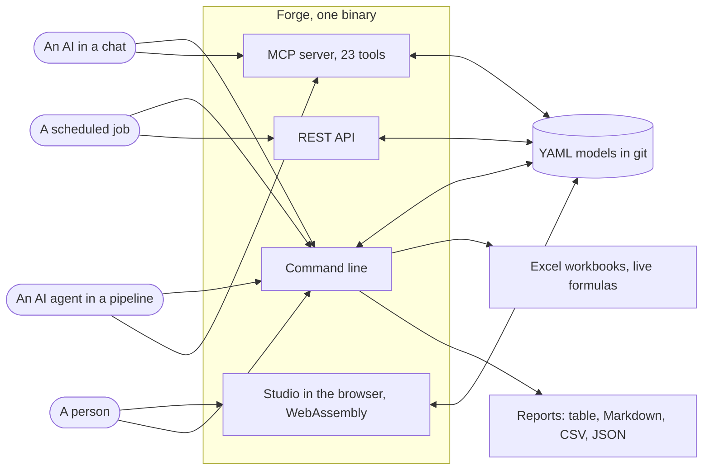
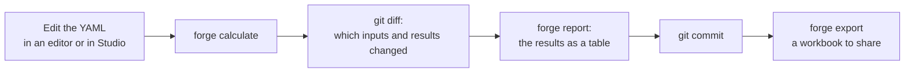
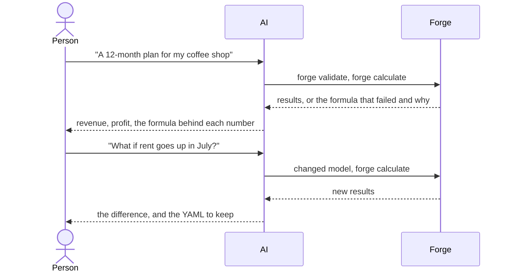
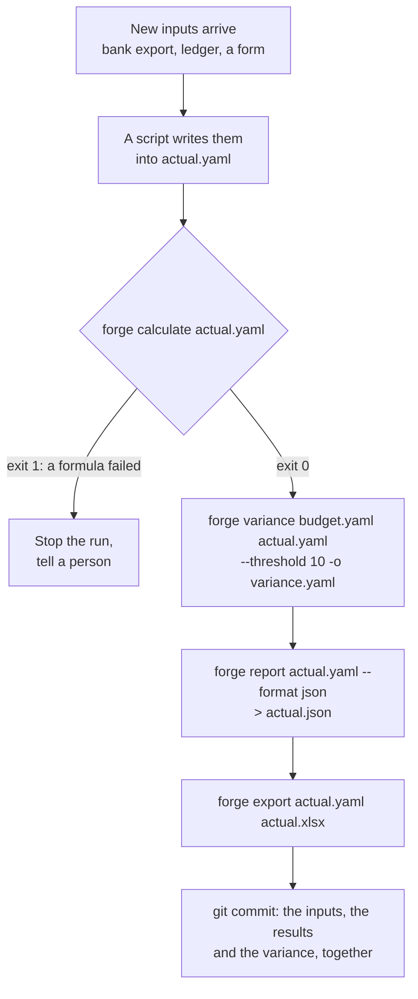
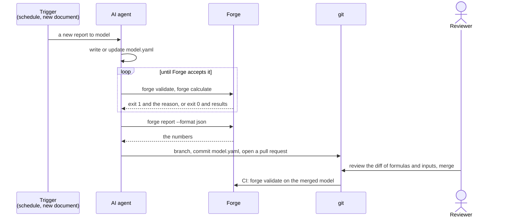

# Workflows: four ways to use Forge

Forge calculates a financial model written as YAML. The same model, and the same binary, serve four ways of working, from one person in an editor to an AI pipeline that nobody watches. This page shows each one with a diagram and the commands it uses.

**What is proven and what is not.** The commands on this page were run against Forge 10.0.0-rc.26 on 2026-11-15, and the chat workflow was run end to end by fresh agents ([PROMPTS.md](PROMPTS.md)). The pipeline without AI is architecture: every step in it is a Forge command that works, but no one has yet run a whole one in production. The pipeline with AI has run once, as Sentinel's first run on a real document (section 4).

## The big picture



Whoever writes the model, Forge does the arithmetic, the model is plain text in git, and every number traces back to a formula. The four entry points share one engine: Studio runs the same code compiled to WebAssembly, and CI checks that it gives the same answers as the binary.

## 1. A person alone

No AI needed. A model is a text file, so it can be reviewed, diffed and kept in git like code, and a change shows as a change to a formula or an input, not as a cell that looks the same.



```sh
# Change an input in budget.yaml, say groceries: 700 to groceries: 750, then
forge calculate budget.yaml          # results written next to their formulas
git diff budget.yaml                 # the input and every result it moved
forge report budget.yaml             # the results as a table
git commit -am "Groceries up to 750"
forge export budget.yaml budget.xlsx # for someone who lives in Excel
```

Two things to know:
- **The first `forge calculate`** of a file that has never been calculated, like the examples, adds a `value:` under every formula, so its first diff is all additions. From then on a diff shows only what moved.
- **`forge calculate` keeps the file as it was** in `budget.yaml.bak`. Add `*.bak` to `.gitignore`, so it is never committed.

On a phone, [Forge Studio](https://forge.mollendorff.ai/) does the same with nothing installed: paste or open the YAML, change an input, see the results move.

## 2. A person with an AI in a chat

The AI turns a request in words into a model, runs Forge, and explains the result; the person asks the next question. The AI never does the arithmetic, so it cannot make a number up.



Seven tested prompts to start from are in [PROMPTS.md](PROMPTS.md). The AI can call Forge from its shell or through the MCP server (`forge mcp`, see [MCP.md](MCP.md)).

## 3. A pipeline without AI

Forge as a deterministic calculator in a financial pipeline: the model is fixed and reviewed, and a job feeds it new inputs, say the month's actuals at month-end. The same inputs always give the same numbers, and with `set -e` the run stops on the first command that fails.



```sh
set -e                                                    # stop on the first failure
# The job has written this month's figures into actual.yaml
forge calculate actual.yaml                               # exit 1 on any failed formula
forge variance budget.yaml actual.yaml --threshold 10 -o variance.yaml
forge report actual.yaml --format json > actual.json      # for the next program
forge export actual.yaml actual.xlsx                      # for the finance team
git add actual.yaml variance.yaml actual.json actual.xlsx
git commit -m "Month-end actuals"
```

What makes Forge fit here:
- **Exit codes:** `forge calculate` and `forge validate` exit with 1 when a formula fails, and name the formula and what depends on it. A failed `forge calculate` leaves the file as it was.
- **A gate for stale files:** `forge validate` exits with 1 when the values stored in a file no longer match its formulas, as after an input was changed without recalculating. Run in CI, it refuses a model whose stored results are out of date. It does not yet refuse a file with no stored values at all, which passes (roadmap T1-AGENT-FRICTION).
- **Output for programs:** `forge report --format json` or `--format csv`, and `forge variance -o variance.yaml` with each line's budget, actual, variance and whether it is good news.
- **Know what each command reads:** `forge report` shows the values stored in the file and never recalculates, so run `forge calculate` first, as above; `forge variance` calculates both files itself. `forge variance` exits with 0 however many lines are over the threshold: a job that should stop on a large variance reads `exceeds_threshold` in `variance.yaml`.
- **No runtime:** one binary, installed in seconds with `install.sh`, nothing else on the machine.
- **A server, if a script would rather not run commands:** `forge serve` gives the same operations as a REST API on this machine.

## 4. A pipeline with AI

The piece the other three lead to. An agent reads something new, an earnings report, a contract, a brief, and writes or updates a model. Forge checks and calculates it, and the agent reads Forge's answer, never its own arithmetic. When Forge refuses the model, the agent reads the reason and fixes it. A person reviews the change as a pull request: a diff of formulas and inputs, not a workbook to trust.



Why this is the point of Forge:
- **The AI is good at reading and writing structure, and bad at arithmetic.** YAML is a format LLMs know well, so the agent writes the model, and Forge, which is checked against Excel, Gnumeric, LibreOffice and R, does the sums.
- **Every run leaves a record:** the model as text, in git, with its results stored next to its formulas, so a number in a report can be traced to the formula and the input behind it.
- **The same answers each time:** rerun a thousand scenarios and the numbers are Forge's every time, never a model's guess.

**It has run once.** [Sentinel](https://github.com/mollendorff-ai/sentinel), a small earnings-analysis pipeline, ran this workflow on Apple's release for the fourth quarter of fiscal 2026 (filed 2026-11-02), with Forge as its only calculator. An AI in a chat read the saved release, wrote the model, and wrote the brief from Forge's results; Forge calculated, ran a Monte Carlo simulation, a tornado, break-even and three scenarios. Everything is in git: the saved filing with its checksums, the model, Forge's results, the brief, and every prompt and answer ([the run](https://github.com/mollendorff-ai/sentinel/tree/main/runs/AAPL/20261115-184457)). Gross profit and operating income, which Forge calculates, equal the figures printed in the filing.

Two checks stand between the AI and the reader. Forge checks the arithmetic. A person-checked file of four figures from the filing checks the AI's reading of it, and the run refuses to start until a person has marked the figures as checked.

What the run does not show, plainly:
- A person started it, by pasting a prompt into a chat, and checked those four figures once for the quarter. Nobody was needed after that, but it was not a scheduled job.
- It is one quarter of one company, a small model of four inputs. It shows that the steps connect, not how they hold up over many documents.
- The AI that wrote the model and the brief was Claude in a chat, not a service Sentinel calls. Sentinel can call one (through an API key), and that mode was tested but not used for this run.
- What Forge made hard for a program, found by the run, is in the roadmap as T1-PIPELINE-FINDINGS; the fresh agents that ran [PROMPTS.md](PROMPTS.md) found others, listed as T1-AGENT-FRICTION.

## Choosing an entry point

| You are | Start with |
|---|---|
| Trying Forge on a phone | [Forge Studio](https://forge.mollendorff.ai/), nothing to install |
| Building a model by hand | the command line and `forge examples starter` |
| Working with an AI in a chat | a prompt from [PROMPTS.md](PROMPTS.md) |
| Connecting an AI host (Claude Desktop, Claude Code) | `forge mcp`, see [MCP.md](MCP.md) |
| Writing a scheduled job | the command line and its exit codes, or `forge serve` |
| Building an AI pipeline | `forge mcp` or the command line, `forge validate` as the gate |
