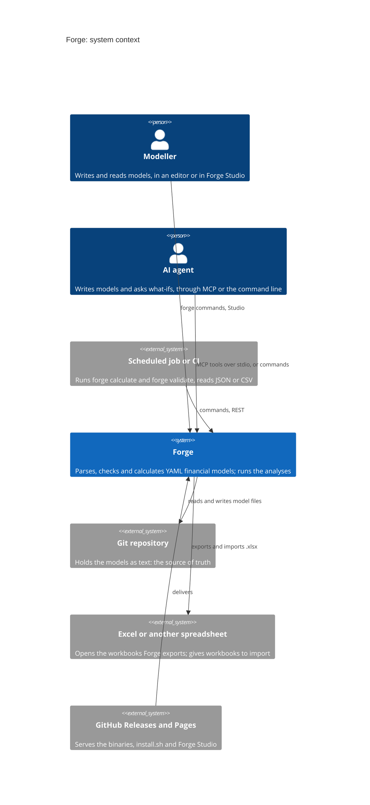
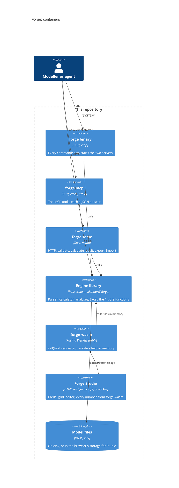
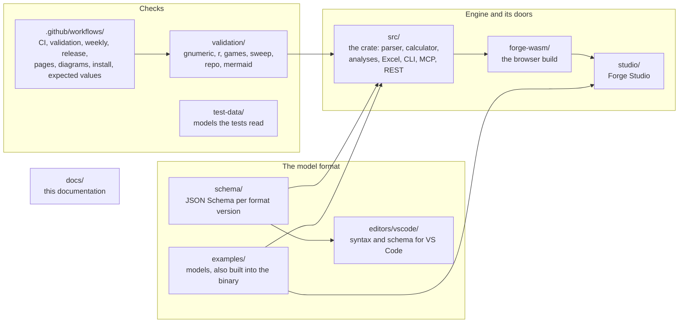

# 00 - Overview

What Forge is, who and what it talks to, the parts it is built from, and where each part lives in this repository. Start here; the [README](README.md) lists the other pages and the decisions (ADRs).

The diagrams follow the [C4 model](https://c4model.com/): this page has level 1 (the system and its surroundings) and level 2 (the deployable parts). [01 - Components](01-COMPONENT-ARCHITECTURE.md) has level 3, the modules inside the engine.

## What Forge does

Forge reads a financial model written in YAML (inputs, formulas, tables, scenarios, games) and calculates it with Excel's functions, plus what a spreadsheet leaves to plug-ins: Monte Carlo, tornado charts, decision trees, real options, bootstrap intervals, Bayesian networks and game theory. A model is a text file in git; `forge calculate` writes each formula's result next to it, so `git diff` shows every number an edit moved.

One engine, written in Rust, answers through four doors: the command line, an MCP server for AI agents, a REST API, and a WebAssembly module that Forge Studio runs in a browser tab. They all call the same functions, so a model gives the same numbers whichever door it came through.

## Level 1: system context

Forge holds no state of its own: no database, no account, no server-side session. Everything it knows is in the model files it is given, and everything it works out is either printed, returned as JSON, or written back into those files.

## Level 2: containers

A _container_ in C4 is something that runs or is deployed on its own. Forge has one engine, compiled two ways, and four ways in.

Forge Studio is opened in a browser by the same person; it is left out of the arrows above to keep them readable.

| Container | Code | Built with | Ships as | More |
| --- | --- | --- | --- | --- |
| Engine library | `src/` (crate `mollendorff-forge`) | default features `cli` (with `excel`), or `--no-default-features` | the crate on crates.io; inside every container below | [01](01-COMPONENT-ARCHITECTURE.md) |
| `forge` binary | `src/main.rs`, `src/cli/` | `cargo build --release` | release archives, `install.sh`, Homebrew, `cargo binstall` | [06](06-INTERFACES.md#the-command-line) |
| MCP server | `src/mcp/` | inside the binary: `forge mcp` | the same binary | [06](06-INTERFACES.md#the-mcp-server), [docs/MCP.md](../MCP.md) |
| REST API | `src/api/` | inside the binary: `forge serve` | the same binary | [08](08-API-SERVER-ARCHITECTURE.md) |
| forge-wasm | `forge-wasm/src/lib.rs` | `cargo build -p forge-wasm --profile wasm --target wasm32-unknown-unknown`, then `wasm-bindgen` | inside Studio; not published alone | [06](06-INTERFACES.md#the-browser-forge-wasm-and-forge-studio), ADR-055 |
| Forge Studio | `studio/` | `node studio/build.mjs` | GitHub Pages, <https://forge.mollendorff.ai/> | [studio/README.md](../../studio/README.md), ADR-056 |

## The repository

| Folder | What it holds |
| --- | --- |
| `src/` | The engine crate and the `forge` binary. [01](01-COMPONENT-ARCHITECTURE.md) maps every module. |
| `forge-wasm/` | The browser build: one function, `call(tool, request)`, over the engine's `*_core` functions (and `version()`). Its `tests/` holds the cases that compare its answers with the native ones (JSON and Node, no Rust tests). |
| `studio/` | Forge Studio: a static page, a worker that runs forge-wasm, and Node tests that compare the page with Forge. |
| `schema/` | One JSON Schema per model format (`forge-v5.6.0.schema.json`, ...), embedded in the binary and copied to the VS Code extension. [schema/README.md](../../schema/README.md) says what each version adds. |
| `examples/` | Example models. Some are built into the binary (`forge examples`) and into Studio's sets; tests run every one. |
| `validation/` | Suites that check Forge against other engines (Gnumeric, LibreOffice, R, Gambit, axelrod, egttools), checks of the repository itself (`repo`), and the check that every Mermaid diagram renders (`mermaid`). [07](07-TESTING-ARCHITECTURE.md). |
| `editors/vscode/` | A VS Code extension: syntax colours (also used by Studio's editor) and the schemas. |
| `test-data/` | Models and workbooks the unit tests read. |
| `docs/` | User documentation, the architecture (this folder) and posts. |
| `.asimov/` | The roadmap (`roadmap.yaml`) and project conventions; roadmap ids such as `T1-COVERAGE-GATE` refer to it. |

## Principles

Each of these is a decision someone made, with the record of why.

| Principle | What it means in the code | Decided in |
| --- | --- | --- |
| The model is text in git | YAML, not a binary format; results are written back into the file so a diff shows them; comments and layout are kept byte for byte | ADR-009, ADR-010, ADR-051 |
| One engine, many doors | Every command is a `*_core` function that returns a value and prints nothing; the CLI prints it, MCP and REST serialize it, forge-wasm returns it as JSON | ADR-047, ADR-055 |
| Excel's meaning, checked | Functions have Excel's names and results; every function is compared with Gnumeric or LibreOffice, the analytics with R, the games with Gambit | ADR-007, ADR-037, ADR-057, ADR-062 |
| Deterministic | The same model gives the same numbers: seeded simulations, a fixed calculation order, results rounded to Excel's 15 digits when written | ADR-016, ADR-065, ADR-066, [STABILITY.md](../STABILITY.md) |
| Fail loudly, and all at once | An unknown name, a cycle or a bad formula is an error that names the cell; every cell that does not depend on it is still calculated, so all errors come in one report | [03](03-FORMULA-EVALUATION.md), [04](04-DEPENDENCY-RESOLUTION.md) |
| Nothing hidden from the gates | 100% coverage, pedantic clippy, inline tests, no file over 1,500 lines, no way round any of them | [CLAUDE.md](../../CLAUDE.md), ADR-004 |
| Libraries before our own code | A stable library wins unless our own code is more correct, simpler, or does what the library cannot | [CLAUDE.md](../../CLAUDE.md), ADR-072 |
| A small browser download | Forge Studio's WebAssembly stays under 3,000,000 bytes gzipped | ADR-070 |

## Where to go next

- To change how a model is read: [02 - Data model](02-DATA-MODEL.md).
- To change how formulas are calculated, or add a function: [03 - Formula evaluation](03-FORMULA-EVALUATION.md), then [10 - Extending Forge](10-EXTENDING-FORGE.md).
- To add a command, an MCP tool or a Studio view: [06 - Interfaces](06-INTERFACES.md).
- To know what will check your change: [07 - Testing architecture](07-TESTING-ARCHITECTURE.md).
