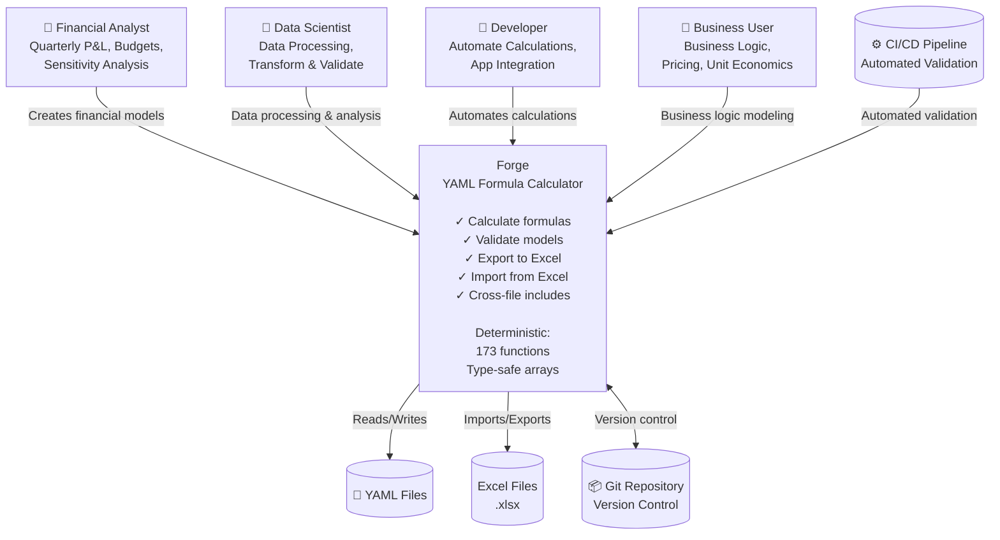

# Forge Architecture Overview

**Document Version:** 3.0.0
**Forge Version:** v5.0.0
**Last Updated:** 2025-12-04
**Status:** Complete

> **Note (2026-11-07):** This overview dates from v5.0.0. The cost, CO₂, token, speed and test-count figures it once carried were never sourced and have been removed; [VALIDATION.md](../../VALIDATION.md) says what is checked and how. The architecture below has not been brought up to date. For example, Forge evaluates formulas with its own evaluator in `src/core/array_calculator` and no longer depends on `xlformula_engine`; 01-COMPONENT-ARCHITECTURE.md, 02-DATA-MODEL.md, 03-FORMULA-EVALUATION.md and ADR-011 still describe that earlier integration.

---

## Table of Contents

1. [Introduction](#introduction)
2. [System Context](#system-context)
3. [Architecture Principles](#architecture-principles)
4. [High-Level Architecture](#high-level-architecture)
5. [Technology Stack](#technology-stack)
6. [Key Characteristics](#key-characteristics)
7. [Module Structure](#module-structure)
8. [Data Flow](#data-flow)
9. [Related Documentation](#related-documentation)

---

## Introduction

### What is Forge?

Forge is a **deterministic YAML formula calculator** with **bidirectional Excel integration**. It enables financial modeling, business calculations, and data processing with:

- **Deterministic results** - Values come from the formula evaluator, not from a model's own arithmetic
- **Excel compatibility** - 173 Excel functions, formula preservation
- **Type-safe arrays** - Homogeneous column arrays with compile-time safety
- **Version control** - YAML files tracked in Git, not binary Excel files
- **Cross-file includes** - `_includes` loads other YAML files; a formula reads their scalars as `@namespace.name` (see FEATURES.md)

### Problem Statement

Traditional financial modeling suffers from:

1. **Untraceable numbers** - A figure an AI model computes in prose has no formula behind it to check
2. **Excel Lock-in** - Binary files, no version control, no code review

### Solution

Forge provides:

- **Deterministic calculation** - Rust-based formula engine
- **YAML-first** - Human-readable, Git-friendly, diff-friendly
- **Bidirectional** - YAML ↔ Excel conversion with formula preservation
- **Fast** - The 5-year DCF model in the README calculates in milliseconds

---

## System Context



### Users

1. **Financial Analysts** - Build quarterly P&L models, budget forecasts, sensitivity analysis
2. **Data Scientists** - Process datasets, transform data, validate calculations
3. **Developers** - Automate financial calculations, integrate into applications
4. **Business Users** - Model business logic, pricing strategies, unit economics

### External Systems

1. **Git Repository** - Version control for YAML models (main integration point)
2. **Excel Files** - Import existing spreadsheets, export for visualization
3. **CI/CD Pipeline** - Automated validation in pull requests
4. **JSON Schema** - Validates YAML structure against `/home/rex/src/utils/forge/schema/forge-v1.0.schema.json`

---

## Architecture Principles

### 1. Determinism Over Intelligence

**Principle:** Mathematical calculations, not AI predictions.

- **No AI in the calculation path** - No LLMs; the same input always gives the same output
- **Rust-based** - Type-safe, memory-safe, deterministic
- **Own evaluator** - Excel-compatible formula evaluation (`src/core/array_calculator`)
- **Reproducible** - Same input → same output, always

### 2. Excel Compatibility = Excel Data Structures

**Principle:** Map 1:1 with Excel to enable trivial conversion.

- **Column arrays** = Excel columns
- **Tables** = Excel worksheets
- **Row-wise formulas** = Excel cell formulas
- **Aggregations** = Excel summary formulas

### 3. Type Safety > Flexibility

**Principle:** Rust's type system prevents errors at compile time.

- **Homogeneous arrays** - All elements same type (Number, Text, Date, Boolean)
- **No mixed types** - Parser rejects `[100, "Q2", true]`
- **Compile-time checks** - Rust compiler catches type mismatches
- **Runtime validation** - Additional checks in parser

### 4. Explicit > Implicit

**Principle:** No magic, clear errors, obvious behavior.

- **Explicit version marker** - `_forge_version: "1.0.0"`
- **Explicit cross-file refs** - `@alias.variable` not auto-discovery
- **Explicit errors** - "Column 'profit' has 3 rows, expected 4"
- **No hidden conversions** - Types don't auto-convert

---

## High-Level Architecture

```mermaid
graph TB
    %% User layer
    user["☁️ User<br/>forge calculate<br/>forge validate<br/>forge export<br/>forge import"]

    %% CLI Layer
    subgraph cli["CLI Layer"]
        main["main.rs"]
        commands["cli/commands.rs"]
    end

    %% Core Processing
    subgraph core["Core Processing"]
        parser["parser/mod.rs"]
        calc["core/array_calculator.rs<br/><br/>Calculator:<br/>• Array operations<br/>• Row-wise formulas<br/>• Aggregation formulas<br/>• 60+ Excel functions"]
        writer["writer/mod.rs"]
    end

    %% Excel Integration
    subgraph excel["Excel Integration"]
        exporter["excel/exporter.rs"]
        importer["excel/importer.rs"]
        translator["excel/formula_translator.rs"]
    end

    %% Data Structures
    subgraph data["Data Structures"]
        types["types.rs<br/><br/>Type-Safe Data:<br/>• ColumnValue enum<br/>• Table struct<br/>• ParsedModel"]
        errors["error.rs"]
    end

    %% External Libraries
    subgraph ext["External Libraries"]
        xle[("Forge evaluator")]
        graph[("petgraph")]
        yaml[("yaml_serde")]
        xlsx_writer[("rust_xlsxwriter")]
        xlsx_reader[("calamine")]
    end

    %% User interactions
    user --> main
    main --> commands

    %% Command routing
    commands -->|parse YAML| parser
    commands -->|calculate| calc
    commands -->|export to Excel| exporter
    commands -->|import from Excel| importer
    commands -->|write YAML| writer

    %% Core dependencies
    parser -->|deserialize| yaml
    parser -->|create Model| types
    calc -->|evaluate formulas| xle
    calc -->|resolve dependencies| graph
    calc -->|operate on data| types
    calc --> errors
    writer -->|serialize| yaml
    parser --> errors

    %% Excel dependencies
    exporter -->|create workbook| xlsx_writer
    exporter -->|translate formulas| translator
    importer -->|read workbook| xlsx_reader
    importer -->|reverse translate| translator
```

---

## Technology Stack

### Core Language

- **Rust 2021 Edition** - Memory safety, type safety, performance
- **Cargo** - Build system, dependency management, testing

### External Dependencies

| Dependency | Version | Purpose |
|------------|---------|---------|
| **petgraph** | 0.6 | Dependency graph, topological sort |
| **serde** | 1.0 | Serialization framework |
| **yaml_serde** | 0.10 | YAML parsing and serialization |
| **rust_xlsxwriter** | 0.90 | Excel .xlsx file creation |
| **calamine** | 0.31 | Excel .xlsx file reading |
| **clap** | 4.5 | CLI argument parsing |
| **thiserror** | 1.0 | Error type derivation |
| **anyhow** | 1.0 | Error handling utilities |
| **regex** | 1.11 | Formula preprocessing |
| **jsonschema** | 0.18 | JSON Schema validation |
| **colored** | 2.1 | Terminal output coloring |

### Development Tools

- **cargo fmt** - Code formatting (rustfmt)
- **cargo clippy** - Linting with pedantic checks
- **cargo test** - Unit, integration, and e2e testing
- **markdownlint-cli2** - Markdown validation
- **yamllint** - YAML validation
- **Mermaid** - Architecture diagrams (GitHub-native rendering)

---

## Key Characteristics

### Performance

- **Milliseconds** - The README's 5-year DCF model calculates in about 5 ms (measured 2026-11-06)
- **Monte Carlo** - 100,000 iterations of `examples/monte-carlo.yaml` took 8.9 s on two cores (measured 2026-11-06)
- **O(V+E)** - Dependency resolution complexity
- **O(n)** - Array formula evaluation (per row)

### Scalability

- **173 functions** - Most are Excel-compatible; `forge functions` lists them
- **External checks** - Formulas are compared with Gnumeric and analytics with R (see VALIDATION.md)

### Reliability

- **Tests** - Unit tests run on every push; the Gnumeric and R suites run weekly and on pull requests that change `src/`
- **Lints** - clippy pedantic; CI fails on warnings
- **Known limitations** - Listed in the README and docs/STABILITY.md

---

## Module Structure

```text
forge/
├── src/
│   ├── lib.rs                    # Library exports (7 modules)
│   ├── main.rs                   # CLI entry point (220 lines)
│   ├── types.rs                  # Data structures (290 lines)
│   ├── error.rs                  # Error types (33 lines)
│   ├── core/
│   │   └── array_calculator.rs   # Array calculator (3,440 lines)
│   ├── parser/
│   │   └── mod.rs                # YAML parser (1,011 lines)
│   ├── excel/
│   │   ├── exporter.rs           # YAML→Excel (218 lines)
│   │   ├── importer.rs           # Excel→YAML (400+ lines)
│   │   ├── formula_translator.rs # Formula translation (286 lines)
│   │   └── reverse_formula_translator.rs (300+ lines)
│   ├── writer/
│   │   └── mod.rs                # YAML writer (300+ lines)
│   └── cli/
│       └── commands.rs           # Command handlers (380 lines)
├── tests/                        # Integration & e2e tests
├── examples/                     # 4 usage examples
├── docs/                         # Documentation
├── diagrams/                     # Architecture diagrams
└── schema/                       # JSON Schema for validation

**Total:** ~7,436 lines of Rust code
```

### Module Responsibilities

| Module | Responsibility | Key Types |
|--------|----------------|-----------|
| **types** | Data structures | `Model`, `Table`, `Column`, `ColumnValue` |
| **parser** | YAML parsing | `parse_model()` |
| **core** | Formula calculation | `ArrayCalculator` |
| **excel** | Excel integration | `Exporter`, `Importer`, `FormulaTranslator` |
| **writer** | YAML serialization | `update_all_yaml_files()` |
| **cli** | Command handling | `calculate()`, `validate()`, `export()`, `import()` |
| **error** | Error types | `ForgeError`, `ForgeResult<T>` |

---

## Data Flow

### Calculate Command Flow

```text
User Input (YAML file)
    ↓
CLI Parser (clap)
    ↓
Command Handler (calculate)
    ↓
YAML Parser (yaml_serde)
    ↓
Array Calculator
    ↓
Dependency Resolution (petgraph)
    ↓
Formula Evaluation (src/core/array_calculator)
    ↓
Results
    ↓
Display (stdout)
```

### Export/Import Flow

```text
YAML Model                       Excel Workbook
    ↓                                 ↑
Parser                          Exporter
    ↓                                 ↑
ParsedModel  ←────────────────→  FormulaTranslator
    ↓                                 ↓
Importer                        rust_xlsxwriter
    ↑                                 ↓
calamine                         .xlsx File
    ↑
Excel Workbook
```

---

## Related Documentation

### Architecture Deep Dives

1. [Component Architecture](01-COMPONENT-ARCHITECTURE.md) - Detailed component interactions
2. [Data Model](02-DATA-MODEL.md) - Type system, structs, enums
3. [Formula Evaluation](03-FORMULA-EVALUATION.md) - Calculation pipeline
4. [Dependency Resolution](04-DEPENDENCY-RESOLUTION.md) - Graph algorithms
5. [Excel Integration](05-EXCEL-INTEGRATION.md) - Bidirectional conversion
6. [CLI Architecture](06-CLI-ARCHITECTURE.md) - Command structure
7. [Testing Architecture](07-TESTING-ARCHITECTURE.md) - Test strategy

### User Documentation

- [README.md](../../README.md) - User guide, features, installation
- [DESIGN_V1.md](../../DESIGN_V1.md) - v1.0.0 array model specification
- [CHANGELOG.md](../../CHANGELOG.md) - Version history
- [KNOWN_BUGS.md](../../KNOWN_BUGS.md) - Known issues and workarounds

### Developer Documentation

- [roadmap.yaml](../../roadmap.yaml) - Future features, milestones
- [warmup.yaml](../../warmup.yaml) - Development protocol
- [GLOSSARY.md](../../GLOSSARY.md) - Canonical terminology

### Diagrams

- [diagrams/architecture-overview.puml](../../diagrams/architecture-overview.puml) - Component diagram
- [diagrams/README.md](../../diagrams/README.md) - PlantUML guide

---

## Architecture Evolution

### v1.0.0 (November 2025)

- **Major rewrite** - Array-based model
- Column arrays with type safety
- Row-wise formulas
- Aggregation formulas
- Excel export/import
- 100 tests passing
- 12.5 hours development time (autonomous AI)

### v1.2.1 (November 2025)

- **27 new Excel functions** (conditional, math, text, date)
- 136 tests passing
- Formula translation improvements
- <8 hours development time

### v1.2.0 (Planned Q1 2026)

- Lookup functions (VLOOKUP, INDEX, MATCH, XLOOKUP)
- Audit trail (dependency visualization)
- Watch mode (auto-recalculate)
- VSCode extension
- GitHub Action

---

## Design Philosophy

### "Excel compatibility = Excel data structures + Excel formulas"

Forge doesn't try to replace Excel. It provides:

1. **Version-controllable alternative** - YAML instead of binary
2. **Validation without AI** - Deterministic, fast, accurate
3. **Modular models** - Cross-file references for reusability
4. **Bidirectional bridge** - Easy migration to/from Excel

### Zero Tolerance for Ambiguity

Financial calculations must be **unambiguous**:

- Type-safe arrays (no mixed types)
- Explicit version markers
- Clear error messages
- No implicit conversions
- Deterministic evaluation

### Performance Matters

Calculation in milliseconds enables:

- Real-time validation in editors
- Fast CI/CD checks
- Interactive development

---

## Measured results

See [VALIDATION.md](../../VALIDATION.md) for what is checked, the latest results, and how to run each check.

---

**Next:** [Component Architecture →](01-COMPONENT-ARCHITECTURE.md)

