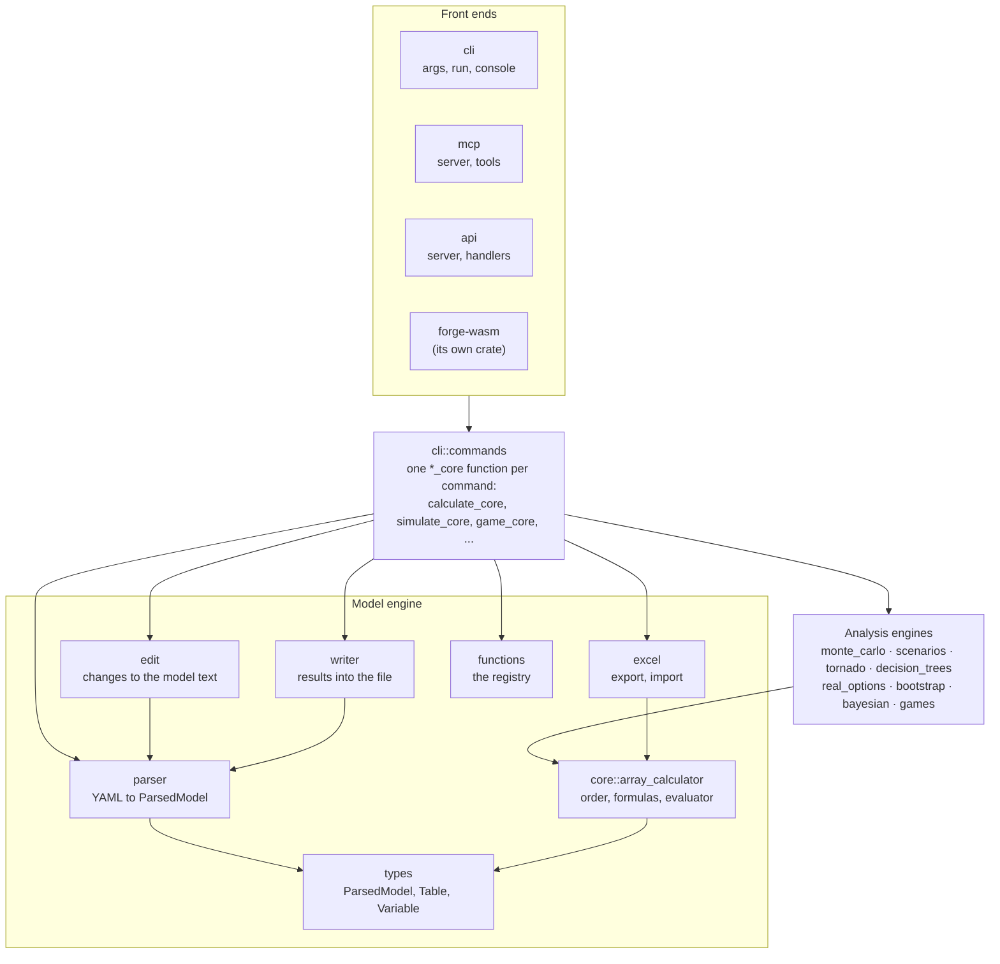
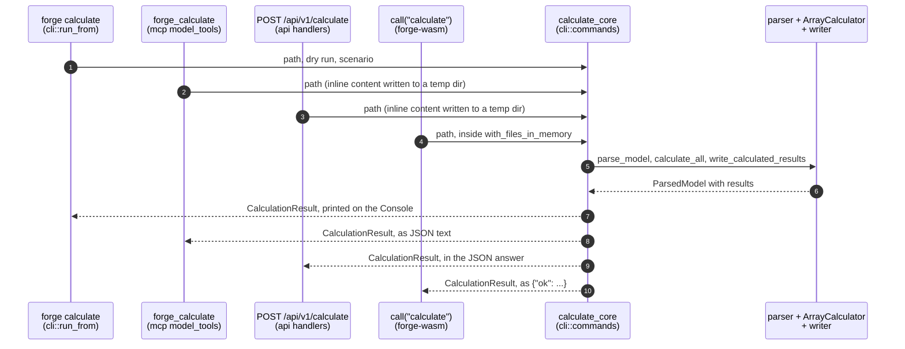
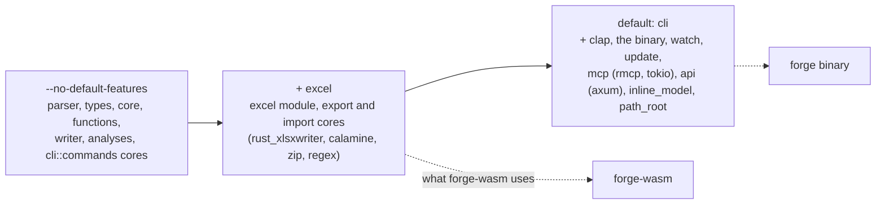
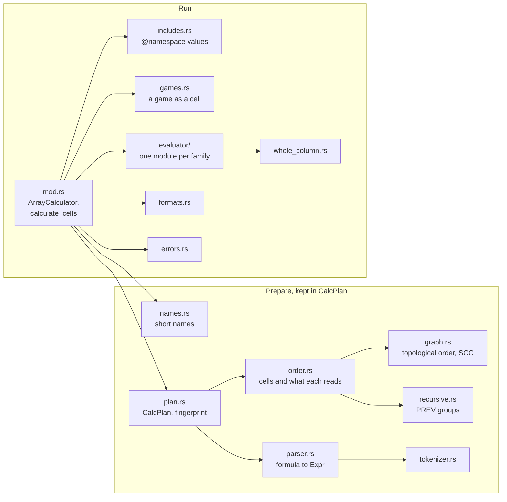

# 01 - Components

The modules inside the engine crate (`mollendorff-forge`, in `src/`), what each owns, which may call which, and the one pattern that ties the four front ends to them. This is level 3 of the C4 model; [00 - Overview](00-OVERVIEW.md) has levels 1 and 2.

## The layers

Arrows point from caller to callee. Every layer also uses `error` (`ForgeError`) and `core::precision`; MCP and REST use `inline_model` and `path_root`. The rules that keep this shape:

- **Each command has a core.** `calculate_core`, `simulate_core`, `game_core` and the others in `src/cli/commands/` take arguments and return a value (`CalculationResult`, `SimulationResult`, ...) that derives `Serialize`. A core prints nothing.
- **MCP, REST and forge-wasm call the core, never the engine directly.** They turn a request into arguments, call the `*_core` function, and turn its result into JSON, so the three give the same answer for the same model. One exception: REST's export and import call `forge export`'s and `forge import`'s printing functions and discard what they print ([08](08-API-SERVER-ARCHITECTURE.md#endpoints)).
- **The command line prints from the core.** Each printing function calls its command's core once and formats the result on a `Console`; what it prints that a client could use is in the result, so MCP, REST and forge-wasm have it too. `validate` calls its core's steps (`ModelToValidate`: read, check the lengths, check), so it can say what it found before a step fails. A fix made in a core reaches every door.
- **The engine knows nothing about the front ends.** `parser`, `types`, `core`, `functions`, `writer` and the analysis modules build without the `cli` feature and without a file system (see [below](#feature-builds)).
- **The analysis engines reuse the calculator.** An engine that moves an input (simulation, tornado, scenarios, goal seek) changes the `ParsedModel` and calculates it again with `ArrayCalculator`; it has no formula logic of its own. [09](09-ANALYSIS-ENGINES.md) explains the two kinds of engine.

## One core, four doors

Here is `calculate` from each door. All four call one function, `calculate_core` (`calculate_plan_core` with `--plan`).

Three mechanisms make a path-based core work from every door:

| Door | How the model reaches the core | Code |
| --- | --- | --- |
| Command line | A path on disk | `src/cli/run.rs` |
| MCP and REST | A path, or the model as text (`content`, `includes`), written to a temporary folder first; a `--root` keeps every path inside one folder | `src/inline_model.rs`, `src/path_root.rs` |
| Browser | The files as a map, held in a thread-local for the length of the call; `parse_model` and `read_model_text` read from it instead of the disk | `src/parser/memory.rs` (`with_files_in_memory`), ADR-055 |

## Feature builds

The crate builds three ways. CI builds and lints each (jobs `test`, `core-browser`, `forge-wasm` in `.github/workflows/ci.yml`).

A module or a function that needs the network, a terminal, threads or the file watcher sits behind `#[cfg(feature = "cli")]`; one that needs a workbook library behind `#[cfg(feature = "excel")]`. `src/lib.rs` and `src/cli/commands/mod.rs` show where each gate is. Code without a gate must build for `wasm32-unknown-unknown`.

## Module map

Every top-level module of `src/lib.rs`, with what it owns, where to start reading, and the decisions behind it.

| Module | Owns | Start at | Decisions |
| --- | --- | --- | --- |
| `types` | The model in memory: `ParsedModel`, `Table`, `Column`, `ColumnValue`, `Variable`, `Metadata`, `Scenario`, `Include`; how a scenario or a simulation sets an input (`types/overrides.rs`) | `src/types.rs` | ADR-051, ADR-059 |
| `parser` | YAML text to `ParsedModel`: the schema check, merge keys refused, multi-document files, includes, periods, `expect:` | `src/parser/mod.rs` (`parse_model`) | ADR-014, ADR-051, ADR-052, ADR-053, ADR-071, ADR-072 |
| `core` | The calculator (`core::array_calculator`), number precision (`core::precision`), unit checks (`core::unit_validator`) | `src/core/array_calculator/mod.rs` (`ArrayCalculator`) | ADR-058, ADR-065, ADR-066 |
| `functions` | The function registry: name, category, syntax, description of every function | `src/functions/definitions.rs` | ADR-013, ADR-015 |
| `writer` | Writing results into the model file, editing its text in place and checking nothing else changed | `src/writer/mod.rs` (`write_calculated_results`) | ADR-051 |
| `edit` | Changing a model's text on request (set an input's value or a formula, add or delete an element) through yaml-edit's lossless tree, kept only if the model reads back valid with that change and nothing else; shared by `forge edit`, `forge_edit` and forge-wasm's `edit` | `src/edit/mod.rs` (`edit_files`) | ADR-075 |
| `error` | `ForgeError` and `ForgeResult`, used everywhere | `src/error.rs` | |
| `monte_carlo` | Distributions, sampling (Monte Carlo, Latin hypercube), correlation, statistics, drivers, the simulation's workbook | `src/monte_carlo/engine.rs` | ADR-016, ADR-017, ADR-076 |
| `scenarios` | Probability-weighted scenarios and their expected values | `src/scenarios/engine.rs` | ADR-018, ADR-067, ADR-074 |
| `tornado` | One input at a time between its low and high value | `src/tornado/engine.rs` | ADR-021 |
| `decision_trees` | Backward induction over decision and chance nodes | `src/decision_trees/engine.rs` | ADR-019 |
| `real_options` | Black-Scholes and binomial valuation of defer, expand, contract, abandon, switch | `src/real_options/engine.rs` | ADR-020 |
| `bootstrap` | Resampling, percentile, basic and BCa intervals | `src/bootstrap/engine.rs` | ADR-022 |
| `bayesian` | Networks of discrete nodes, inference with evidence | `src/bayesian/engine.rs` | ADR-023 |
| `games` | Games read from `games:`, dominance, pure and mixed equilibria, the count form, dynamics, tournaments | `src/games/model.rs` | ADR-068, ADR-073 |
| `excel` | Export to and import from `.xlsx`; formula translation both ways (`workbook_refs`) | `src/excel/workbook_refs.rs` | ADR-033, ADR-034, ADR-054 |
| `cli` | Commands and their help (`cli/args.rs`), their options (`cli/args/options.rs`), running a command in-process (`cli/run.rs`), the `Console`, and every command with its core (`cli/commands/`) | `src/cli/run.rs` (`run_from`) | ADR-032, ADR-047 |
| `mcp` | The MCP server over stdio and its tools, grouped in `mcp/server/` | `src/mcp/server.rs` | ADR-047, ADR-048, ADR-049 |
| `api` | The REST server, its security layer and handlers | `src/api/server.rs` (`build_router`) | ADR-001 |
| `inline_model` | A model sent as text, written to a temporary folder for a core | `src/inline_model.rs` | ADR-049 |
| `path_root` | The folder `--root` keeps MCP and REST inside | `src/path_root.rs` | |

`forge-wasm/src/lib.rs` is a crate of its own, a thin layer like `mcp`: it maps a tool name to a core and returns JSON.

## Inside the calculator

`core::array_calculator` is the heart of the engine and the largest module. [03](03-FORMULA-EVALUATION.md) and [04](04-DEPENDENCY-RESOLUTION.md) explain it; this is the map.

The evaluator has one module per family of functions (`math`, `aggregation`, `logical`, `text`, `dates`, `lookup`, `financial`, `statistical`, `trig`, `conditional`, `array`, `info`, `forge`, `advanced`, and a few smaller ones). `evaluator/mod.rs` (`evaluate_function`) asks each family in turn whether it knows the name.

## Where state lives

Forge has very little state, on purpose:

| State | Where | Lifetime |
| --- | --- | --- |
| The model | `ParsedModel`, owned by the caller | One command |
| Calculated values | Inside `ParsedModel` (scalar `value`, table columns) and the calculator's `EvalContext` | One calculation |
| What does not depend on values | `CalcPlan` (`core/array_calculator/plan.rs`): parsed formulas, the order, name resolution, keyed by a fingerprint of names and formulas | Shared across the many calculations of a simulation, a sensitivity table or a goal seek |
| Files held in memory | A thread-local in `parser/memory.rs` | One `with_files_in_memory` call |
| Results on disk | The model file (`writer`), `.yaml.bak` beside it | Until the next calculation |

There is no global cache, no database and no configuration file. Two calls with the same files give the same answer.

## Where to change what

| To change | Look at | Then read |
| --- | --- | --- |
| How a YAML key is read | `src/parser/model.rs`, `src/parser/variables.rs`, `schema/` | [02](02-DATA-MODEL.md) |
| A function's result | `src/core/array_calculator/evaluator/<family>` | [03](03-FORMULA-EVALUATION.md) |
| Which cell is calculated first, a cycle message | `src/core/array_calculator/order.rs`, `graph.rs`, `recursive.rs` | [04](04-DEPENDENCY-RESOLUTION.md) |
| How `forge edit` writes a change | `src/edit/` (`text.rs` writes, `check.rs` reads back) | [02](02-DATA-MODEL.md#changing-the-models-text) |
| A workbook's layout or a translated formula | `src/excel/` | [05](05-EXCEL-INTEGRATION.md) |
| A command's output or arguments | `src/cli/commands/<command>`, `src/cli/args.rs` | [06](06-INTERFACES.md) |
| An MCP tool | `src/mcp/server/*_tools.rs`, `src/mcp/types.rs` | [06](06-INTERFACES.md#the-mcp-server) |
| A simulation, a game or another analysis | the analysis module and its command in `src/cli/commands/` | [09](09-ANALYSIS-ENGINES.md) |
| Anything new | | [10 - Extending Forge](10-EXTENDING-FORGE.md) |
