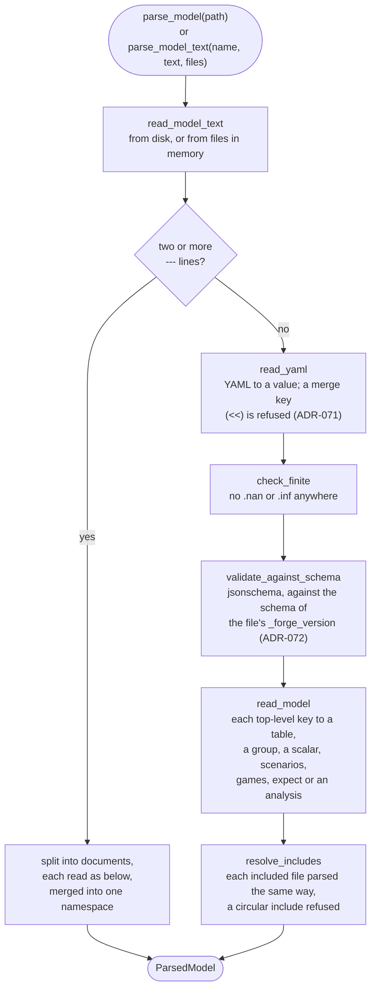
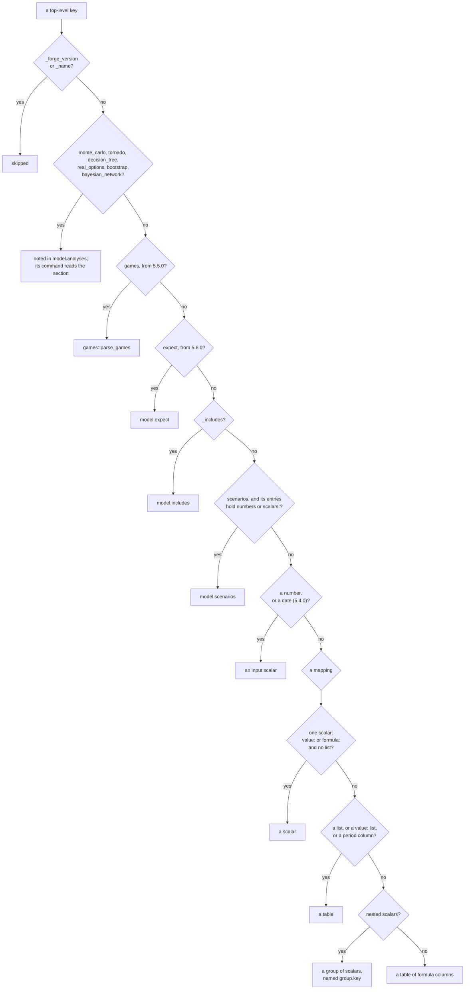
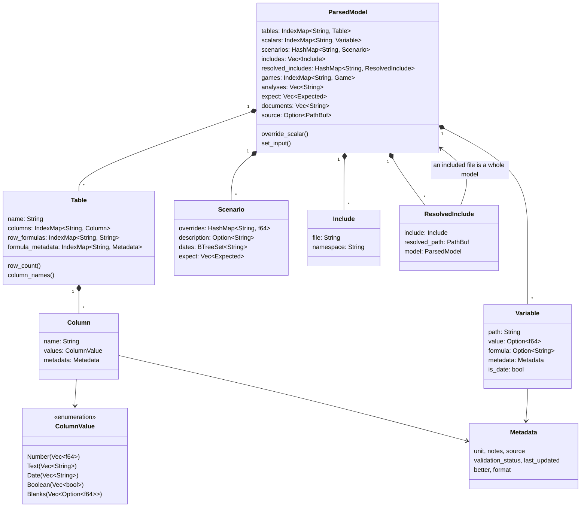
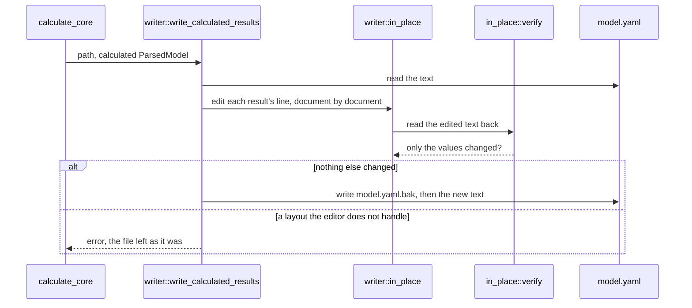
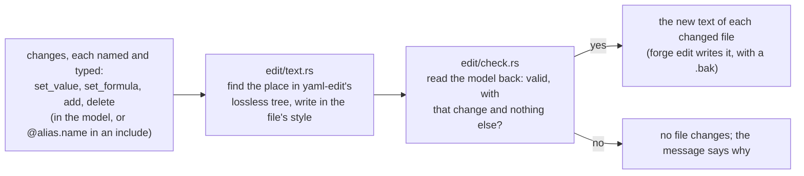

# 02 - Data model

How a YAML file becomes the model Forge calculates: the file's shape, the steps that read it, the types it is read into, and the format versions that say which keys a file may use.

The user's view of the same file is [FEATURES.md](../FEATURES.md#the-model-file); the exact rules of each format are the JSON schemas in `schema/` and [schema/README.md](../../schema/README.md).

## A model file

```yaml
_forge_version: "5.4.0"          # the model format, not the Forge version (required)
_includes:                       # other files, read under a name
  - file: costs.yaml
    as: costs

assumptions:                     # a group of scalars
  price_per_dozen: {value: 16, unit: CAD, format: "$#,##0.00"}
  opening_dozens_per_day: 55     # an input in the short form (5.1.0)

months:                          # a table: columns of equal length
  month: [1, 2, 3]
  season: [0.85, 1.25, 0.8]
  dozens: "=assumptions.opening_dozens_per_day * season * 30"   # a row formula
  revenue: "=dozens * assumptions.price_per_dozen"
  flour: "=dozens * 12 / 9 * @costs.ingredients.flour_per_kg"   # a value of costs.yaml

year:
  revenue: {formula: "=SUM(months.revenue)", value: 76560}      # a result, written back

scenarios:                       # named overrides
  flour_shock:
    scalars:
      "@costs.ingredients.flour_per_kg": 1.70
```

Besides tables, groups and scenarios, a file can hold analysis sections (`monte_carlo`, `tornado`, `decision_tree`, `real_options`, `bootstrap`, `bayesian_network`), `games:` (5.5.0) and `expect:` (5.6.0). A file can also be several YAML documents separated by `---`, which share one namespace (ADR-052).

## Reading a file



| Step | Code | Fails with |
| --- | --- | --- |
| Read the text | `src/parser/memory.rs` (`read_model_text`) | the file cannot be read, or is not among the files in memory |
| Split documents | `src/parser/multi_doc.rs` | a name defined in two documents, naming both |
| YAML | `src/parser/merge_keys.rs` (`read_yaml`) | invalid YAML; a `<<` merge key |
| Finite numbers | `src/parser/finite.rs` | `.nan`, `.inf` |
| Schema | `src/parser/schema.rs`, `schema_reader.rs`, `schema_errors.rs` | an unknown version; a key or a value the format does not allow, with its path and a suggestion (`'formla': did you mean 'formula'?`) |
| Sections | `src/parser/model.rs` (`read_model`), `variables.rs`, `arrays.rs`, `periods.rs`, `expect.rs` | a mixed array, a bad date, a game named like a table |
| Includes | `src/parser/includes.rs` | a missing file, a circular include, an `as` used twice |

The schemas are embedded in the binary (`include_str!` in `src/parser/schema_reader.rs`) and compiled once. They check the shape of a file. Whether a formula's names exist, and whether its stored results are current, is checked later, by the calculator and `forge validate`.

## How a top-level key is read

`read_model` in `src/parser/model.rs` looks at each key once, in the file's order. The order of these tests matters: a group and a table are told apart by their contents, not their names.



A group's scalars are stored flat under their full dotted name (`assumptions.price_per_dozen`); there is no group type. A table keeps its data columns and its row formulas in two maps and remembers the order they came in, so an export and a write-back keep the file's column order.

## The types

All in `src/types.rs`, with how a scenario or a simulation sets an input in `src/types/overrides.rs`.



Points that are easy to miss:

- **A value is an `f64`.** A date is its day number with `is_date` set (ADR-054, ADR-060); a text or a boolean exists only in a table column or inside a formula. A scalar holds one number.
- **A formula scalar's stored `value` is never read.** The calculator clears it before calculating (`calculate_cells` in `src/core/array_calculator/mod.rs`): a stored result is a cache for people and `git diff`, not an input.
- **`Blanks` is data only.** A `null` in a column of numbers (5.3.0, ADR-059); a formula never produces an empty cell, and a formula reads one as 0.
- **An included file is a whole `ParsedModel`**, kept in `resolved_includes` by its `as` name and calculated first. A formula reads it as `@costs.ingredients.flour_per_kg`; a scenario can override it under the same name.
- **`ParsedModel` derives `Serialize`.** forge-wasm's `model` tool and several MCP answers return parts of it as JSON.

## Names

| A formula writes | It means | Resolved in |
| --- | --- | --- |
| `assumptions.price_per_dozen` | The scalar with that full name | `src/core/array_calculator/names.rs` |
| `price_per_dozen` | In order: the scalar of the formula's own group with that name, a top-level scalar with that name, the one scalar in any group whose last part it is (an error if there are several) | `src/core/array_calculator/names.rs` |
| `revenue` in a row formula | The current row of the table's own column | `src/core/array_calculator/mod.rs` (`evaluate_in_context`) |
| `months.revenue` | Another table's column: the current row in a row formula, the whole column in an aggregate (ADR-058) | `src/core/array_calculator/whole_column.rs` |
| `@costs.ingredients.flour_per_kg` | A scalar of the file included as `costs` | `src/core/array_calculator/includes.rs` |
| `price_war.equilibria` | A game's result, named under the game (ADR-068) | `src/core/array_calculator/games.rs` |

Names are Unicode (`hypothèses.coût_unitaire`, `假设.单价`): anything that matches a name must use `char::is_alphanumeric`, never an ASCII class.

## Format versions

Every file states the format it is written in. A newer format only adds; a file of an older format reads exactly as before. `forge upgrade` moves a file to a newer one, and the writer writes in the file's own format (a date as a date only from 5.4.0).

| Format | Adds | Decision |
| --- | --- | --- |
| 1.0.0 | Scalars only | ADR-014 |
| 5.0.0 | Tables, row formulas, includes, the analysis sections | ADR-014 |
| 5.1.0 | Plain-number inputs and `{formula: ...}` without `value: null` | ADR-051 |
| 5.2.0 | Period columns (`{start: 2026-12, count: 300, unit: month}`) | ADR-053 |
| 5.3.0 | The empty cell, `null` in a number column | ADR-059 |
| 5.4.0 | A date as a scalar; `format:` beside `unit:` | ADR-060, ADR-061 |
| 5.5.0 | `games:` | ADR-068, ADR-073 |
| 5.6.0 | `expect:`, at the top and in each scenario | ADR-074 |

[10 - Extending Forge](10-EXTENDING-FORGE.md#add-a-key-or-a-model-format-version) lists every place a new format version touches.

## Writing results back

`forge calculate` (without `--dry-run`) writes each formula scalar's result into its `value:`, rounded to 15 significant digits as Excel shows it, and changes nothing else in the file: comments, quotes, blank lines and key order stay byte for byte (ADR-051).



Table columns are never written back: a row formula's results are recalculated each time. Under a scenario (`--scenario`) nothing is written, since the file holds the base case.

## Changing the model's text

Results are one kind of write; a change to the model itself (a new input value, a new formula, an added or deleted input, formula or column) is another. `src/edit/` makes those (ADR-075), for `forge edit`, the MCP tool `forge_edit` and forge-wasm's `edit`:



Every byte outside a change stays as it was, comments included. `edit` never writes results; `forge calculate` does. Forge Studio still changes its YAML with `studio/text.js`; moving it onto `edit` is a later step of ADR-075.
