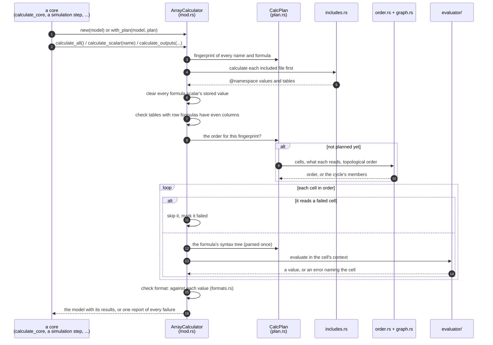
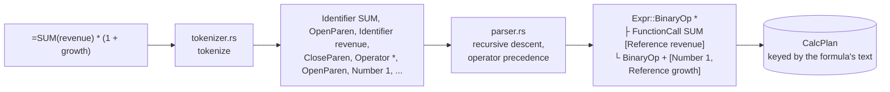
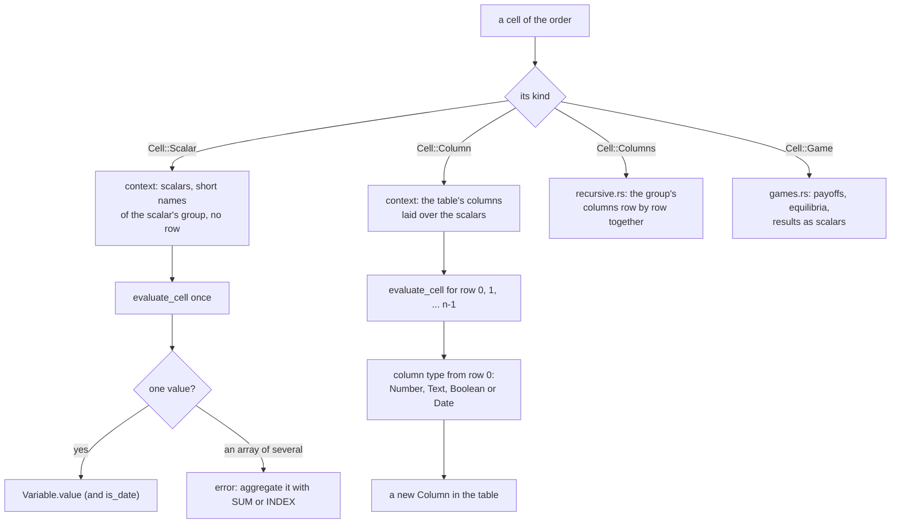
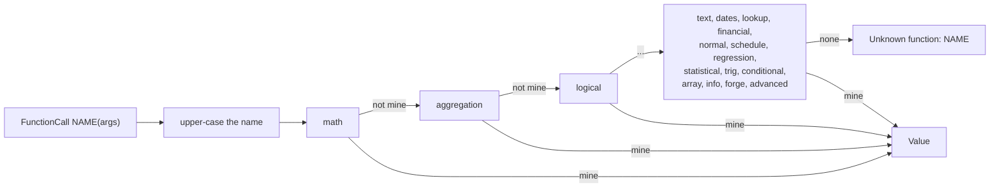
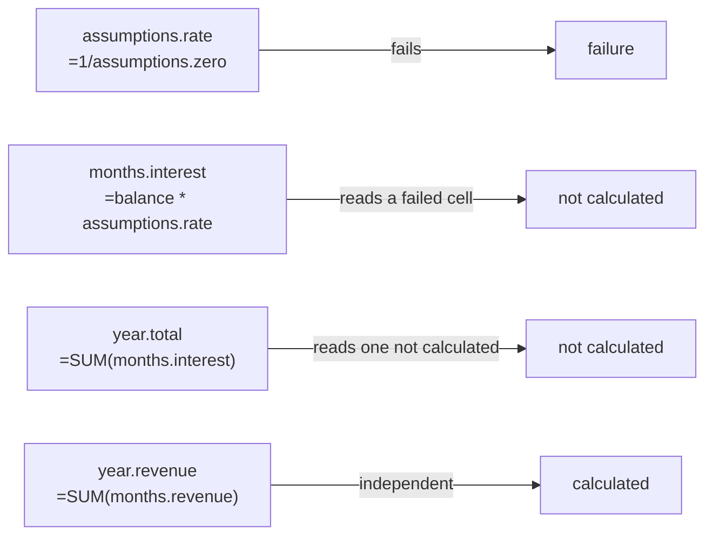

# 03 - Formula evaluation

How `ArrayCalculator` turns a `ParsedModel` into numbers: the steps of one calculation, how a formula is parsed and evaluated, how functions are found, how errors are collected, and how precision is kept. The order the cells are calculated in is [04 - Dependency resolution](04-DEPENDENCY-RESOLUTION.md).

All paths below are under `src/core/array_calculator/`.

## One calculation



The three entry points differ only in which failures fail the answer:

| Method | Fails when | Used by |
| --- | --- | --- |
| `calculate_all` | Any cell fails | `calculate`, `validate`, export, most commands |
| `calculate_scalar(name)` | `name` failed or reads a failed cell | goal seek, break-even, sensitivity: a search can pass through inputs where an output it does not ask for has no answer |
| `calculate_outputs(scalars, columns)` | One of the outputs failed | `forge simulate --seek` |

Every method still calculates every cell: the difference is only in what is reported.

## From text to a syntax tree



`Expr` (`parser.rs`) has a variant for each kind of node: `Number`, `Text`, `Boolean`, `Reference`, `FunctionCall`, `BinaryOp`, `UnaryOp`, `ArrayIndex`, `Range`, `Array` (an array constant, ADR-064) and `CallResult` (calling a `LAMBDA`'s result). A formula is parsed once per `CalcPlan`, so a simulation of thousands of iterations parses each formula once.

## Evaluating a formula

The evaluator walks the tree with an `EvalContext` (`evaluator/mod.rs`) that holds everything a formula may read:

| Field | Holds |
| --- | --- |
| `scalars` | Every calculated scalar by its full name, the included values (`@costs.x`), and, laid over them for one formula, the columns of the formula's own table and the short names that hide another name |
| `tables` | Every table's columns, shared (`Arc`), never copied per formula |
| `aliases` | The short names the current formula may use, resolved once per section (`names.rs`) |
| `current_row`, `row_count` | The row a row formula is in; `None` for a scalar formula |
| `lag`, `growing_table` | `PREV`: how many rows back a reference is read, and the table growing row by row ([04](04-DEPENDENCY-RESOLUTION.md#prev-columns-that-read-the-row-above)) |
| `whole_args`, `hidden_row` | The arguments read as whole columns in a row formula (ADR-058): while one is evaluated, the row is hidden |
| `scenarios` | Each scenario's overrides, for `SCENARIO()` |

A value is `evaluator::Value`: `Number`, `Text`, `Boolean`, `Array` (a shared vector), `Lambda` or `Null`.



A name in a row formula is the value in the current row, except inside an argument Excel reads as a range (`SUM(revenue)`, `SUMIFS(months.revenue, ...)`), where it is the whole column. `whole_column.rs` holds the one table of which argument of which function is a range; the evaluator, the calculation order and the Excel export all read it.

## Finding a function



`evaluate_function` in `evaluator/mod.rs` asks each family module's `try_evaluate(name, args, ctx)` in turn; the first to answer `Some` wins. A family module checks its arguments with the shared helpers (`require_args`, ...) and evaluates them itself, so a function decides whether an argument is read as a number, a column or a lambda.

The **function registry** (`src/functions/definitions.rs`) is a separate list of every function's name, category, syntax and description. The calculator does not read it; `forge functions`, the MCP tool, Studio's suggestions, `docs/FUNCTIONS.md` (generated in CI) and the Excel export do. Tests tie the two together:

| Test | In | Checks |
| --- | --- | --- |
| `every_listed_function_is_known_to_the_calculator` | `src/functions/registry.rs` | each listed function is found by some `try_evaluate` |
| `every_listed_excel_function_is_known_to_the_export` | `src/excel/formula_translator.rs` | each listed Excel function is in the export's list |
| `every_function_count_written_anywhere_is_the_registry_count` | `validation/repo/src/doc_counts.rs` | the count in the README and docs matches the registry |
| the Gnumeric suite | `validation/gnumeric/` | each function's results match Gnumeric or LibreOffice |

[10](10-EXTENDING-FORGE.md#add-a-function) is the checklist for adding one.

## Errors: all of them, at once

A failing cell does not stop the calculation. Every cell that does not read it is still calculated, and the error names where it happened, so one run reports everything that is wrong.



What `forge calculate` prints for that model:

```text
Error: Formula evaluation error: 1 formula failed:
  - assumptions.rate: Division by zero (formula: =1/assumptions.zero)
  Not calculated, because they use a failed formula:
  - months.interest (uses assumptions.rate)
  - year.total (uses months.interest)
```

- `errors.rs` (`locate_error`) adds the cell's name, the row (one-based) and the formula to an evaluation error.
- A failed or skipped cell gets no value, so nothing can read a stale number from it.
- `Outcome::report` sorts the failures and the skipped cells by name, so the report is the same on every run.
- A cycle, uneven columns in a table with row formulas, and an included file that fails stop the calculation before any cell is evaluated: there is no order to follow.

## Precision

The engine calculates in `f64` and keeps full precision between formulas. At its edges it does what Excel does (`src/core/precision.rs`):

| Rule | Where | Decision |
| --- | --- | --- |
| A number written to a file or printed is rounded to 15 significant digits (`418.3299999999999` is stored as `418.33`) | `precision::to_15_digits`, the writer, the cores' results | ADR-051 |
| Two numbers compare as equal when they agree to 15 digits | `evaluator/operators.rs` (`values_equal`) | ADR-065 |
| A formula's last `+` or `-`, and the last addition of `SUM`, are 0 when they nearly cancel | `precision::final_sum`, `evaluate_cell` | ADR-066 |
| A test states the exact bits a result must have (`assert_exact!`), or compares with a stated tolerance | `src/lib.rs` | |

## Caching between calculations

A simulation, a sensitivity table or a goal seek calculates the same formulas thousands of times with different inputs. `CalcPlan` (`plan.rs`) keeps what depends only on names and formulas:

- parsed syntax trees, by the formula's text;
- the calculation order and each cell's dependencies, by a fingerprint of every name and formula in the model;
- how each name resolves.

A model with any other name or formula gets its own entry, so a cached plan never changes a result: `ArrayCalculator::with_plan` gives the same answers as `ArrayCalculator::new`, only faster. Values are never cached.
