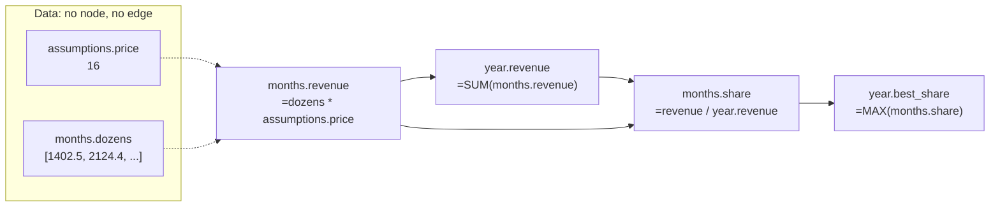
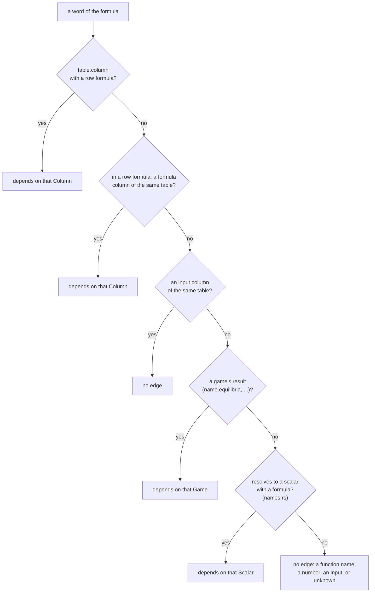
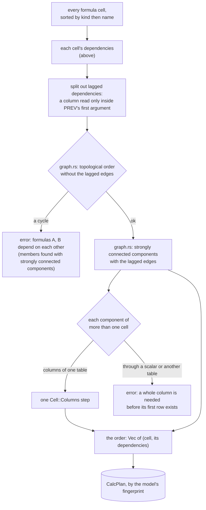
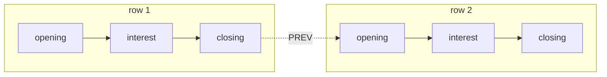
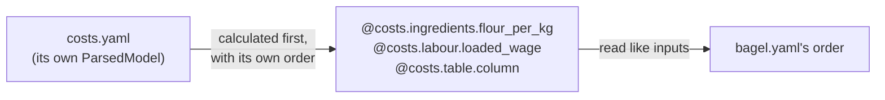

# 04 - Dependency resolution

Which cell is calculated before which: the cells of a model, how their dependencies are found, the order, cycles, columns that read the row above (`PREV`), included files and games. How each cell is then evaluated is [03 - Formula evaluation](03-FORMULA-EVALUATION.md).

All paths below are under `src/core/array_calculator/`.

## One graph for the whole model

Every formula in a model is a node of one graph: a scalar can read a calculated column, and a column can read a calculated scalar, in either order. There is no "tables first, then scalars" phase.



Arrows point from a cell to the cells that read it. `months.share` reads the scalar `year.revenue`, which sums the column `months.revenue`: a column, a scalar and a column again, in one order. A cell is one of four kinds (`Cell` in `order.rs`):

| Kind | Is | Calculated by |
| --- | --- | --- |
| `Cell::Column { table, column }` | One row-formula column, all its rows | `ArrayCalculator::calculate_column` |
| `Cell::Scalar(name)` | One scalar with a formula | `calculate_scalar_cell` |
| `Cell::Columns { table, columns }` | Columns of one table that read each other through `PREV`, calculated together row by row | `recursive.rs` |
| `Cell::Game(name)` | A game: its payoffs worked out, its equilibria found, its results stored as scalars under its name | `games.rs` |

Inputs (a scalar without a formula, a data column) are not cells: nothing needs to be calculated before them.

## Finding what a formula reads

`cell_dependencies` in `order.rs` reads the **words** of the formula (`formula_words`: names, with string literals removed) and resolves each the way the evaluator will:



Two points follow:

- **Dependency finding and evaluation resolve names with the same function** (`resolve_scalar_name` in `names.rs`), so the order always matches what the formula will read. A change to name resolution changes both.
- **An unknown name adds no edge.** It fails when its cell is evaluated, with the cell's name; every other cell is still calculated ([03](03-FORMULA-EVALUATION.md#errors-all-of-them-at-once)).

## The order



- `graph.rs` has the two algorithms (a topological sort and Tarjan's strongly connected components). They visit nodes in the same order petgraph did, so the order, and which error is reported first, did not change when petgraph was replaced; a test compares them on thousands of random graphs, with petgraph kept as a dev-dependency for it.
- Cells start sorted by kind, then name (`Cell` derives `Ord`). With the sort's fixed visiting order, the calculation order, and so the error report, is the same on every run (`test_order_is_the_same_on_every_run`).
- The order with each cell's dependencies is stored in the `CalcPlan` under the model's fingerprint, so a simulation orders its model once.

## PREV: columns that read the row above

A period table (a loan, a cash balance) has columns that read each other across rows:

```yaml
schedule:
  month: {start: 2026-12, count: 300, unit: month}
  opening: "=PREV(closing, loan.principal)"   # last row's closing, or the principal in row 1
  interest: "=opening * loan.rate / 12"
  closing: "=opening + interest - loan.payment"
```

`opening` reads `closing`, and `closing` reads `opening`, but never in the same row. `recursive.rs` handles this (ADR-053):



1. A dependency is _lagged_ when a column of the same table is read only inside `PREV`'s first argument (`names_by_row` walks the syntax tree).
2. Without the lagged edges the cells must still have an order; a cycle there is an ordinary circular reference.
3. With them, cells that reach each other form a group. The group is one step, `Cell::Columns`, calculated row by row, its columns in the order of step 2 within each row. While it runs, `EvalContext.growing_table` says the table's columns are shorter than the table, and `lag` tells a reference inside `PREV` how many rows back to read.

A model without `PREV` has no lagged edge and no group.

## Included files



Each included file is a whole model, calculated on its own before the model that includes it (`includes.rs`), recursively for an include of an include. Its values enter the main model's context as `@namespace.path`, which never matches a cell name of the main model (`@` is part of the word), so they add no edge. A circular include is refused when the files are read ([02](02-DATA-MODEL.md#reading-a-file)). A scenario that overrides `@costs.x` changes the included model before it is calculated.

## Games

A game's payoff cells are formulas over the model (ADR-068). The game is one cell, `Cell::Game`, whose dependencies are every cell its payoffs read (`game_dependencies`). Its results (`price_war.equilibria`, `price_war.equilibrium_1.lune.payoff`, `price_war.dominated.lune.hold`, ...) become scalars named under it, and a formula that reads one depends on the game. So a model can calculate a payoff from its inputs, find the equilibrium, and use the equilibrium's payoff in a later formula, in one order.

## Bayesian networks

A network is ordered as a game is (ADR-074, `src/core/array_calculator/network.rs`). Its priors and table entries may be formulas over the model's scalars (`src/bayesian/written.rs`), and the network is one cell, `Cell::Network`, whose dependencies are every cell those formulas read. Once they are worked out, each row is checked to be probabilities and inference runs; the posterior of each named query (`bayesian_network.queries.<q>: {node, evidence}`) becomes a scalar `bayesian_network.<q>.<state>`, and a formula that reads one depends on the network. A network whose formulas read its own results is a cycle, and is refused. `examples/expected_loss.yaml` feeds the probability of default, given the economy, into an expected loss.
