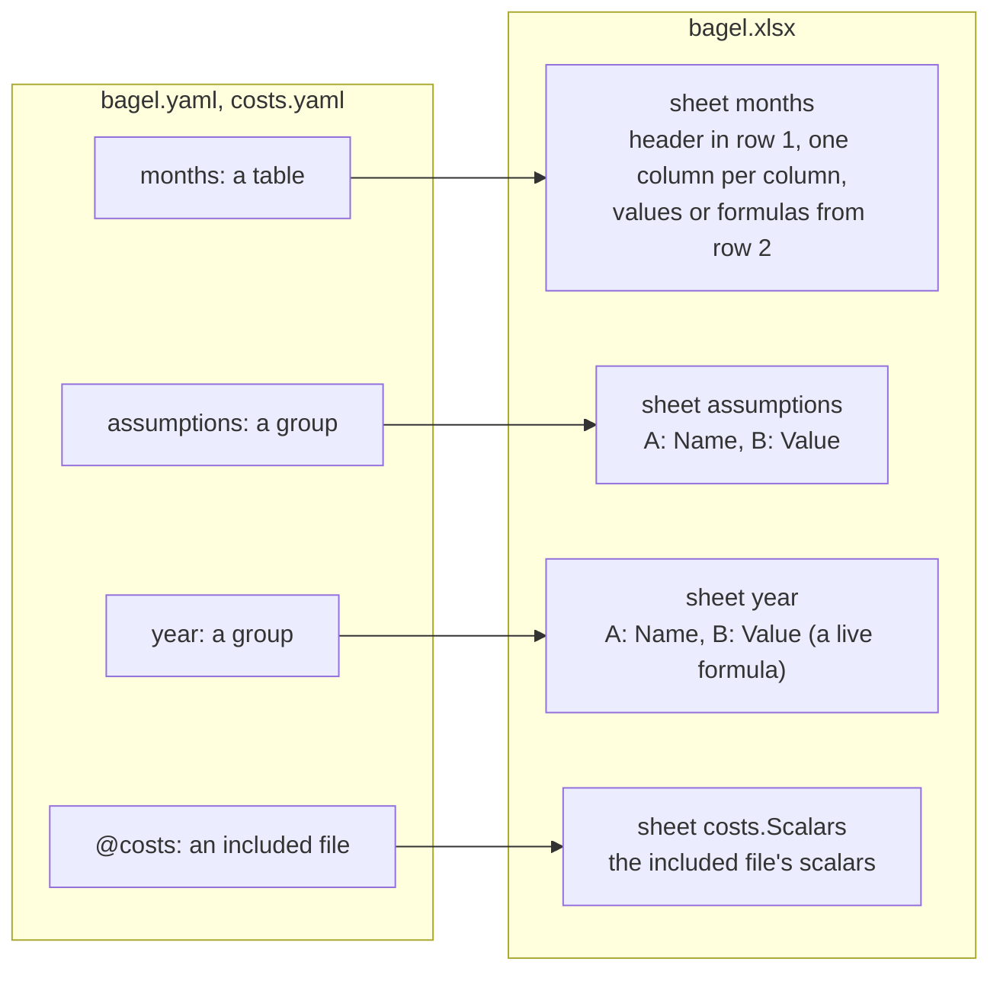
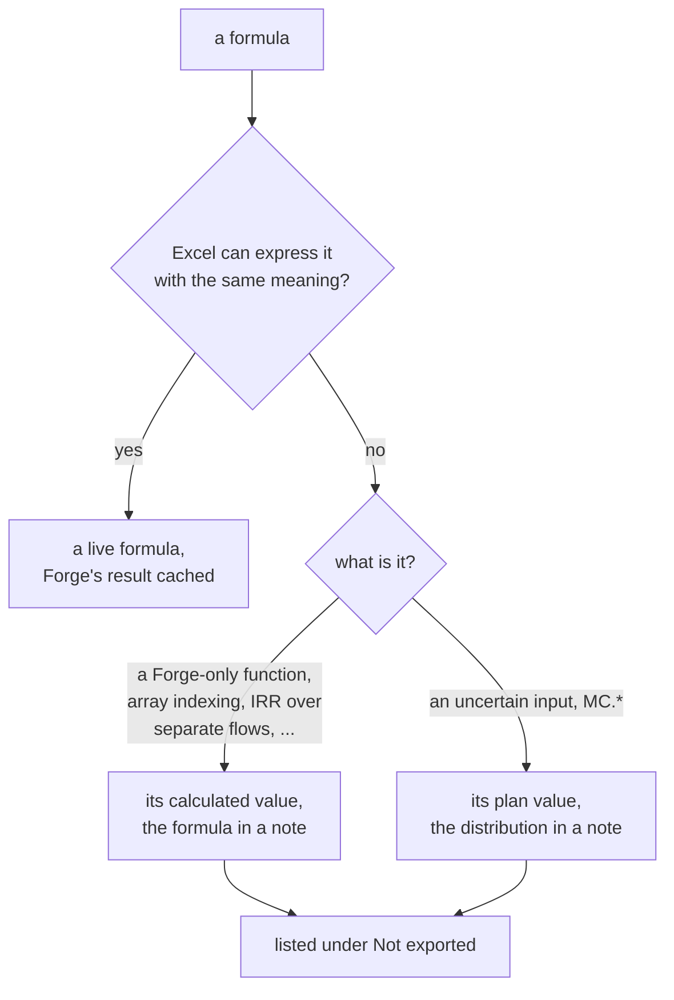
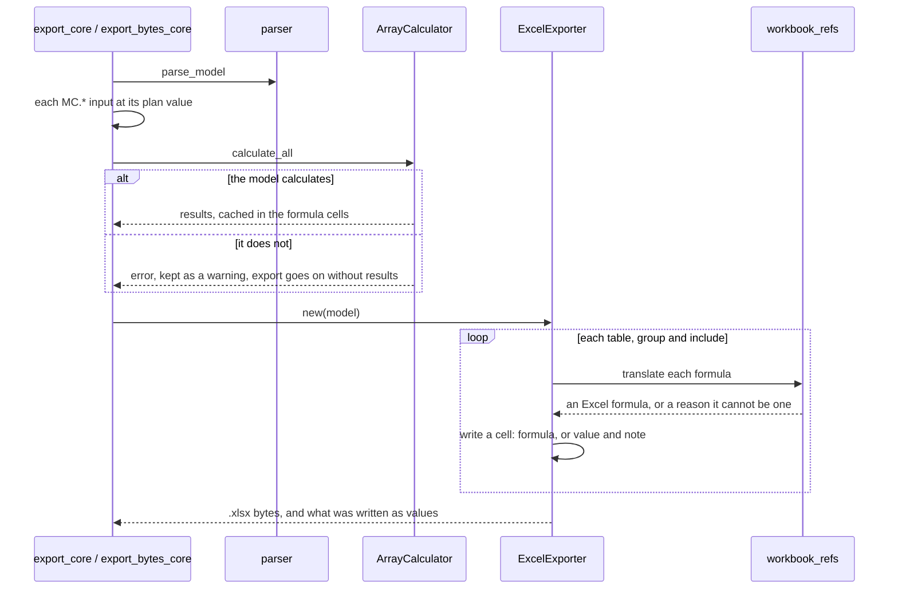

# 05 - Excel integration

How `forge export` writes a model as an `.xlsx` workbook with live formulas, and how `forge import` reads one back. Both need the `excel` feature (part of the default build, and of forge-wasm, so Forge Studio exports and imports too).

| | Code | Library |
| --- | --- | --- |
| Export | `src/excel/exporter.rs`, `src/excel/exporter/` | `rust_xlsxwriter` |
| Import | `src/excel/importer/` | `calamine` |
| Formula translation, both ways | `src/excel/workbook_refs.rs`, `src/excel/workbook_refs/` | Forge's own tokenizer |
| The commands' cores | `src/cli/commands/excel_io/` (`export_core`, `export_bytes_core`, `import_core`, `import_text_core`) | |
| What is carried and what is not, in the output | `src/cli/commands/carried.rs` | |

Decisions: ADR-033 (export), ADR-034 (import), ADR-054 (dates), ADR-061 (number formats), ADR-064 (array constants).

## One picture of the workbook

Export and import share one layout, so a model exported and imported again comes back with the same formulas:

- A **table** is a sheet named after it, columns in the model's order.
- A **group** `g` is a sheet `g` with `Name` and `Value`; scalars outside any group go on a sheet `Scalars`; an included file's on `{namespace}.Scalars`.
- A formula cell holds the formula and Forge's calculated result as its cached value, so a viewer that does not recalculate (Quick Look, iOS Files) shows Forge's number.
- `unit:`, `notes:` and the other metadata go into cell notes; `format:` becomes the cell's number format.

## Translating formulas

`workbook_refs.rs` translates token by token, resolving every name the way the calculator does ([02](02-DATA-MODEL.md#names)), so a formula means the same in Excel as in Forge:

| Forge | Excel (the bagel example) |
| --- | --- |
| `=dozens * assumptions.price_per_dozen` in `months` | `=C2 * 'assumptions'!$B$2` |
| `=dozens * 12 / assumptions.bagels_per_kg_flour * @costs.ingredients.flour_per_kg` | `=C2 * 12 / 'assumptions'!$B$6 * 'costs.Scalars'!$B$2` |
| `=SUM(months.revenue)` in the `year` group | `=SUM('months'!$D$2:$D$13)`, an array formula over the column |
| `=PREV(closing, loan.principal)` | the first value in the first row, the cell above in the others (`excel/previous_rows.rs` reads it back as `PREV`) |
| A date | a date serial with a date format (`workbook_refs/dates/`, ADR-054) |

Import runs the reverse (`workbook_refs/reverse.rs`): each cell reference becomes the Forge name of what is in that cell.

## What Excel cannot hold

A formula Excel cannot express with the same meaning is not written as text. It is written as its calculated value, with a cell note and a warning in the command's output:

Some parts of a model have no Excel equivalent at all and are listed as not exported: `scenarios`, the analysis sections (`tornado`, `monte_carlo`, ...), `better:` and comments. The YAML file stays the source of truth ([README](../../README.md#status-and-known-limitations)). `forge import` brings a value-only cell back as a value; it does not recreate the distribution or the scenarios.

## Export

`export_bytes_core` returns the workbook as bytes (forge-wasm, the MCP tool's inline answer); `export_core` writes a file.

## Import

`ExcelImporter` (`src/excel/importer/`) reads each sheet: a sheet whose header is `Name`, `Value` holds scalars, any other sheet is a table (`importer/table.rs`, `importer/layout.rs` find where a table starts and ends). Formulas are translated with every sheet's layout known, so a reference to another sheet becomes the right Forge name. The result is a `ParsedModel`, written as:

- by default, one YAML file in the format the model needs (the bagel comes back as 5.4.0, for its `format:`), with each `{namespace}.Scalars` sheet written as an included file beside it;
- with `--multi-doc`, one file with a document per sheet (ADR-052);
- with `--split-files`, one file per sheet (refused when sheets refer to each other).

The output ends with whether every formula came in as a formula (`carried.rs`).

## How it is checked

- Each Gnumeric case is calculated by Forge, exported, recalculated by Gnumeric (or LibreOffice), and imported back: a formula that does not survive the round trip fails ([07](07-TESTING-ARCHITECTURE.md)).
- A property test exports and imports generated models and compares the numbers (`properties` in `src/lib.rs`).
- Studio's `excel.mjs` checks that the workbook Studio downloads is the one `forge export` writes.
