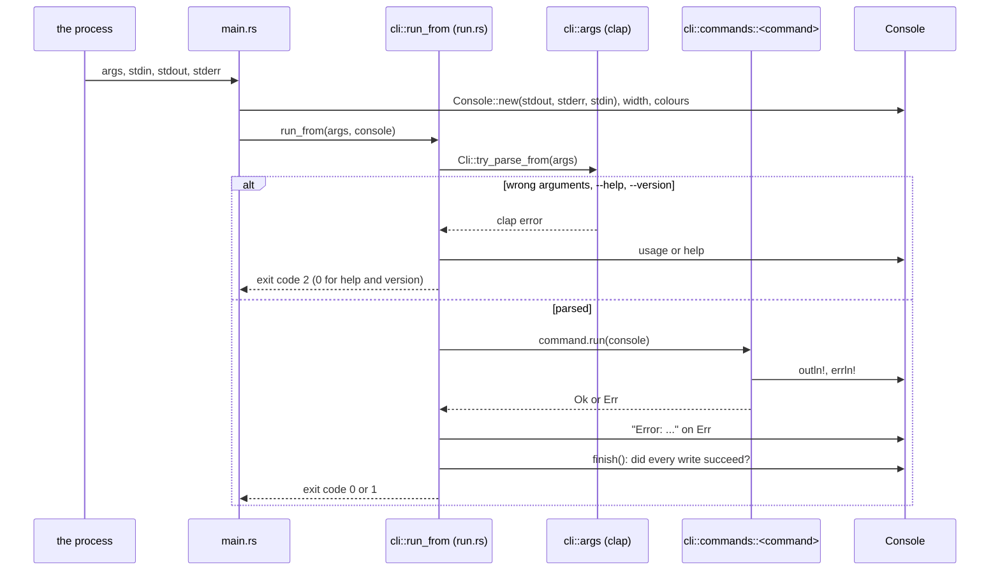
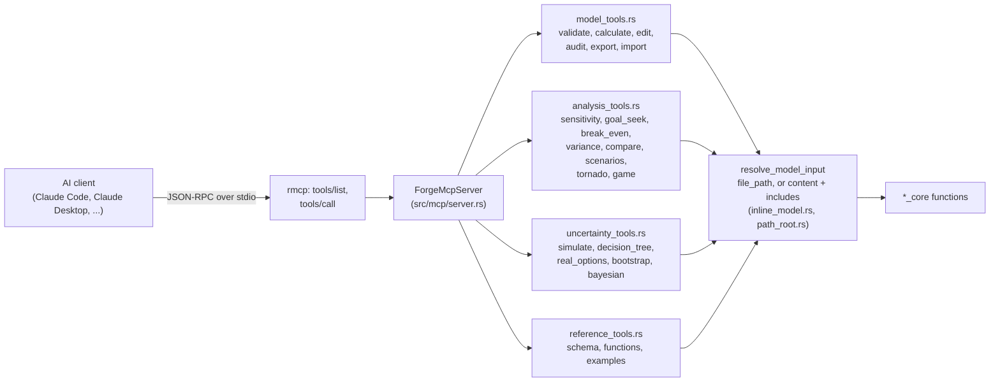
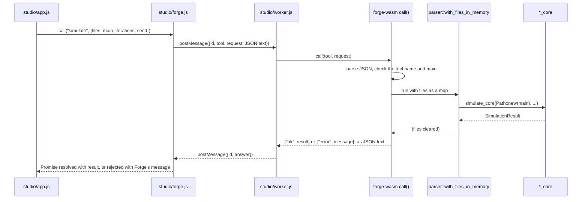

# 06 - Interfaces

The four ways into the engine: the command line, the MCP server, the REST API and the browser. Each is a thin layer over the same `*_core` functions ([01](01-COMPONENT-ARCHITECTURE.md#one-core-four-doors)). This page covers the command line, MCP and the browser; the REST API has its own page, [08](08-API-SERVER-ARCHITECTURE.md).

| Door | Started by | Transport | Code | User docs |
| --- | --- | --- | --- | --- |
| Command line | `forge <command>` | arguments, stdout and stderr, exit code | `src/main.rs`, `src/cli/` | `forge --help`, [FEATURES.md](../FEATURES.md) |
| MCP server | `forge mcp [--root DIR]` | MCP (JSON-RPC) over stdio, rmcp | `src/mcp/` | [docs/MCP.md](../MCP.md) |
| REST API | `forge serve [--root DIR] [--token ...]` | HTTP and JSON, axum | `src/api/` | [08](08-API-SERVER-ARCHITECTURE.md) |
| Browser | Forge Studio loads forge-wasm in a worker | `call(tool, request)`, JSON text both ways | `forge-wasm/src/lib.rs`, `studio/` | [studio/README.md](../../studio/README.md) |

## The command line

The parts that make the command line testable without starting a process:

- **`run_from` is the whole program.** `main.rs` only builds a `Console` on the process's streams and turns `run_from`'s `u8` into the exit code. A test calls `run_from` with buffers (`cli::forge` in tests) and reads exactly what a user would see, colours and exit code included. CLAUDE.md requires this: a test of the command line calls the same code in-process.
- **`Console` collects write failures.** A command writes with `outln!` and `errln!` as it would with `println!`; a failed write (a full disk, a closed pipe) is kept, later writes are skipped, and `finish` reports it once. So a command's code has no error path per line.
- **`--help` text is the manual.** Each command's `long_about` in `src/cli/args.rs` holds its examples; `validation/repo` checks that the README's and docs' commands exist and print what they show.
- **The servers are commands too.** `forge mcp` and `forge serve` are arms of the same `Commands` enum; `starts_a_server` tells `main.rs` not to end quietly when a client disconnects.

## The MCP server

`forge mcp` serves the Model Context Protocol over stdin and stdout with the rmcp SDK (ADR-048). Each tool is a method with `#[tool(name = "forge_...", description = "...")]`; rmcp builds the tool list, the JSON schema of each request type (`src/mcp/types.rs`, `schemars`) and the routing.

A tool handler:

1. turns its request into a path: `file_path` as given (checked against `--root` when there is one), or `content` and `includes` written to a temporary folder (`inline_model.rs`, ADR-049: a sandboxed client cannot share files with the server);
2. calls the command's core;
3. serializes the result with `serde_json`, rounding numbers to 15 digits (`precision::Rounded`), and for inline content with results written back, adds the calculated file's text as `calculated_content`.

An error is returned as the tool's error text, never as a panic or a closed connection. The server's instructions (`INSTRUCTIONS` in `src/mcp/server.rs`) tell an agent how to start a model; a test checks the number of tools it lists, and CI's `mcp-smoke` job runs the built binary over a real stdio session.

## The browser: forge-wasm and Forge Studio

Forge Studio calculates nothing itself: every number on the page is an answer from forge-wasm, which runs the same cores in WebAssembly (ADR-055, ADR-056).

- **One function.** `call(tool, request)` takes the tool's name (the MCP tool's without `forge_`) and JSON text, and returns JSON text. `TOOLS` in `forge-wasm/src/lib.rs` lists them; `STUDIO_TOOLS` adds `model`, the parsed structure Studio draws its cards from.
- **Files in memory, not on disk.** The request's `files` map (the main model and every file it includes, by the path written in `_includes`) is held in a thread-local for the length of the call (`src/parser/memory.rs`). `parse_model` and `read_model_text` read from it, so every core runs unchanged. Nothing is written back: Studio's changes to the YAML text are forge-wasm's `edit` (ADR-075) and calls `calculate` again.
- **A worker.** A long simulation runs off the page's thread; `forge.js` matches answers to requests by `id`.
- **The same answers.** CI's `forge-wasm` job runs every case of `forge-wasm/tests/cases.json` through the WebAssembly module in Node and natively, and fails on any difference; Studio's screen tests compare what the page shows with `forge calculate` run natively ([07](07-TESTING-ARCHITECTURE.md#webassembly-and-studio)).
- **A budget.** The gzipped module must stay under the ceiling of ADR-070; the CI summary prints its size.

- **A model in a link.** `studio/link.js` opens a model from the part of an address after `#`: `name=`, `yaml=` (percent-encoded text) and `gzip=` (gzipped, base64url), the first file the main one (ADR-080). A fragment never reaches a server, so the model stays in the tab; the query carries only `?example=` and `&model=`. A fragment is read whole or not at all, and Studio asks before it replaces files that are the person's own. `studio/tests/link.mjs` fails if any request carries part of a model.
- **A policy.** `studio/index.html` has a Content Security Policy that limits scripts, workers and every request to the page's own address, so a missed escape cannot run a script or send a model elsewhere. A feature that needs another origin changes the policy in an ADR.

What the page itself owns (views, editing a line of YAML, suggestions, offline caching) is in [studio/README.md](../../studio/README.md#how-it-is-built).

## Keeping the doors in step

A change to a command touches each door that exposes it. The table says what each door has, so nothing is left behind:

| Concern | Command line | MCP | REST | forge-wasm | Studio |
| --- | --- | --- | --- | --- | --- |
| Arguments | `src/cli/args.rs` | `src/mcp/types.rs` | `src/api/handlers.rs` | `run_on_files` in `forge-wasm/src/lib.rs` | `studio/tools.js` (Tools view) |
| Model from text | no | `content`, `includes` | `content`, `includes` | `files` | the open set |
| Writes the file | yes, unless `--dry-run` | yes, unless `dry_run` | yes, unless `dry_run` | never | never (edits text) |
| Listed in | `forge --help` | the tool count test, [MCP.md](../MCP.md) | [08](08-API-SERVER-ARCHITECTURE.md) | `TOOLS` | [studio/README.md](../../studio/README.md) |

[10](10-EXTENDING-FORGE.md#add-a-command) is the checklist.
