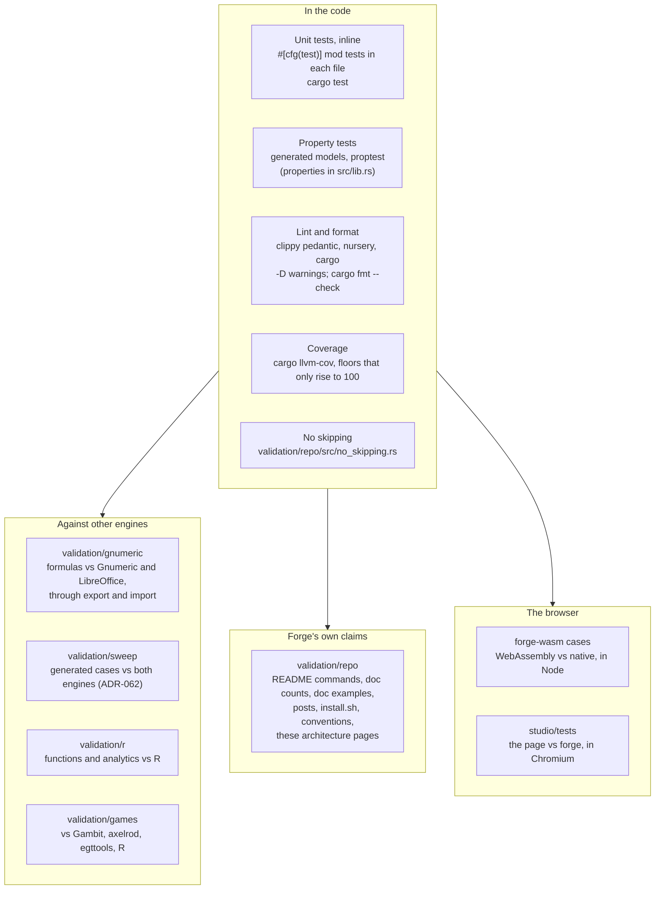
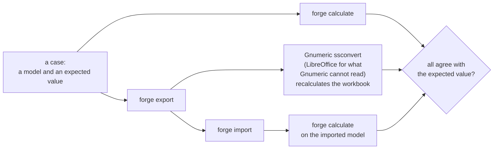
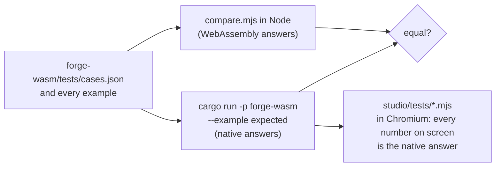
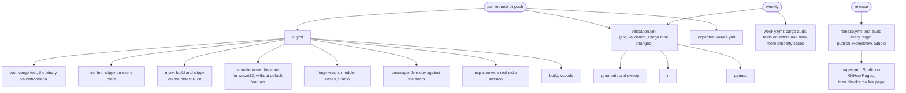

# 07 - Testing architecture

What checks a change to Forge, where each check lives, and which ones run on a pull request. The rules themselves are in [CLAUDE.md](../../CLAUDE.md); what has been compared with which outside engine, and the results, is in [VALIDATION.md](../../VALIDATION.md). This page is the map between them.

## The layers of checks



Everything in the code, the claims and the browser runs on every pull request; the suites against other engines run on pull requests that touch `src/`, `validation/` or `Cargo.toml`, and weekly.

## Unit tests

- **Inline, always.** Every test is in a `#[cfg(test)] mod tests` in the file it tests; there is no `tests/` folder in any crate and no test module in a file of its own. `no_skipping.rs` counts both, at a budget of zero.
- **In-process.** A test of a command calls `cli::run_from` with buffers (`cli::forge` in tests) or the command's core; a test of an MCP tool calls its handler, or a client over an in-memory transport (`src/mcp/mod.rs`). No test starts the binary, except the coverage script's run of `main` and MCP over real stdio (`scripts/coverage.sh`).
- **Exact numbers.** A result is compared with `assert_exact!` (the same bits) when the value is known exactly, or with a stated tolerance when it is approximate. The expected value comes from Excel, Gnumeric, R or a closed form, never from Forge's own output.
- **Example models are tests.** The tests in `src/cli/commands/examples/mod.rs` (`bagel_example` and others) run each example and assert the numbers its README states, each checked against a calculation written outside Forge.
- **`test-data/`** holds models and workbooks the tests read.

## Property tests

`properties` in `src/lib.rs` generates models (tables of three to eight rows, numbers from 1e-6 to 1e12, empty cells, formula columns and scalars over them) and checks four rules that need no reference engine:

1. `format:` never changes a value (ADR-061).
2. `forge export` then `forge import` gives back the same numbers.
3. Calculating gives the same output every time, and calculating the file it wrote changes nothing.
4. A seeded simulation gives the same numbers every time.

CI fixes the seed (`PROPTEST_RNG_SEED=1`), so a pull request sees the same cases; the weekly workflow draws many more from a new seed it prints. A failure found by proptest becomes an ordinary unit test. Saved failing cases are in `src/lib.proptest-regressions`.

## Gates that cannot be switched off

| Gate | Enforced by | Notes |
| --- | --- | --- |
| 100% coverage: lines, functions, regions | CI job `coverage` (floors in `.github/workflows/ci.yml`, which only rise), `make coverage` (fails below 100) | Measured by `scripts/coverage.sh`: the tests, then the built program for `main` and MCP. No `cfg(coverage)` code, no `coverage(off)` |
| Pedantic clippy on stable and on the oldest supported Rust | CI jobs `lint`, `msrv`, `core-browser`, `forge-wasm` | `pedantic`, `nursery` and `cargo` groups in every crate; no `allow` or `expect` attributes (a budget that only falls) |
| Formatting | CI job `lint`, the pre-commit hook (`.cargo-husky/hooks/pre-commit`) | No `rustfmt::skip` |
| No file over 1,500 lines, tests included | `no_skipping.rs` | Split by what the code does |
| No crate in two versions | `clippy.toml` (`allowed-duplicate-crates`), counted in `no_skipping.rs` | Only the maintainer may allow one, for a core library with no fix on our side |

`no_skipping.rs` keeps a budget for each way round these rules (lint attributes, lints allowed in a `Cargo.toml`, coverage-only code, ignored tests, formatting skips, test files outside the code, allowed duplicate crates). A count that rises fails the test; a count that falls fails it too until the budget is lowered in the same change, so the budgets only fall.

## Against other engines

The suites in `validation/` are workspace crates (`gnumeric`, `r`, `repo`) or Python and R scripts (`games`, `sweep`). They run the built binary, as a user would, against engines Forge does not share code with (ADR-037, ADR-057).



| Suite | Compares | With | Runs |
| --- | --- | --- | --- |
| `validation/gnumeric` | Every formula case in its spec files | Gnumeric, LibreOffice | `validation.yml`, on pull requests that touch `src/`, `validation/` or `Cargo.toml`, and weekly |
| `validation/sweep` | Generated arguments, drawn from a seed toward the edges | Gnumeric and LibreOffice | `validation.yml`: a few thousand cases per pull request, many more weekly (ADR-062) |
| `validation/r` | Math, date and financial functions; the analytics (simulation, bootstrap, tornado, ...) | R | `validation.yml` |
| `validation/games` | Equilibria, tournaments, dynamics, games of many players | Gambit, axelrod, egttools, R | `validation.yml` |
| `validation/mermaid` | Every ` ```mermaid ` block of every Markdown file renders | mermaid 12.3.0 in Chromium, as GitHub draws it | `diagrams.yml`, on pull requests and pushes to main that change a Markdown file |

An expected value is never changed silently: a pull request that changes or removes one must say so in its title and give each new value's source (`expected-values.yml`, ADR-057).

## What Forge says about itself

`validation/repo` (crate `mollendorff-forge-repo`) checks the repository's documents against the code and the binary, so a claim cannot drift:

| Module | Checks |
| --- | --- |
| `readme_commands.rs` | Every `$ forge ...` block in the README runs and prints what the README shows |
| `help_examples.rs` | Every example in `forge <command> --help` uses a command and flags Forge has; the whole models the help shows (bayesian, bootstrap, decision-tree, real-options) run with their examples |
| `doc_counts.rs` | Function counts, test counts and stale wording in the README and docs |
| `doc_examples.rs` | Every model in `docs/EXAMPLES.md` runs and gives the numbers shown |
| `posts.rs` | The numbers in `docs/posts/` are what Forge prints |
| `workflows_doc.rs` | `docs/WORKFLOWS.md` names only commands the binary has, and links only to pages that exist |
| `install_script.rs` | `install.sh` downloads what the release workflow publishes |
| `conventions.rs` | The conventions in `.asimov/project.yaml` that a test can check |
| `architecture_docs.rs` | These architecture pages: every link resolves, every path they name exists, every ADR is in the index |
| `no_skipping.rs` | The budgets above |

## WebAssembly and Studio



CI's `forge-wasm` job lints and tests forge-wasm natively, builds the module, checks its size against ADR-070's budget, compares every case's WebAssembly answer with the native one, builds Studio and runs its tests (the page holds no calculation code, every scalar and grid cell is Forge's, edits change one line, offline works, the layout fits a 320 px screen, ...). [studio/README.md](../../studio/README.md#how-it-is-checked) lists each test.

## Which workflow runs what



## Running it locally

```bash
cargo test                                  # unit and property tests of the crate
cargo test -p mollendorff-forge-repo        # the repository checks (builds the binary first)
cargo test -p forge-wasm --release          # forge-wasm, natively
make lint                                   # clippy with -D warnings, as CI
cargo fmt --all -- --check
make coverage                               # needs cargo-llvm-cov; fails below 100
```

The outside-engine suites need Gnumeric, LibreOffice, R or Python packages; each folder's README says how to run it.
