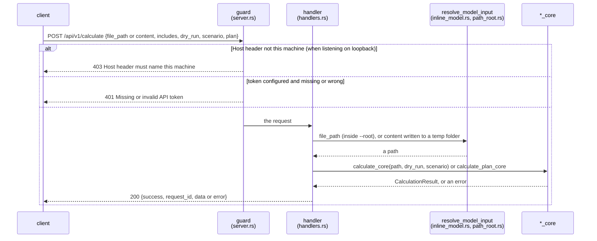
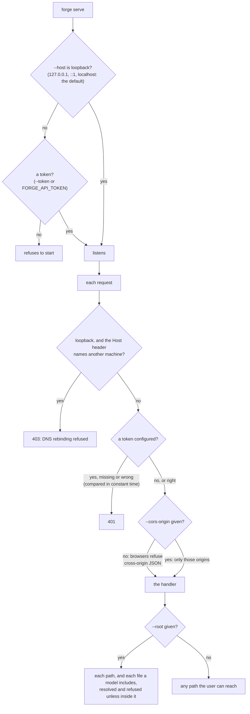

# 08 - REST API

`forge serve` runs an HTTP API for systems that cannot speak MCP or run a command: five operations on model files (validate, calculate, audit, export, import), with JSON in and out. It is a thin layer like the others ([06](06-INTERFACES.md)): the handlers call the same core functions as the MCP tools.

It is not a full mirror of the command line. The analyses (simulate, scenarios, tornado, goal seek, games and the rest) are reached through the command line, MCP or forge-wasm. ADR-001 explains why HTTP and not gRPC.

| | Code |
| --- | --- |
| Configuration, router, security layer, serving | `src/api/server.rs` (`ApiConfig`, `build_router`, `guard`, `run_api_server`) |
| Request and response types, handlers | `src/api/handlers.rs` |
| A model sent as text | `src/inline_model.rs` |
| `--root` | `src/path_root.rs` |
| Arguments of `forge serve` | `ServeArgs` in `src/cli/args.rs` |

## A request



## Endpoints

| Method and path | Request | Calls | Answer's `data` |
| --- | --- | --- | --- |
| `GET /` | | | name, version, the endpoint list |
| `GET /health` | | | status |
| `GET /version` | | | the Forge version |
| `POST /api/v1/validate` | a model source | `validate_core` | `valid`, `message`, `result` (`ValidationResult`) |
| `POST /api/v1/calculate` | a model source, `dry_run`, `scenario`, `plan` | `calculate_core`, or `calculate_plan_core` when `plan` | `calculated`, `result` (`CalculationResult`), and `calculated_content` for inline content written back |
| `POST /api/v1/audit` | a model source, `variable` | `audit_core` | `audited`, `result` (`AuditResult`) |
| `POST /api/v1/export` | `yaml_path`, `excel_path` | `forge export`'s function, with its output discarded | `exported`, the paths |
| `POST /api/v1/import` | `excel_path`, `yaml_path` | `forge import`'s function, with its output discarded | `imported`, the paths |

A **model source** is flattened into the request: either `file_path` (a path on the server), or `content` (the YAML text) with `includes` (the text of each `_includes` entry, by its `as` name). Export and import take paths only.

Every answer has the same envelope (`ApiResponse`): `success`, a `request_id` (a UUID), and `data` or `error`. Numbers in `data` are rounded to 15 significant digits, as everywhere Forge writes a number.

A model that fails to validate, calculate, export or import is not an HTTP error: the answer is `200` with `success: true`, and `data` says so (`valid: false`, `calculated: false`, `exported: false`, ...) with Forge's message in `message`. `401` and `403` come only from the guard; a body that is not the request's JSON is refused by axum before the handler (`400` or `422`). `ApiResponse::err` exists, but no handler uses it yet.

## Security

The API reads and writes the files a request names, with the permissions of the user who runs it. So it starts closed (`ApiConfig` and `ApiConfig::check` in `src/api/server.rs`):



| Setting | Flag | Environment | Default |
| --- | --- | --- | --- |
| Address | `--host`, `--port` | `FORGE_HOST`, `FORGE_PORT` | `127.0.0.1:8080` |
| Token on `/api/v1/*` | `--token` | `FORGE_API_TOKEN` | none (required off loopback) |
| Browser origins | `--cors-origin` (repeatable) | | none |
| Folder every path stays in | `--root` | | none |

`--root` limits what requests name; it is not a sandbox (a process that can change links inside the root while a request runs can get around it, as `src/path_root.rs` says).

## Running and tests

`run_api_server` binds, serves until Ctrl+C or SIGTERM, and shuts down gracefully. Its tests run in-process: `build_router` is exercised with axum's `oneshot` for every endpoint and every refusal, and one test serves on a free port until told to stop, so the whole server is covered without a separate process.

```bash
forge serve                                   # 127.0.0.1:8080, no token needed
FORGE_API_TOKEN=... forge serve --host 0.0.0.0 --root /srv/models
curl -s localhost:8080/api/v1/calculate -H 'Content-Type: application/json' \
  -d '{"file_path": "model.yaml", "dry_run": true}'
```
