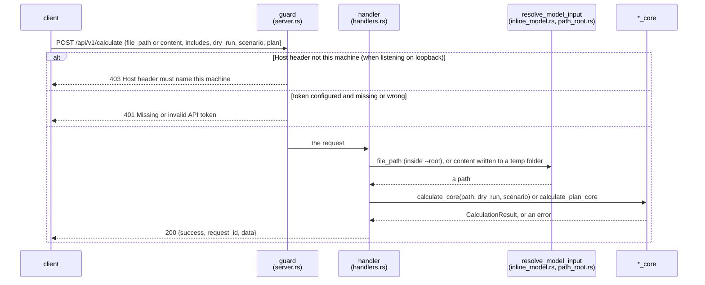
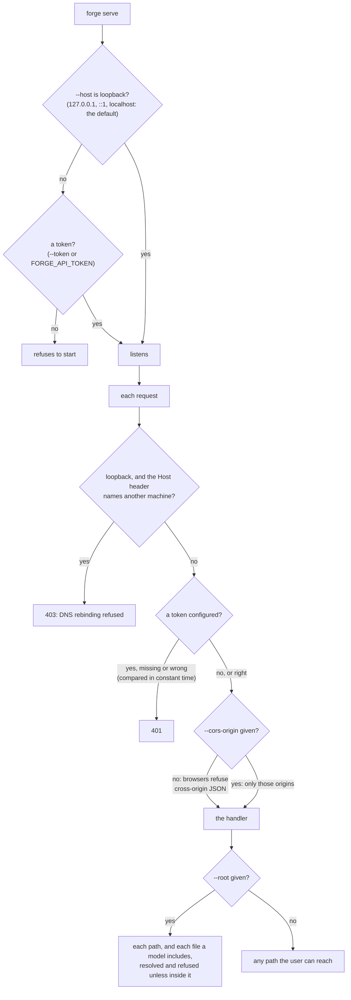

# 08 - REST API

`forge serve` runs an HTTP API for systems that cannot speak MCP or run a command: every MCP tool, with JSON in and out: five endpoints of their own on model files (validate, calculate, audit, export, import), and one for each other tool (simulate, goal seek, scenarios, tornado, games, `edit`, the discovery tools and the rest), at `POST /api/v1/<name>`. It is a thin layer like the others ([06](06-INTERFACES.md)): the handlers call the same core functions as the MCP tools, and the other endpoints run the tool itself (ADR-081). ADR-001 explains why HTTP and not gRPC.

| | Code |
| --- | --- |
| Configuration, router, security layer, serving | `src/api/server.rs` (`ApiConfig`, `build_router`, `guard`, `run_api_server`) |
| Request and response types, the five handlers | `src/api/handlers.rs` |
| The other tools' routes, `ForgeMcpServer::call`, the OpenAPI document | `src/api/tools.rs` (`routes`, `served`, `openapi`) |
| A model sent as text | `src/inline_model.rs` |
| `--root` | `src/path_root.rs` |
| Arguments of `forge serve` | `ServeArgs` in `src/cli/args/options.rs` |

## A request



## Endpoints

| Method and path | Request | Calls | Answer's `data` |
| --- | --- | --- | --- |
| `GET /` | | | `name`, `version`, `description`, `endpoints` |
| `GET /health` | | | `status`, `uptime_message` |
| `GET /version` | | | `version`, `features` (the name of each tool the server serves) |
| `GET /api/v1/openapi.json` | | | An OpenAPI 3.1 document, made when the server starts (below) |
| `POST /api/v1/validate` | a model source | `validate_core` | `valid`, `file_path`, `message`, `result` (`ValidationResult`) |
| `POST /api/v1/calculate` | a model source, `dry_run`, `scenario`, `plan` | `calculate_core`, or `calculate_plan_core` when `plan` (which never writes: `dry_run` is then true) | `calculated`, `file_path`, `dry_run`, `message`, `result` (`CalculationResult`), and `calculated_content` for inline content written back |
| `POST /api/v1/audit` | a model source, `variable` | `audit_core` | `audited`, `file_path`, `variable`, `message`, `result` (`AuditResult`) |
| `POST /api/v1/export` | `yaml_path`, `excel_path` | `export_core` | `exported`, the paths, `message` |
| `POST /api/v1/import` | `excel_path`, `yaml_path` | `import_core` | `imported`, the paths, `message` |

Each of the other 18 tools has an endpoint made from the tool list when the server starts, so a new tool gets its endpoint, its line in `GET /`, its name in `features` and its path in the document with nothing else to write (ADR-081):

| Method and path | Request | Calls | Answer's `data` |
| --- | --- | --- | --- |
| `POST /api/v1/<name>`, the tool's name without `forge_` and with `-` for `_` (`forge_goal_seek` is `/api/v1/goal-seek`) | The tool's arguments, as `tools/call` takes them; no body is no arguments, for a tool that takes none | `ForgeMcpServer::call(name, arguments)`, which reads the request as MCP does and runs the tool's method, which calls the command's core | What the tool answers, as JSON |

The five own endpoints keep their requests and answers, shaped differently from their tools', since clients read them; making them answer as their tools do waits for a version that may break them.

A **model source** is flattened into the request: either `file_path` (a path on the server), or `content` (the YAML text) with `includes` (the text of each `_includes` entry, by its `as` name). Export and import take paths only.

Every answer from a handler has the same envelope (`ApiResponse`): `success`, a `request_id` (a UUID), and `data`. A tool endpoint's failure has the same envelope with `success: false` and `error`, in place of `data`: **`422`** when the tool fails or its arguments are not its request (the message is the one MCP answers as `isError`), and **`400`** when the body is not JSON. Numbers in `data` are rounded to 15 significant digits, as everywhere Forge writes a number.

For the five own endpoints, a model that fails to validate, calculate, export or import is not an HTTP error: the answer is `200` with `success: true`, and `data` says so (`valid: false`, `calculated: false`, `exported: false`, ...) with Forge's message in `message`. So `ApiResponse` has only `ok`. For these five, every other status comes before a handler, and none of them is in the envelope:

| Status | From | Body |
| --- | --- | --- |
| `403` | the guard: a `Host` header that does not name this machine, when listening on loopback | `{"error": "Host header must name this machine"}` |
| `401` | the guard: a token is configured and the request to `/api/` has none, or another | `{"error": "Missing or invalid API token"}`, with `WWW-Authenticate: Bearer` |
| `415`, `400`, `422` | axum's `Json`: no `Content-Type: application/json`, JSON that does not parse, JSON that is not the request's shape | axum's message, as text |
| `404`, `405` | axum's router: no such path, or not its method | empty |

## The OpenAPI document

`GET /api/v1/openapi.json` answers an OpenAPI 3.1 document built when the server starts (`openapi` in `src/api/tools.rs`), with a path for every endpoint above, itself included. Each tool's request body is the schema `tools/list` gives the tool, its `$defs` moved to `components.schemas`; the five own endpoints' bodies are schemars' schemas of their request types. OpenAPI 3.1's schema objects are JSON Schema 2020-12, which schemars writes, so no schema is translated. The document says each answer's envelope and not the shape of `data`: the MCP tools declare no output schema either. Tests check that every reference resolves, every schema is valid, the operation ids are unique, and each tool's body is its listed schema; and that every served tool answers over REST what it answers over MCP (ADR-081).

## Security

The API reads and writes the files a request names, with the permissions of the user who runs it. So it starts closed (`ApiConfig` and `ApiConfig::check` in `src/api/server.rs`):



| Setting | Flag | Environment | Default |
| --- | --- | --- | --- |
| Address | `--host`, `--port` | `FORGE_HOST`, `FORGE_PORT` | `127.0.0.1:8080` |
| Token on `/api/v1/*` | `--token` | `FORGE_API_TOKEN` | none (required off loopback) |
| Browser origins | `--cors-origin` (repeatable) | | none |
| Folder every path stays in | `--root` | | none |

The token and `--root` hold for every endpoint, the tools' included. `--root` limits what requests name; it is not a sandbox (a process that can change links inside the root while a request runs can get around it, as `src/path_root.rs` says).

## Running and tests

`run_api_server` binds, serves until Ctrl+C or SIGTERM, and shuts down gracefully. Its tests run in-process: `build_router` is exercised with axum's `oneshot` for every endpoint and every refusal, and one test serves on a free port until told to stop, so the whole server is covered without a separate process.

```bash
forge serve                                   # 127.0.0.1:8080, no token needed
FORGE_API_TOKEN=... forge serve --host 0.0.0.0 --root /srv/models
curl -s localhost:8080/api/v1/calculate -H 'Content-Type: application/json' \
  -d '{"file_path": "model.yaml", "dry_run": true}'
```
