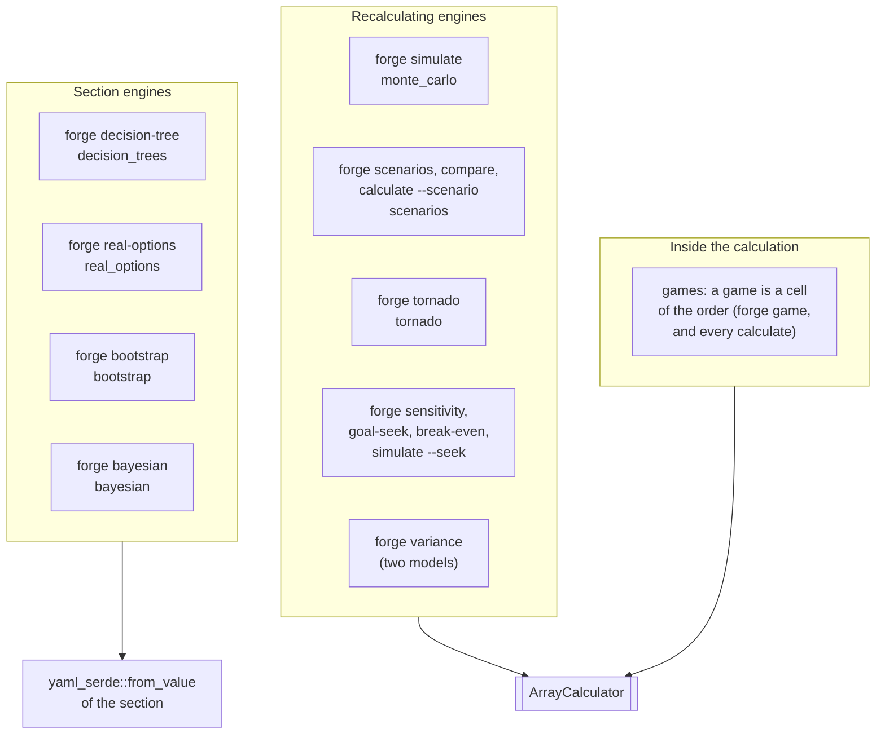
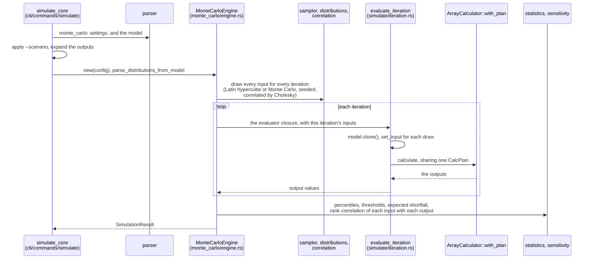
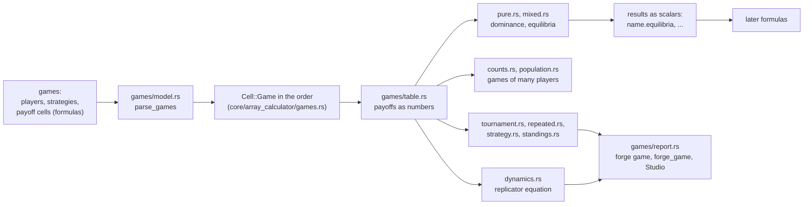

# 09 - Analysis engines

What Forge does beyond calculating a model once: simulation, scenarios, sensitivity, searches, decision trees, real options, bootstrap, Bayesian networks and games. Each has a module (or a command) of its own, and the decision behind it is an ADR. ADR-050 keeps all of them supported.

## Two kinds of engine

| Kind | Reads | Numbers come from | Example |
| --- | --- | --- | --- |
| **Recalculating** | The whole model, through `parse_model`, and its own section (`monte_carlo:`, `tornado:`, `scenarios:`) | Calculating the model with some inputs changed: `ParsedModel::override_scalar` or `set_input`, then `ArrayCalculator` | `forge tornado` moves each input to its low and high value and calculates `year.profit` each time |
| **Inside the calculation** | `games:`, whose payoff cells are formulas over the model | The game is one cell of the order; its results are scalars later formulas read ([04](04-DEPENDENCY-RESOLUTION.md#games)) | `price_war.equilibrium_1.lune.payoff` |
| **Section** | Only its own top-level section, deserialized into a config struct | The numbers written in that section | `forge decision-tree` reads `decision_tree:`'s nodes and values |

Most section engines do not read the model's formulas: a value in a decision tree is a number, not `=year.profit`. The Bayesian network is the exception (ADR-074): a prior or a table entry may be a formula over the model's scalars, and its named queries' posteriors are scalars later formulas read, so it is a cell of the calculation as a game is ([04](04-DEPENDENCY-RESOLUTION.md#bayesian-networks)); `forge bayesian --scenario` works it out under a scenario. For the other section engines, a test can tie the two: `decision_tree.rs`'s tests calculate the model and check that the tree's written values are its results.

## A recalculating engine: Monte Carlo

The simulation shows the pattern every recalculating engine follows.

- **The engine does not know the calculator.** `MonteCarloEngine::run_with_evaluator` takes a closure from inputs to outputs. The command supplies one that calculates the model; the engine's own tests supply simple functions. This keeps `monte_carlo/` testable on its own.
- **One plan for every iteration.** The iterations have the same names and formulas, so the order and the parsed formulas are worked out once (`CalcPlan`, [03](03-FORMULA-EVALUATION.md#caching-between-calculations)).
- **Determinism.** A seed gives the same draws, and the same draws for two runs that differ in one input, so `simulate --seek` compares like with like (ADR-016, [STABILITY.md](../STABILITY.md)). Iterations run in sequence, not in parallel (ADR-017), which also keeps the module free of threads for the browser.
- **A summary that is always a number.** `Statistics::from_samples` works each figure out the plain way and, only when that overflows although every sample is finite, again on samples divided by a power of two. The mean (`monte_carlo::statistics::mean`) is that one wherever it is used (statistics, expected shortfall, each input's mean); the variance is `None` when it exceeds the largest `f64`, and a histogram wider than that is cut in halves (ADR-079). The spreadsheet functions are unchanged: `=STDEV(-1E+307, 1E+307)` is `#NUM!`, as in Excel.
- **The plan value.** Each `MC.*` input has a `value:`, its plan figure; `forge simulate` prints each output at plan beside its mean, and `forge calculate --plan` (`calculate_plan_core`) calculates the whole model at plan (ADR-076).

The other recalculating engines are simpler versions of the same loop:

| Command | Loop | Module | Decision |
| --- | --- | --- | --- |
| `forge scenarios`, `compare`, `calculate --scenario` | Each scenario's overrides applied, the model calculated; probabilities weigh the results | `src/scenarios/`, `src/cli/commands/prediction/scenarios.rs`, `compare.rs` | ADR-018, ADR-067, ADR-074 |
| `forge tornado` | Each input at its low and its high value, alone | `src/tornado/` | ADR-021 |
| `forge sensitivity` | An output for each value of one input, or a table for two | `src/cli/commands/analysis/sensitivity.rs` | |
| `forge goal-seek`, `break-even` | Bisection on one input until the output reaches the target (`calculate_scalar`) | `src/cli/commands/analysis/goal_seek.rs` | |
| `forge simulate --seek` | Bisection on one input, a whole simulation per step, the same draws each time | `src/cli/commands/probability_seek.rs` | ADR-076 |
| `forge variance` | Two models calculated, compared line by line, with `better:` saying which way is good | `src/cli/commands/analysis/variance.rs` | ADR-002 |

## Section engines

| Command | Section | Module | What it does | Decision |
| --- | --- | --- | --- | --- |
| `forge decision-tree` | `decision_tree:` | `src/decision_trees/` | Backward induction over decision and chance nodes; the policy, the expected value and the risk profile | ADR-019 |
| `forge real-options` | `real_options:` | `src/real_options/` | Black-Scholes and binomial trees for defer, expand, contract, abandon and switch options | ADR-020 |
| `forge bootstrap` | `bootstrap:` | `src/bootstrap/` | Resampling with replacement, seeded; percentile, basic and BCa intervals | ADR-022 |
| `forge bayesian` | `bayesian_network:` | `src/bayesian/` | Discrete networks, exact inference with evidence by variable elimination | ADR-023 |

Each module has the same parts: `config.rs` (the section's struct, deserialized with serde, and its `validate`), `engine.rs` (the algorithm and its result types), and `mod.rs` (the public names, and tests of the whole engine). `real_options` adds `black_scholes.rs` and `binomial.rs`; `bayesian` adds `inference.rs` (variable elimination). The command in `src/cli/commands/prediction/` reads the section, builds the engine, and prints or returns the result.

## Games

Games are the newest engine and sit between the two kinds: their payoffs are formulas over the model, and their results are values the model reads (ADR-068, ADR-073).

The game theory is checked against Gambit (equilibria), the axelrod library (tournaments), egttools (dynamics) and R (closed forms, games of many players) in `validation/games/`.

## Adding an engine

[10](10-EXTENDING-FORGE.md#add-an-analysis-engine) has the checklist. Choose the kind first: if the engine's numbers should follow the model's inputs, make it recalculating (a closure over `ArrayCalculator`, as Monte Carlo does) or a cell of the order (as games are), not a section of literal numbers.
