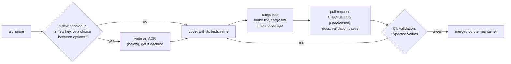
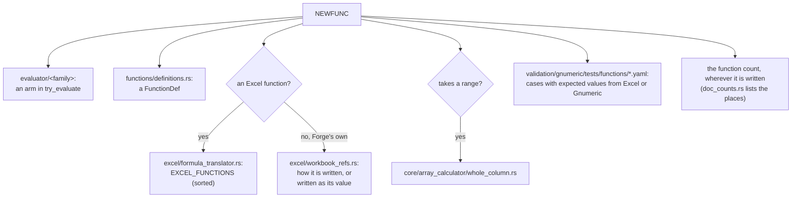
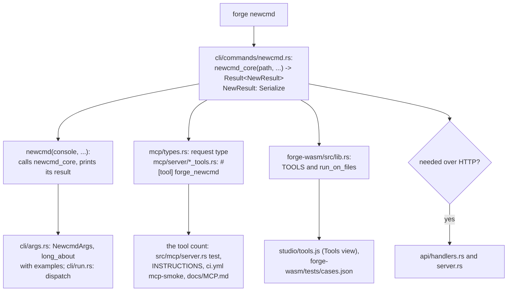

# 10 - Extending Forge

Checklists for the changes people make most often, with every place each one touches. The gates in [CLAUDE.md](../../CLAUDE.md) apply to all of them: 100% coverage, pedantic clippy, inline tests, no file over 1,500 lines, nothing switched off. [CONTRIBUTING.md](../../CONTRIBUTING.md) says what a pull request needs (a CHANGELOG entry, green CI, new validation cases in the same pull request).

## The path of a change

A failing gate is fixed in the code, never by switching the gate off ([07](07-TESTING-ARCHITECTURE.md#gates-that-cannot-be-switched-off)).

## Add a function

1. **Evaluate it.** Add an arm to the `try_evaluate` of the family module it belongs to, under `src/core/array_calculator/evaluator/` (`math`, `text`, `financial`, ...). Check arguments with the shared helpers (`require_args` and others in `evaluator/mod.rs`). Follow Excel's result, including its errors and edge cases; where Excel and Gnumeric differ, Excel wins and the case says why.
2. **List it.** Add a `FunctionDef` to `src/functions/definitions.rs` with its category, Excel-style syntax, a one-line description, and `scalar: true` if it works without a table. `every_listed_function_is_known_to_the_calculator` fails until steps 1 and 2 agree.
3. **Export it.** An Excel function goes into `EXCEL_FUNCTIONS` in `src/excel/formula_translator.rs` (kept sorted; a test checks). A function Excel lacks is written as its value with a note, or translated in `src/excel/workbook_refs.rs` (as `VARIANCE` and the others in `FORGE_FUNCTIONS` are).
4. **Ranges.** If an argument is a range in Excel (`SUMIFS`'s sum range), add it to `whole_column.rs` so a row formula reads the whole column there (ADR-058).
5. **Test it.** Unit tests in the family module with exact expected values; cases in `validation/gnumeric/tests/functions/<family>.yaml` (each recalculated by Gnumeric or LibreOffice after `forge export`); R cases in `validation/r/` for statistics and finance where R has the function.
6. **Count it.** The function count is written in the README, `docs/FEATURES.md`, `docs/MCP.md`, `src/cli/args.rs`, `src/mcp/mod.rs`, `src/mcp/server.rs` and `Cargo.toml`; `doc_counts.rs` fails, naming each place, until they all say the registry's count. Update the comment at the top of `definitions.rs` too (no test reads it). `docs/FUNCTIONS.md` is generated by CI.

Studio's suggestions, `forge functions` and the MCP tool read the registry, so they need nothing more.

## Add a command

1. **The core first.** `newcmd_core` in `src/cli/commands/` takes paths and options and returns a `Serialize` result; it prints nothing and builds without the `cli` feature unless it truly needs it (gate it with `#[cfg(feature = "cli")]` then, and it will not be in the browser).
2. **Print from the core.** The printing function calls `newcmd_core` and formats its result on the `Console` with `outln!`. Several older commands repeat their core's steps instead ([01](01-COMPONENT-ARCHITECTURE.md#the-layers)); a new one should not.
3. **The command line.** Arguments in `src/cli/args.rs`, with a `long_about` that shows real examples; the arm in `src/cli/run.rs`. Test through `cli::forge` (in-process) for output and exit codes.
4. **MCP.** A request type in `src/mcp/types.rs` (with `file_path`, `content`, `includes` if it reads a model), a `#[tool]` method in the right `src/mcp/server/*_tools.rs` that resolves the input with `resolve_model_input` and calls the core. Raise the tool count in its test, in `INSTRUCTIONS`, in `.github/workflows/ci.yml` (`mcp-smoke`) and in `docs/MCP.md`.
5. **The browser.** Add the tool to `TOOLS` and `run_on_files` in `forge-wasm/src/lib.rs`, a case to `forge-wasm/tests/cases.json` so CI compares WebAssembly with native, and, if Studio should offer it, to `studio/tools.js`.
6. **REST**, only if an HTTP client needs it ([08](08-API-SERVER-ARCHITECTURE.md)).
7. **Docs.** `docs/FEATURES.md`, the README's table if it is a headline feature, and an example model if it has a section of its own.

## Add a key or a model format version

A new top-level key, or a new form of an existing one, usually needs a new model format version, so a file of an older format reads exactly as before ([02](02-DATA-MODEL.md#format-versions)).

| Place | What to change |
| --- | --- |
| `schema/forge-v5.N.0.schema.json` | A copy of the last schema with the new key; `schema/forge.schema.json` (the version switch for editors); `schema/README.md` (what the version adds) |
| `editors/vscode/schemas/` | The same files; `editors/vscode/test/schema.js` |
| `src/parser/schema_reader.rs` | `include_str!` the new schema |
| `src/parser/schema.rs` | The version among the known ones; `format_at_least` checks for the key |
| `src/parser/model.rs` (`read_model`) | Read the key, only from its version (`format_at_least(version, "5.N.0")`), so an older file's group of that name still reads as a group |
| `src/types.rs` | Where the parsed value lives in `ParsedModel` |
| `src/writer/mod.rs` | The list of versions that write dates as dates, if the new one should |
| `src/cli/commands/upgrade.rs` | The new target, and what `forge upgrade` must refuse or rewrite |
| `src/cli/commands/schema.rs`, `src/cli/args.rs` | `forge schema v5.N` |
| Tests | Parsing, the refusal in older versions, upgrade, the write-back, an example model |
| An ADR | Why the key, and why this shape |

## Add an analysis engine

1. **Choose its kind** ([09](09-ANALYSIS-ENGINES.md#two-kinds-of-engine)). Prefer one that recalculates the model (its numbers follow the inputs) over a section of literal numbers.
2. **A module of its own** under `src/` with `config.rs` (the section, with serde and `validate`), `engine.rs` (the algorithm and its result types, independent of the calculator: take a closure, as `MonteCarloEngine::run_with_evaluator` does) and `mod.rs`. Add it to `src/lib.rs`; it must build for `wasm32-unknown-unknown` without default features (no threads, no file system, no clock without a fallback).
3. **Its section** in the schema of a new format version (above), and in `ANALYSES` in `src/parser/model.rs` so the model notes it.
4. **A command** for it (above).
5. **Validation** against an independent implementation (R, Python, a published reference) in `validation/`, with the source of every expected value.
6. **An example** under `examples/` and a test that runs it and asserts its numbers.

## Change how the model is calculated

A change in `src/core/array_calculator/` can move numbers in every model. Before opening the pull request:

- run the Gnumeric, R and games suites (or let the Validation workflow run them), not only `cargo test`;
- if an expected value has to change, say `changes expected values` in the title and give the new value's source (`expected-values.yml`);
- check `CalcPlan`: anything cached by the plan must depend only on names and formulas, never on values ([03](03-FORMULA-EVALUATION.md#caching-between-calculations));
- keep dependency finding and evaluation on the same name resolution ([04](04-DEPENDENCY-RESOLUTION.md#finding-what-a-formula-reads)).

## Add a library

Prefer a stable, well-maintained library to code of our own (CLAUDE.md). Two limits:

- **Every crate in one version.** `cargo clippy` fails on a duplicate. If a core library brings one and nothing on our side can fix it, only the maintainer may allow it, in `clippy.toml` with the reason beside it, counted in `no_skipping.rs` in the same change.
- **The browser budget.** Code the browser build includes must keep Forge Studio's WebAssembly under 3,000,000 bytes gzipped (ADR-070); CI's `forge-wasm` job prints the size.

## Write an ADR

A decision that changes behaviour, adds a key, or chooses between real options gets an Architecture Decision Record in this folder:

- **Name:** `ADR-NNN-WHAT-IT-DECIDES.md`, the next number after the highest. A number is never reused, including the ones missing today ([README](README.md#numbers-not-in-the-list)).
- **Header:** `# ADR-NNN: Title`, then `**Status:**`, `**Date:**`, `**Decided by:**` and `**For:**` (the roadmap items). ADR-073 to ADR-077 are good models.
- **Body:** `## Context`, the questions with the options and what was decided, `## What is built, in order`, `## Consequences`.
- **Status:** `Proposed`, then `Accepted` (with the date), then what is built (`built`, or the steps built so far); later `Superseded by ADR-NNN` or `Partly superseded`. When the status changes, change it in the ADR and in the [index](README.md) in the same commit.
- **History:** an ADR is a record of a decision at its date. When the code later moves, add a dated note at the top rather than rewriting the decision; update a path that moved if the note would otherwise mislead.
- **The index:** add a row to [README.md](README.md); the `architecture_docs.rs` check in `validation/repo` fails when an ADR is missing from the index.

## Update these pages

When a change moves something these pages describe (a module, a step of the calculation, a door, a gate), update the page in the same pull request. `validation/repo/src/architecture_docs.rs` checks that every link here resolves and every source path they name exists, so a renamed file is caught; what a page says about it is up to the reviewer.
