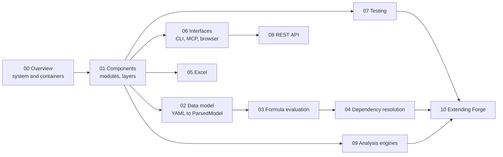

# Forge architecture

How Forge is built, for the people who maintain and extend it: the parts, how a model is read and calculated, the ways in, the checks, and the decisions behind each (the ADRs). Users start at the [main README](../../README.md) and [FEATURES.md](../FEATURES.md) instead.

## Reading order

New to the code: 00, 01 and 07, then the page for what you are changing. Changing something: [10 - Extending Forge](10-EXTENDING-FORGE.md) has the checklist and links back to the page that explains it.

## Pages

| Page | What it covers |
| --- | --- |
| [00 - Overview](00-OVERVIEW.md) | What Forge does, the C4 system context and containers, the repository's folders, the principles |
| [01 - Components](01-COMPONENT-ARCHITECTURE.md) | The modules of the engine crate, the layers and their rules, one core behind four doors, feature builds, where state lives |
| [02 - Data model](02-DATA-MODEL.md) | A model file, how it is read and checked, the types it becomes, names, format versions, writing results back |
| [03 - Formula evaluation](03-FORMULA-EVALUATION.md) | One calculation step by step, formulas to syntax trees, the evaluation context, finding a function, errors, precision, caching |
| [04 - Dependency resolution](04-DEPENDENCY-RESOLUTION.md) | One graph for the whole model, what a formula reads, the order, cycles, `PREV`, includes, games |
| [05 - Excel integration](05-EXCEL-INTEGRATION.md) | The workbook layout, formula translation both ways, what Excel cannot hold, export, import |
| [06 - Interfaces](06-INTERFACES.md) | The command line, the MCP server, forge-wasm and Forge Studio, and keeping the doors in step |
| [07 - Testing architecture](07-TESTING-ARCHITECTURE.md) | Unit and property tests, the gates, the suites against other engines, the repository checks, the browser checks, which workflow runs what |
| [08 - REST API](08-API-SERVER-ARCHITECTURE.md) | `forge serve`: endpoints, requests and answers, security |
| [09 - Analysis engines](09-ANALYSIS-ENGINES.md) | Recalculating and section engines, Monte Carlo step by step, the others, games |
| [10 - Extending Forge](10-EXTENDING-FORGE.md) | Checklists: a function, a command, a key or format version, an analysis engine, a library, an ADR |

Other documents this folder relies on: [CLAUDE.md](../../CLAUDE.md) (the rules), [VALIDATION.md](../../VALIDATION.md) (what is checked against what, with results), [schema/README.md](../../schema/README.md) (the model formats), [studio/README.md](../../studio/README.md) (Forge Studio), [forge-wasm/README.md](../../forge-wasm/README.md), [docs/MCP.md](../MCP.md), [docs/STABILITY.md](../STABILITY.md) and [docs/GLOSSARY.md](../GLOSSARY.md).

The diagrams are [Mermaid](https://mermaid.js.org/), which GitHub draws in place; the overview's are in Mermaid's C4 notation. Edit them as text, like the code.

## Architecture Decision Records

Each ADR records one decision: the context, the options, what was decided and why, and what was built. An ADR is a record at its date; when the code moves on, a dated note is added at its top rather than the decision rewritten. [10](10-EXTENDING-FORGE.md#write-an-adr) says how to write one.

| ADR | Title | Status |
|-----|-------|--------|
| [ADR-001](ADR-001-NO-GRPC.md) | HTTP REST Over gRPC | Accepted |
| [ADR-002](ADR-002-VARIANCE-YAML-ONLY.md) | Variance YAML Only | Accepted |
| [ADR-004](ADR-004-100-PERCENT-TEST-COVERAGE.md) | 100% Test Coverage Requirement | Accepted; enforced since 2026-11-16: CI fails below coverage floors that only rise to 100, and `make coverage` fails below 100 |
| [ADR-005](ADR-005-NO-LSP.md) | No Language Server Protocol | Accepted |
| [ADR-006](ADR-006-COVERAGE-EXCLUSIONS.md) | Coverage Exclusions | Superseded (2026-11-22): no coverage exclusions remain |
| [ADR-007](ADR-007-E2E-GNUMERIC-VALIDATION.md) | E2E Validation via Gnumeric | Accepted |
| [ADR-008](ADR-008-FPA-NATIVE-FUNCTIONS.md) | FP&A-Native Functions | Accepted |
| [ADR-009](ADR-009-YAML-FOR-AI-EFFICIENCY.md) | YAML for AI Token Efficiency | Accepted |
| [ADR-010](ADR-010-GIT-NATIVE-FINANCIAL-MODELING.md) | Git-Native Financial Modeling | Accepted |
| [ADR-011](ADR-011-XLFORMULA-EQUIVALENCE.md) | xlformula_engine Equivalence Testing | Superseded |
| [ADR-012](ADR-012-FEATURE-FLAGS.md) | Feature Flags for Demo/Enterprise | Superseded |
| [ADR-013](ADR-013-FUNCTION-REGISTRY.md) | Function Registry | Implemented |
| [ADR-014](ADR-014-schema-versioning.md) | Schema Versioning | Partly superseded |
| [ADR-015](ADR-015-FUNCTION-SCALAR-CLASSIFICATION.md) | Function Scalar Classification | Partly superseded |
| [ADR-016](ADR-016-monte-carlo-architecture.md) | Monte Carlo Architecture | Accepted (§7 superseded) |
| [ADR-017](ADR-017-MONTE-CARLO-SEQUENTIAL.md) | Monte Carlo Sequential | Accepted |
| [ADR-018](ADR-018-SCENARIO-ANALYSIS.md) | Scenario Analysis | Implemented |
| [ADR-019](ADR-019-DECISION-TREES.md) | Decision Trees | Implemented |
| [ADR-020](ADR-020-REAL-OPTIONS.md) | Real Options | Implemented |
| [ADR-021](ADR-021-TORNADO-DIAGRAMS.md) | Tornado Diagrams | Implemented |
| [ADR-022](ADR-022-BOOTSTRAP-RESAMPLING.md) | Bootstrap Resampling | Implemented |
| [ADR-023](ADR-023-BAYESIAN-NETWORKS.md) | Bayesian Networks | Implemented |
| [ADR-024](ADR-024-SELF-UPDATE.md) | Self-Update | Restored |
| [ADR-025](ADR-025-FEATURE-GATE-INVERSION.md) | Feature Gate Inversion | Superseded |
| [ADR-027](ADR-027-E2E-TEST-MIGRATION.md) | E2E Test Migration | Partly superseded |
| [ADR-031](ADR-031-LICENSE-ELASTIC-2.0.md) | License: MIT OR Apache-2.0 | Accepted |
| [ADR-032](ADR-032-CLI-SCHEMA-EXAMPLES.md) | CLI Schema Examples | Accepted |
| [ADR-033](ADR-033-EXCEL-EXPORT.md) | Excel Export | Implemented |
| [ADR-034](ADR-034-EXCEL-IMPORT.md) | Excel Import | Implemented |
| [ADR-035](ADR-035-RICH-METADATA.md) | Rich Metadata | Implemented |
| [ADR-036](ADR-036-TESTING-PHILOSOPHY.md) | E2E Testing Philosophy | Accepted |
| [ADR-037](ADR-037-EXTERNAL-VALIDATION-ENGINES.md) | External Validation Engines | Accepted |
| [ADR-038](ADR-038-EDGE-CASE-DISCOVERY.md) | Edge Case Discovery | Accepted |
| [ADR-039](ADR-039-STATISTICAL-VALIDATION.md) | Statistical Validation | Accepted |
| [ADR-040](ADR-040-FINANCIAL-ANALYTICS-VALIDATION.md) | Financial Analytics Validation | Accepted |
| [ADR-041](ADR-041-AUTO-GENERATED-EXPECTED.md) | Auto-Generated Expected Values | Not implemented |
| [ADR-042](ADR-042-FUZZING-STRATEGY.md) | Property-Based Fuzzing Strategy | Superseded by ADR-062 and the property tests (2026-11-22); its design was not built |
| [ADR-043](ADR-043-REGRESSION-DETECTION.md) | Regression Detection | Not implemented |
| [ADR-044](ADR-044-SMART-ROUTING.md) | Smart Test Routing | Superseded |
| [ADR-045](ADR-045-COVERAGE-TRACKING.md) | Function-Level Coverage Tracking | Not implemented |
| [ADR-046](ADR-046-R-VALIDATED-ANALYTICS.md) | R-Validated Analytics E2E Tests | Accepted |
| [ADR-047](ADR-047-MCP-CORE-EXTRACTION.md) | Dual CLI/MCP Output (Core Extraction) | Accepted |
| [ADR-048](ADR-048-RMCP-MIGRATION.md) | rmcp Migration | Accepted |
| [ADR-049](ADR-049-MCP-INLINE-CONTENT.md) | MCP Inline Content for Sandboxed Clients | Accepted |
| [ADR-050](ADR-050-KEEP-ALL-ANALYSIS-ENGINES.md) | Keep All Analysis Engines Supported | Accepted |
| [ADR-051](ADR-051-SCALAR-SHORT-FORM.md) | Scalar Short Form, No Nulls, Results Written Back in Place | Accepted |
| [ADR-052](ADR-052-MULTI-DOCUMENT-ONE-NAMESPACE.md) | The Documents of a File Share One Namespace | Accepted |
| [ADR-053](ADR-053-PERIODS-AND-THE-ROW-ABOVE.md) | Periods and the Row Above | Accepted |
| [ADR-054](ADR-054-A-DATE-IS-A-DATE.md) | A Date Is a Date | Accepted |
| [ADR-055](ADR-055-FORGE-IN-THE-BROWSER.md) | Forge in the Browser (forge-wasm) | Accepted; built (forge-wasm, in Forge Studio since 2026-11-12) |
| [ADR-056](ADR-056-FORGE-STUDIO.md) | Forge Studio, a Web Interface in This Repository | Accepted; built, at <https://forge.mollendorff.ai/> |
| [ADR-057](ADR-057-VALIDATION-IN-THIS-REPOSITORY.md) | The Validation Suites Live in This Repository | Accepted; built |
| [ADR-058](ADR-058-AGGREGATES-IN-A-ROW-FORMULA.md) | Aggregates in a Row Formula | Accepted; built |
| [ADR-059](ADR-059-AN-EMPTY-CELL.md) | An Empty Cell in a Number Column | Accepted; built |
| [ADR-060](ADR-060-A-DATE-AS-A-SCALAR.md) | A Date as a Scalar | Accepted; built |
| [ADR-061](ADR-061-A-NUMBER-FORMAT.md) | A Number Format, Next to the Unit | Accepted; built |
| [ADR-062](ADR-062-GENERATED-CASES.md) | Generated Cases Against Gnumeric and LibreOffice, in CI | Accepted; built |
| [ADR-063](ADR-063-ORIGIN-OF-FORGE.md) | Where Forge Came From, and Why It Is Not a Trading Engine | Accepted |
| [ADR-064](ADR-064-ARRAY-CONSTANTS.md) | Array Constants in Formulas | Accepted; built |
| [ADR-065](ADR-065-HOW-TWO-NUMBERS-COMPARE.md) | How Two Numbers Compare | Accepted by merging; checked in Excel (2026-11-18) |
| [ADR-066](ADR-066-A-LAST-SUM-NEAR-ZERO.md) | A Last Sum Near Zero Is Zero | Accepted by merging; measured in Excel (2026-11-18) |
| [ADR-067](ADR-067-A-SCENARIO-WITHOUT-A-PROBABILITY.md) | A Scenario Without a Probability Is Compared, Not Weighted | Accepted (option 1); built |
| [ADR-068](ADR-068-GAMES.md) | Games: a Payoff Table, Its Equilibria, and Tournaments | Accepted; built: games played once, tournaments, `forge game`, the `forge_game` MCP tool, Studio, and `validation/games`. Games of many players and the dynamics are ADR-073 |
| [ADR-069](ADR-069-ONE-MODEL-VALIDATOR.md) | One Model Validator, Without a JSON Schema Engine | Superseded by ADR-072 |
| [ADR-070](ADR-070-STUDIO-DOWNLOAD-BUDGET.md) | What Forge Studio's Download Budget Is For | Accepted |
| [ADR-071](ADR-071-A-YAML-MERGE-KEY-IS-REFUSED.md) | A YAML Merge Key Is Refused, With One Message | Accepted (option 1); built |
| [ADR-072](ADR-072-VALIDATOR-REVISITED.md) | jsonschema Checks Every Model Again | Accepted; built |
| [ADR-073](ADR-073-GAMES-OF-MANY-PLAYERS.md) | Games of Many Players, and Strategies That Spread | Accepted; built: the count form, the symmetric mixed equilibria, the `dynamics:` key and Forge Studio's view of them (2026-11-22) |
| [ADR-074](ADR-074-A-SCENARIO-STATES-ITS-RESULTS.md) | A Scenario States Its Results, and a Bayesian Network Reads the Model | Accepted (2026-11-22), all seven questions as recommended; built: `expect:`, `forge validate`, `calculate --scenario`, MCP, REST and Studio (steps 1 to 4); a network's formulas, `forge bayesian --scenario` and named queries (steps 5 and 6) |
| [ADR-075](ADR-075-FORGE-WRITES-THE-MODEL.md) | Forge Writes the Model | Accepted; built: the yaml-edit spike, `set_value`, `set_formula`, `add`, `delete` in `forge edit`, `forge_edit` and forge-wasm (steps 1 and 2), `rename` of a scalar, a group, a table and a column (step 3), `make_uncertain` and `make_certain` (step 4), and `rename`, `add_strategy`, `delete_strategy`, `add_player` and `delete_player` of a game's strategies and players (step 5) |
| [ADR-076](ADR-076-SIMULATIONS-AND-GAMES-ON-THE-CARDS.md) | Simulations and Games on Forge Studio's Cards | Accepted; steps 1 to 4 built (2026-11-22) |
| [ADR-077](ADR-077-WHAT-STUDIO-SHOWS-FIRST-AND-HOW-IT-HELPS.md) | What Forge Studio Shows First, and How It Helps | Accepted; built (the docs, Tools' whole answer, a set's questions, every model's Model view, the help) |
| [ADR-078](ADR-078-A-WAY-IN-FOR-EACH-READER.md) | A Way In for Each Reader | Proposed (2026-11-23): five readers, the guide in `docs/guide/`, each page tested from its first commit |

### Numbers not in the list

- **ADR-003** (editor extensions) was removed when ADR-005 replaced it.
- **ADR-026** (FPGA acceleration for trading), **ADR-028** (crystal analysis for another project, never built) and **ADR-030** (a go-to-market plan from the Elastic-2.0 period) were removed as not Forge's work (CHANGELOG; ADR-063 tells the history).
- **ADR-029**: no record says what it was.

A number is never reused.
