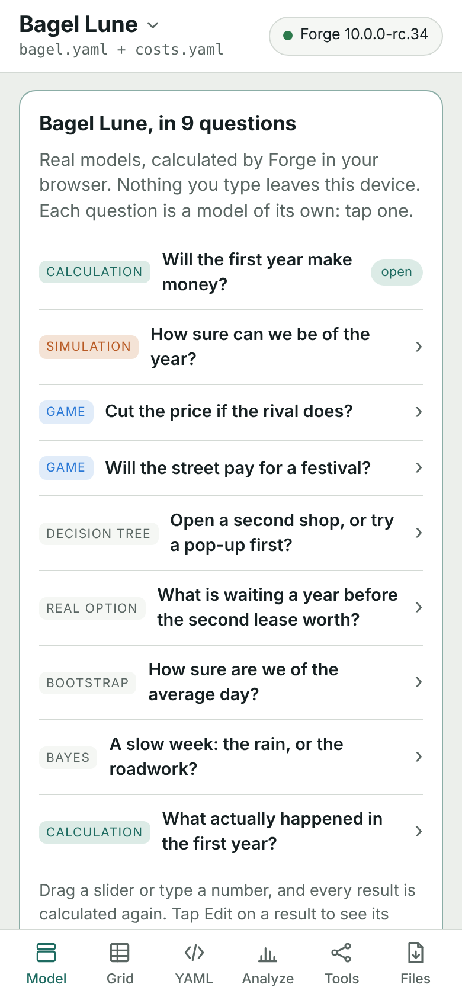
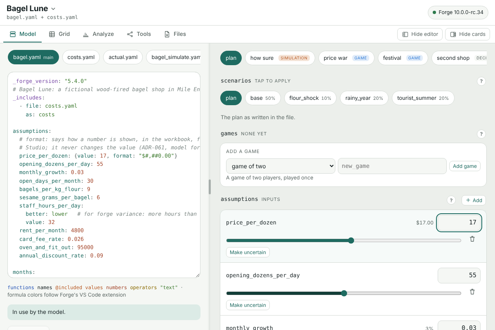
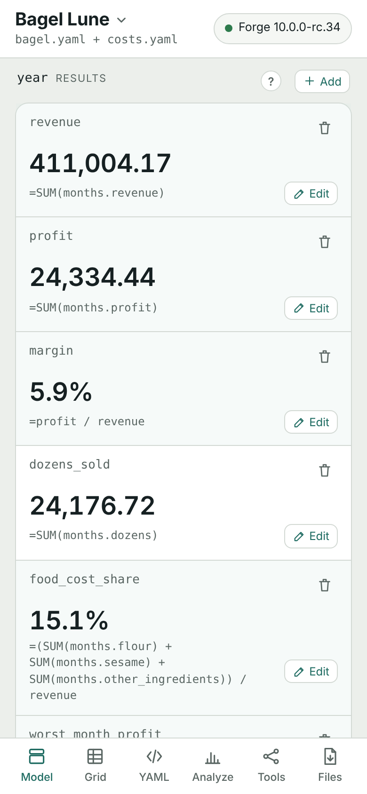
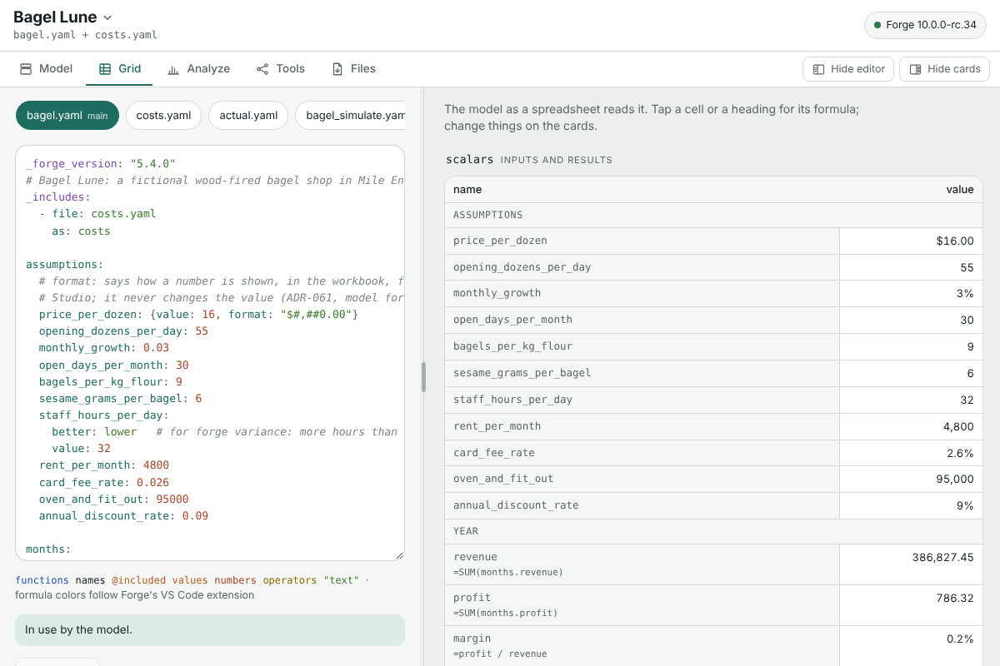
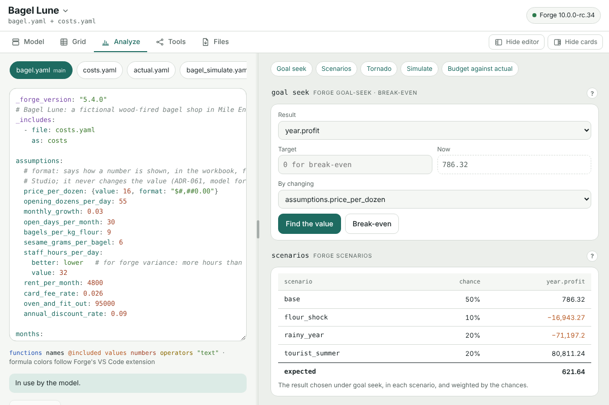
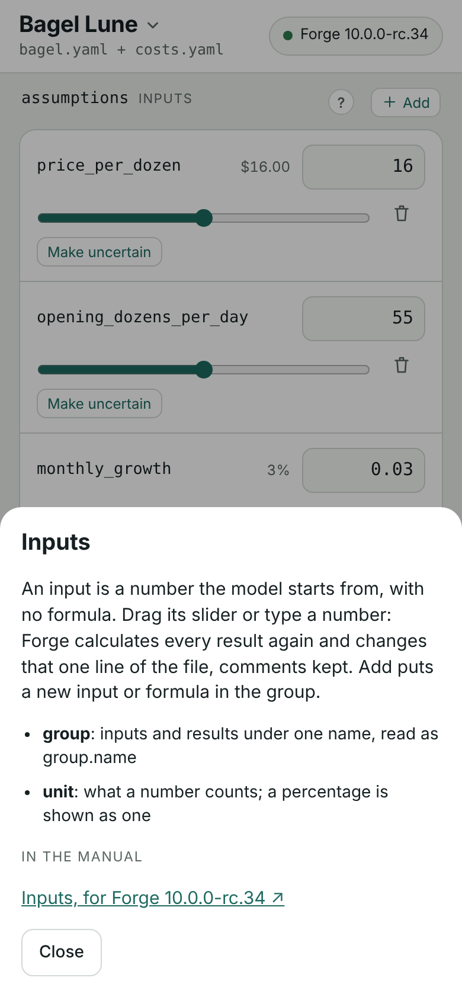

# Forge Studio: a tour

[Forge Studio](https://forge.mollendorff.ai/) is Forge in a browser tab, made for a phone as much as a laptop: you open a model, change a number and see every result calculated again, with no install and no account. It runs the same engine as the command line, so the numbers are the ones `forge calculate` prints. This tour uses the bagel shop of [lesson 1](01-first-ten-minutes.md), and every picture in it was taken from the running page by [`studio/screenshots.mjs`](../../studio/screenshots.mjs).

Nothing you type leaves your device: the page does the work itself, and [studio/README.md](../../studio/README.md#your-model-stays-on-your-device) says how that is held.

## Open a model

[This link](https://forge.mollendorff.ai/?example=bagel) opens the bagel shop. A first visit starts with a card of the questions the shop's models answer, each marked with what kind of model it is: a calculation, a simulation, a game, a decision tree, a real option, a bootstrap or a Bayesian network. Tap a question to open that model.



"Got it" puts the card away for good; the Files tab brings it back. Under the card, the Model view shows the plan: the model as it is written in the file.

Three ways to open something else:

- **A question on the card**, or the strip of model names at the top of the Model view once the card is gone, opens another model of the same example.
- **Files** lists every example. It also opens a YAML file or an Excel workbook from your device.
- **A link** can open a model of an example (`?example=bagel&model=price_war.yaml`), or carry a model of its own after a `#`, which the browser never sends anywhere ([how a link carries a model](../../studio/README.md#a-link-that-carries-a-model)).

## Change a number

The Model view shows cards: **inputs** to change, **results** with the formula under each, tables and scenarios. Under `assumptions`, `price_per_dozen` has a field and a slider. Type 17 in the field and press Enter.



Two things happened. Forge calculated every result again, and it changed one line of the file: on a wide screen the YAML sits beside the cards, and `price_per_dozen` there is now 17, with the comments and every other line as they were. Studio writes no YAML of its own: each change goes through Forge's `edit`, which keeps a change only when it can read the model back with exactly that change, and otherwise shows Forge's message.

Scroll to `year` for the results.



The profit is 24,334.44, where it was 786.32 at 16. Each result shows its formula; **Edit** opens it to be changed, with suggestions for names and functions, and Forge refuses a formula it cannot calculate and says why.

## The views

The tabs at the bottom of a phone, and the top of a wide screen, are six ways to look at the same model:

| Tab | What it shows |
| --- | --- |
| **Model** | The cards: inputs, results with their formulas, tables, scenarios to apply, games, and for a model with uncertain inputs the range under each result. **Add** puts a new input, formula or table column in a group, and the bin on a card deletes it. **Make uncertain** on an input turns it into a distribution. |
| **Grid** | The model as a spreadsheet reads it, read-only. A tap on a cell shows its formula and leads to its card. |
| **YAML** | The model's text, coloured with Forge's own rules, with suggestions for the keys of the model format and for names and functions inside a formula. On a phone you apply an edit with a button; on a wide screen the editor is beside the cards, and a number typed in one changes the other. |
| **Analyze** | Goal seek, break-even, scenarios, a tornado, a simulation, and budget against actual. |
| **Tools** | The MCP server's tools, run on the open model, with each answer shown whole. |
| **Files** | The examples; opening a file; saving the model's YAML or its Excel workbook; a link to the open model. |





Analyze asks the questions of lessons [4](04-what-if.md) and [5](05-how-likely.md) without a command: the scenarios table is the one of [lesson 4](04-what-if.md#scenarios-other-guesses-with-their-chances), and a game on the Model view is [lesson 6](06-what-will-they-do.md)'s.

## The ? on each heading

Every heading has a "?" that opens a few sentences about the section, the terms it uses, and a link to the manual on GitHub at the release that is running.



## Keep your work

Studio keeps your files in the browser's storage on your device until you save them. **Save** gives you the model's YAML or its Excel workbook (on an iPhone or iPad it opens the share sheet: Save to Files, iCloud Drive), and **Copy** on Files makes a link that opens the same model in another browser. Once the page has loaded it works without a connection, and on an iPhone it can be added to the Home Screen like an app (Share, Add to Home Screen).

## Check it yourself

Studio's numbers are Forge's, so the command line gives the same ones. The bagel at 16:

```text
$ forge calculate examples/bagel/bagel.yaml --dry-run
      year.revenue = 386827.449537828
      year.profit = 786.320361712362
```

And at 17, the price you typed:

```text
$ forge edit examples/bagel/bagel.yaml --set assumptions.price_per_dozen=17
✅ Wrote bagel.yaml (as it was: examples/bagel/bagel.yaml.bak)
```

```text
$ forge calculate examples/bagel/bagel.yaml --dry-run
      year.revenue = 411004.165133942
      year.profit = 24334.4413523276
```

Studio shows these to two places: 411,004.17 and 24,334.44.

## Where this page's claims come from

Its commands and links are run and followed by `validation/repo`'s `guide` check, like the lessons'. Its pictures are made by `studio/screenshots.mjs`, and `validation/repo`'s `studio_guide` check fails if a picture is missing, is not one the script makes, or the script makes one the page does not show. What the page says Studio does is what [studio/README.md](../../studio/README.md) says and the tests in `studio/tests/` hold: every number on screen is `forge calculate`'s (`screen.mjs`), a change on a card is Forge's `edit` (`formulas.mjs`, `elements.mjs`), the Grid is Forge's cells (`grid.mjs`), the help sheets and their links to the manual (`help.mjs`), the welcome card (`welcome.mjs`), a link that carries a model (`link.mjs`) and the page working offline (`offline.mjs`).
