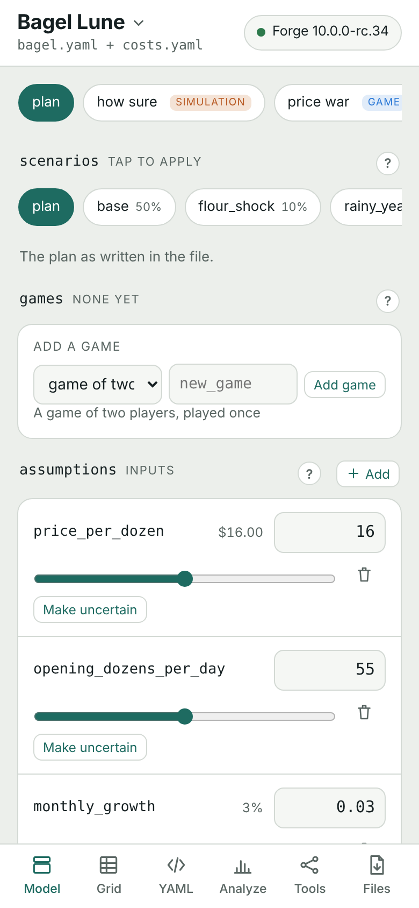
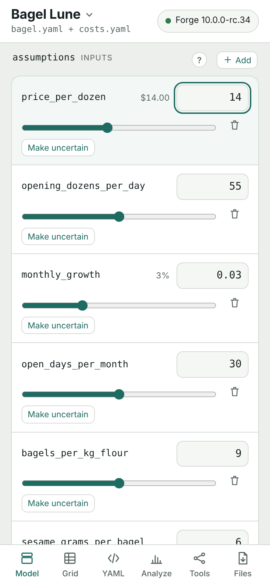
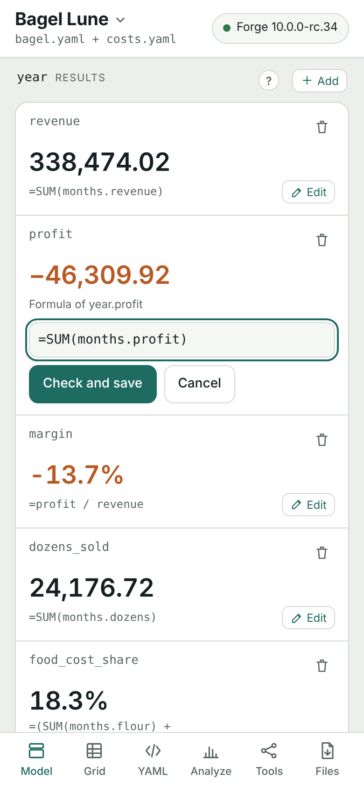
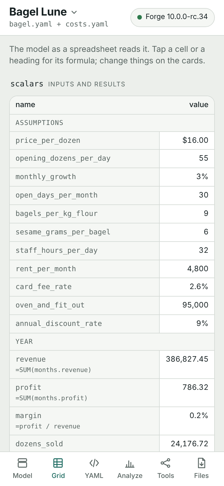
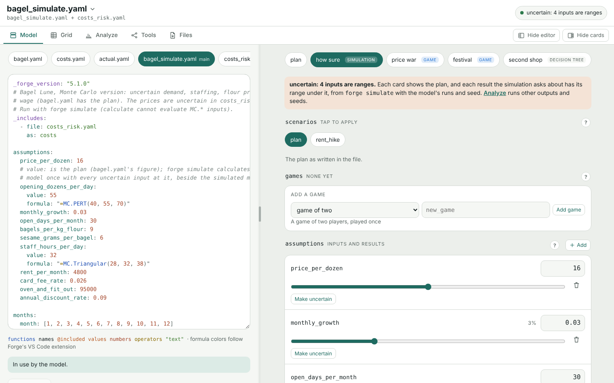
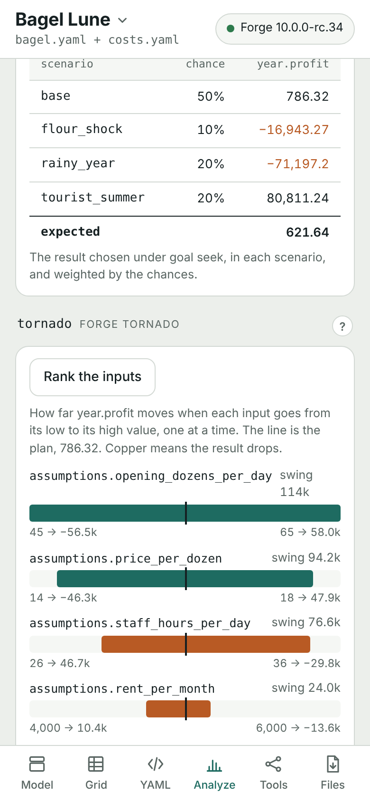
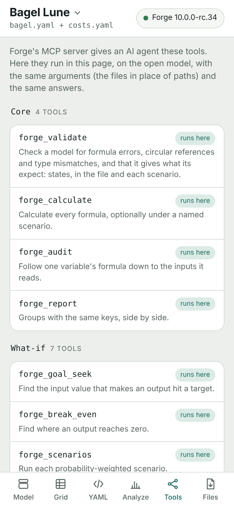
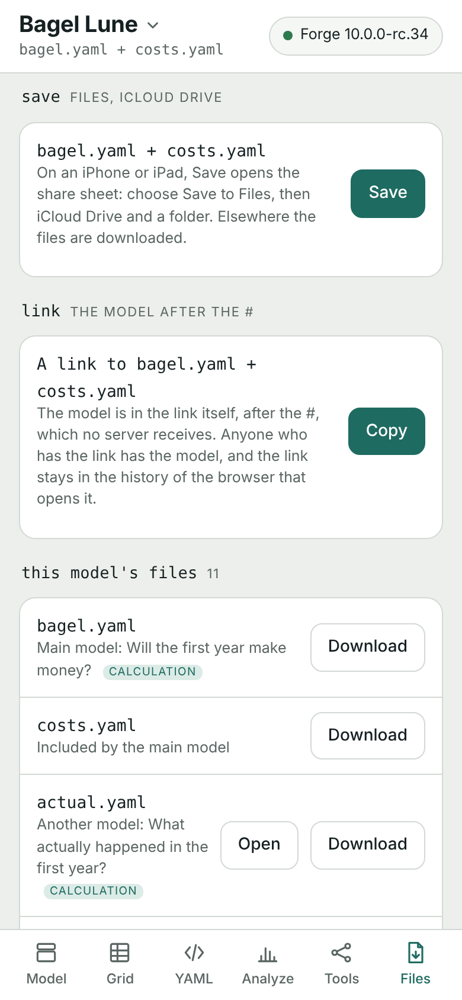
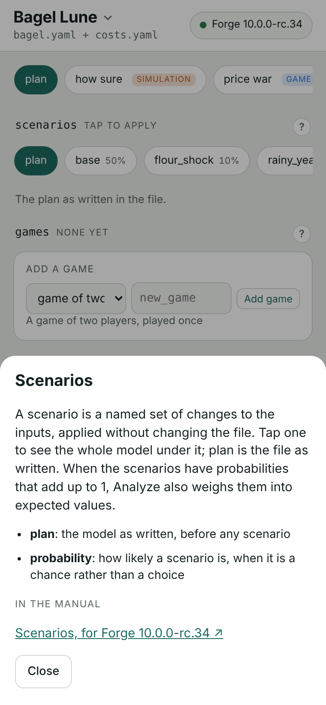

# Forge Studio: a walk through

[Forge Studio](https://forge.mollendorff.ai/) is Forge in a browser tab, made for a phone as much as a laptop. You open a model, change a number and see every result calculated again, by the same engine as the command line. This page walks through it on Bagel Lune, the bagel shop of [lesson 1](01-first-ten-minutes.md). [Open it](https://forge.mollendorff.ai/?example=bagel) to follow along: every picture here is a screen of that link.

Nothing you type leaves the tab: the page runs Forge itself, with no server doing the work, no account and no analytics ([how that is kept](../../studio/README.md#your-model-stays-on-your-device)).

## The model

A first visit opens with a welcome card; tap **Got it** to put it away. On a phone the bottom bar has six views: Model, Grid, YAML, Analyze, Tools and Files. Studio opens on Model.



Top to bottom:

- **The title** is the open model. The files under it are the main file and the files it includes: `bagel.yaml + costs.yaml`. Tap it to open another model.
- **The strip of questions** appears when an example is several models, as the bagel shop is. Each question is a model of its own, with its kind beside it: `plan` is a calculation, `how sure` a simulation, `price war` a game. They are [lessons 1, 5 and 6](README.md) in turn.
- **Scenarios** are the model's named guesses. Tap one and the whole page shows the model under it; `plan` is the file as written. The chance beside each is its probability ([lesson 4](04-what-if.md#scenarios-other-guesses-with-their-chances)).
- **Groups of inputs and results** come after, one card per number. The `?` beside a heading says what the section is, in a few sentences, with a link to the manual.

## Change an input

An input is a number with no formula. Each has a field and a slider; type a number or drag.



Studio writes your change into that one line of the YAML, comments and all, and asks Forge to calculate every formula again. At a price of 14 instead of 16, the year's profit goes from 786.32 to −46,309.92. [The last section](#check-it-in-a-terminal) runs the same two models in a terminal.

The slider's range comes from the number. A unit sets how the number is shown: `$16.00` and `3%` are 16 and 0.03 with a `format` or a `unit`. **Make uncertain** under an input turns it into a range to simulate ([lesson 5](05-how-likely.md)).

## A result, and the formula under it

A result is a number calculated by a formula, in Excel's language. Its formula is under it, and **Edit** opens it.



Change the formula and tap **Check and save**. Studio keeps the change only if Forge can calculate the model with it; if not, Forge's message says why, and the file stays as it was. So the page never holds a model Forge would refuse. A negative result is copper.

## Grid and YAML

**Grid** is the model as a spreadsheet reads it, read-only: the scalars with their formulas, then each table with a column for each name. Tap a cell for its formula.



**YAML** is the file itself, with Forge's colours for formulas and suggestions for the keys of the model format and for the names and functions inside a formula. On a phone you apply an edit with a button. At 900 pixels wide or more the editor sits beside the cards, and a number typed in one changes the other:



## Analyze

**Analyze** asks the model other questions: goal seek and break-even, scenarios weighed by their chances, a tornado, a simulation and budget against actual. Each is one of Forge's commands ([lesson 4](04-what-if.md) and [lesson 5](05-how-likely.md)) run on the open model.



The tornado moves each input from its low to its high, one at a time, and sorts them by how far the year's profit moves. The bars here are `forge tornado`'s, line for line: opening dozens per day swings the year by 114,499.75, the price by 94,192.48. Copper means the result drops as the input rises.

## Tools

**Tools** shows what an AI agent gets from Forge's MCP server: the tools, each with the request an agent would send for the open model and the answer, run in the page.



It is the way to see what an agent sees before you hand it a model ([Forge with an AI](ai.md)).

## Files

**Files** is where models come and go.



- **The examples** open any of Forge's examples, and **this model's files** lists the open one's, each with a Download.
- **Save** keeps the model's files. On an iPhone or iPad it opens the share sheet: choose Save to Files, then iCloud Drive and a folder. Elsewhere the files are downloaded.
- **Link** copies a link that carries the model in the part of the address after the `#`, which no server receives. Anyone who has the link has the model, and it stays in the history of the browser that opens it ([how a link is read](../../studio/README.md#a-link-that-carries-a-model)).
- **Excel** writes the workbook `forge export` writes, and **your own model** opens YAML files from your device, or an Excel workbook, which `forge import` turns into a model ([Excel integration](../FEATURES.md#excel-integration)).

Your files are kept in the browser's storage on your device. A link or an address that would replace files of your own asks first.

## Help

The `?` beside each heading opens a few sentences on it, the terms it uses, an example to open and the manual at the release that is running.



## Check it in a terminal

Studio calculates with Forge itself, so its numbers are the command line's. The tornado of the screens above, at the plan:

```text
$ forge tornado examples/bagel/bagel.yaml
   Base value: 786.32
   assumptions.opening_dozens_per_day |██████████████████████████████| swing 114,499.75  (output -56,463.56 at low, 58,036.20 at high)
   assumptions.price_per_dozen        |████████████████████████      | swing 94,192.48  (output -46,309.92 at low, 47,882.56 at high)
```

The price bar's low end is a price of 14, and its output is the profit that [the input section](#change-an-input) showed. Typing 14 into Studio is `forge edit`:

```text
$ forge edit examples/bagel/bagel.yaml --set assumptions.price_per_dozen=14
✅ Wrote bagel.yaml (as it was: examples/bagel/bagel.yaml.bak)
```

```text
$ forge calculate examples/bagel/bagel.yaml --dry-run
      year.revenue = 338474.018345599
      year.profit = -46309.9216195182
      year.margin = -13.7%  (-0.136819723551819)
📋 Dry run complete - no changes written
```

That is the revenue, the profit and the margin of the Model view's year group at a price of 14.

## Where this page's pictures and numbers come from

The pictures are not drawn by hand: `studio/screenshots.mjs` opens Studio in a headless browser, types the price, taps Edit and each tab, and takes them, so that they can be made again after a release (`node studio/screenshots.mjs <built Studio folder> docs/images`). A test checks that every image in `docs/images` is one that script makes. The numbers in the text are the ones above, run by the guide's tests with the other pages' commands, and the layout and the numbers on Studio's screens are checked by Studio's own tests (`studio/tests/`). What this page says Studio looks like is true of the release it was made for, and a later release can look different until the pictures are made again.

## Your turn

Type 18 as the price. What does the year's profit become?

<details>
<summary>The answer</summary>

`47,882.56`, the high end of the price bar in the tornado above: the tornado moves the price from 14 to 18.

</details>
